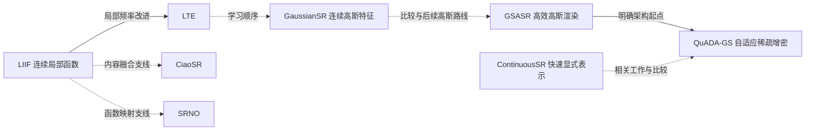

# 从 LIIF 到前沿的学习路线

这是一条面向零基础计科大学生的**任意倍率图像超分辨率**路线。覆盖截至2026-10-29核实的代表性工作，终点包括2026正式发表方向和2026-09预印本。它不是全体超分辨率论文排行，也不是产业部署效果保证。

## 第一件事

先从[00_教材导航](../04_%E6%95%99%E5%AD%A6/%E9%9B%B6%E5%9F%BA%E7%A1%80%E6%95%99%E6%9D%90/00_%E6%95%99%E6%9D%90%E5%AF%BC%E8%88%AA.md)读第1–8章，完成像素、坐标、矩阵、插值、网络、训练与评价的基础练习；再读第9–10章，把LIIF的查询、特征展开、局部集成与cell完整算一遍。随后打开[LIIF会议正文对照](../PUBLICATION_SCOPE.md)。不再要求零基础读者只学四章就直接跳入论文方法。

完整教材仍在[从LIIF开始的零基础学习手册](../04_%E6%95%99%E5%AD%A6/%E4%BB%8ELIIF%E5%BC%80%E5%A7%8B%E7%9A%84%E9%9B%B6%E5%9F%BA%E7%A1%80%E5%AD%A6%E4%B9%A0%E6%89%8B%E5%86%8C.md)。遇到术语，先查[术语与符号速查](../04_%E6%95%99%E5%AD%A6/%E9%9B%B6%E5%9F%BA%E7%A1%80%E6%95%99%E6%9D%90/%E6%9C%AF%E8%AF%AD%E4%B8%8E%E7%AC%A6%E5%8F%B7%E9%80%9F%E6%9F%A5.md)，再回到对应例题；不按固定天数赶读。

## 阅读次序

| 次序 | 论文 | 先回答的问题 | 当前材料与教材衔接 |
|---|---|---|---|
| 1 | [LIIF](../01_%E8%AE%BA%E6%96%87/01_LIIF_2021/LIIF.md) | 图像怎样用局部函数表达？ | 正文对照；教材第9–10章 |
| 2 | [LTE](../01_%E8%AE%BA%E6%96%87/02_LTE_2022/LTE.md) | 频率、振幅、相位怎样参与预测？ | 正文对照；教材第11章 |
| 支线A | [CiaoSR](../01_%E8%AE%BA%E6%96%87/03_CiaoSR_2023/CiaoSR.md) | 内容相关性怎样改变融合权重？ | 正文对照；SI另存未译；教材第12章 |
| 支线B | [SRNO](../01_%E8%AE%BA%E6%96%87/04_SRNO_2023/SRNO.md) | 怎样从函数空间理解超分辨率？ | 正文对照；SI另存未译；教材第13章 |
| 3 | [GaussianSR](../01_%E8%AE%BA%E6%96%87/05_GaussianSR_2025/GaussianSR.md) | 高斯怎样形成连续特征场？ | 含整合扩展读本；教材第14–15章 |
| 4 | [GSASR](../01_%E8%AE%BA%E6%96%87/06_GSASR_2025/GSASR.md) | 高斯颜色怎样直接渲染？ | 正文及整合SI对照；教材第15章 |
| 对照 | [ContinuousSR](../01_%E8%AE%BA%E6%96%87/07_ContinuousSR_2026/ContinuousSR.md) | 快速显式表示的条件和代价是什么？ | 2025 arXiv v1原文含SI及原创导读；教材第15章作有限对照 |
| 5 | [QuADA-GS](../01_%E8%AE%BA%E6%96%87/08_QuADA-GS_2026/QuADA-GS.md) | 怎样按区域分配表示数量？ | 正文对照；作者SI未取得；教材第16章 |

七篇对照的制作与验收状态以各 translation_notes 和 [交付验收](../PUBLICATION_SCOPE.md) 为准。LIIF、CiaoSR、SRNO依据用户提供的会议版正文转换；LTE、GaussianSR、GSASR、QuADA-GS依据已核实的CC BY 4.0版本转换。ContinuousSR仍保留2025 arXiv v1原创导读，完整对照待用户提供原文。旧导读作为入门解释保留，其历史交付状态由本轮记录更新。

图中虚线包含教学联系或比较关系，实线文字说明有来源支持的较直接联系；不是自动生成的严格引用网络。证据见 [LIIF路线检索记录](../PUBLICATION_SCOPE.md)。

## 按掌握程度安排进度

| 阶段 | 学习内容 | 进入下一阶段前应能完成 |
|---|---|---|
| 基础一 | 教材第1–4章 | 列像素中心、算矩阵、完整插值，并给出逆问题不唯一的例子 |
| 基础二 | 第5–8章与第18章核心题 | 手算网络前向传播和参数更新，说明误差统计的对象与协议 |
| LIIF | 第9–10章，然后读LIIF正文 | 从一个查询点依次算特征、坐标、cell、四角预测与融合 |
| 频率与信息融合 | 第11–13章，对应LTE、CiaoSR、SRNO | 分别算周期特征、softmax、积分近似和线性注意力；不混用公式 |
| 高斯路线 | 第14–16章，对应已有高斯论文 | 区分核与密度、三种合成方式、坐标变换和树的叶子计数 |
| 证据与综合 | 第17章、第18章全文 | 写出附有来源和条件的比较结论，区分作者报告与自己的计算 |

每阶段都允许回查前章。能独立复算、解释每个数和符号从哪里来，再往下读；不要用“几天读完几篇”替代掌握程度。基础完成后，CiaoSR与SRNO是可分别深入的支线；函数空间章以前面的注意力和矩阵知识为先修。

## 怎样到达“了解这个方向”

能回答以下六个问题，比记住所有论文缩写更有用：输入中缺什么信息；用什么表示图像；任意尺度是怎样实现的；额外容量花在哪里；指标在什么协议下算；论文没有验证什么。使用 [论文阅读与实验对照工作表](../04_%E6%95%99%E5%AD%A6/%E8%AE%BA%E6%96%87%E9%98%85%E8%AF%BB%E4%B8%8E%E5%AE%9E%E9%AA%8C%E5%AF%B9%E7%85%A7%E5%B7%A5%E4%BD%9C%E8%A1%A8.md) 逐篇填写。

## 这一批的范围

项目Zotero现有8个论文父条目、14个PDF附件：8份此前正文、3份用户提供会议版正文、3份独立SI。会议版与arXiv版是同一论文的不同版本，不能算成11篇论文。没有训练模型、重跑基准或测真实延迟。生成式任意倍率超分辨率是后续可扩展分支，检索记录列出 OmniScaleSR、CASR 等来源，本批不把它们混入已下载清单。最新预印本不自动等于最强方法。
