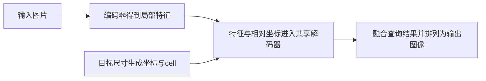

# LIIF：从“存像素”到“问坐标”

本页保留为原创入门导读。用户本轮提供的会议PDF已完成 [正文完整逐段中英对照](../../PUBLICATION_SCOPE.md)，含图表、公式和学习附录。原始PDF与不同版本仍保存在项目Zotero；作者、版本和哈希见 [LIIF](LIIF.md)。

## 先用一句话抓住问题

**如果我想要输出257×193，而不是预先限定的2倍或4倍，模型怎样知道这些新像素的颜色？**

用函数表达图像，意味着给定一个位置就能计算一个颜色；让同一个函数处理不同图片，则需要加入这张图片的特征。这两个层次分别是“在哪儿查询”和“查询哪张图片”。

## 原文最值得定位的内容

原文第3–4页的LIIF由局部特征与共享解码器预测查询位置的RGB；3×3邻域展开丰富特征，局部集成融合附近预测，cell告知输出像素大小。第4页介绍用超分辨率任务训练编码器与解码器。实验部分讨论不同倍率及消融。这里概括方法结构，不把连续输出解释为无限真实细节恢复。[固定版本原文](https://arxiv.org/abs/2012.09161v2)

## 原创算例：同一张“连续纸”，两种网格

设一张教学用灰度图由F(x,y)=50x+100y给出，x,y都在[0,1]。这只是易计算的玩具函数，没有训练神经网络。

取2×2输出，中心为0.25和0.75。左上位置值为50×0.25+100×0.25=37.5；右下为112.5。取4×4输出，中心为0.125、0.375、0.625、0.875，左上值变为18.75。函数没换，只换了采样网格。

真实图像不知道这个函数，所以需要学习表示。这个例子只证明“函数与采样网格可以分开”，并没有证明神经网络能准确预测缺失纹理。

## 阅读时画出这四个箭头

在纸上逐个标注：哪些数是输入，哪些是训练后的参数，哪些是中间特征。输入图片变了会重新编码；目标输出尺寸变了会改变查询网格。不要把“新图片编码”和“重新训练模型”混为一谈。

## 三个检查问题与解答

**为什么特征比一个RGB三元组有用？** RGB只直接记录颜色；学习特征还可能编码周围边缘与纹理信息，但具体通道意义不能未经分析就命名。

**为什么看最近的一个局部预测可能出接缝？** 最近邻身份会在边界突然切换。两边预测器或特征不完全一致时，输出可能跳变。融合给出一种过渡机制，但实际连续性还受实现与边界条件影响。

**为什么把cell加进去不等于精确抗混叠？** cell提供像素覆盖范围的信息；网络如何使用仍由训练学得。精确积分、抗混叠性质需要另外的推导或实验，不能只因存在cell输入就宣称成立。

## 怎样读实验而不被倍率迷惑

先标出训练倍率，再找测试倍率。训练范围之外的测试属于倍率外推。记录骨干和评测协议；只比较相同设置。视觉图有助于发现纹理和接缝，但少量展示不是总体统计。使用 [论文阅读与实验对照工作表](../../04_%E6%95%99%E5%AD%A6/%E8%AE%BA%E6%96%87%E9%98%85%E8%AF%BB%E4%B8%8E%E5%AE%9E%E9%AA%8C%E5%AF%B9%E7%85%A7%E5%B7%A5%E4%BD%9C%E8%A1%A8.md) 填表。

## 文末：零基础术语与前置知识

| 术语 | 中文解释 | 深入链接 |
|---|---|---|
| implicit image function | 输入位置和图像信息，输出颜色的神经函数 | [隐式神经表示](../../02_%E6%A6%82%E5%BF%B5/%E9%9A%90%E5%BC%8F%E7%A5%9E%E7%BB%8F%E8%A1%A8%E7%A4%BA.md) |
| latent code | 网络编码出的数值向量 | [张量与特征图](../../02_%E6%A6%82%E5%BF%B5/%E5%BC%A0%E9%87%8F%E4%B8%8E%E7%89%B9%E5%BE%81%E5%9B%BE.md) |
| MLP | 多层向量变换与非线性组成的网络 | [多层感知机](../../02_%E6%A6%82%E5%BF%B5/%E5%A4%9A%E5%B1%82%E6%84%9F%E7%9F%A5%E6%9C%BA.md) |
| feature unfolding | 把邻域向量按顺序拼接 | [张量与特征图](../../02_%E6%A6%82%E5%BF%B5/%E5%BC%A0%E9%87%8F%E4%B8%8E%E7%89%B9%E5%BE%81%E5%9B%BE.md) |
| local ensemble | 融合附近多个预测 | [局部集成](../../02_%E6%A6%82%E5%BF%B5/%E5%B1%80%E9%83%A8%E9%9B%86%E6%88%90.md) |
| cell decoding | 把输出像素大小作为额外输入 | [连续坐标与单元](../../02_%E6%A6%82%E5%BF%B5/%E8%BF%9E%E7%BB%AD%E5%9D%90%E6%A0%87%E4%B8%8E%E5%8D%95%E5%85%83.md) |
| extrapolation | 在训练条件范围之外测试 | [训练与推理](../../02_%E6%A6%82%E5%BF%B5/%E8%AE%AD%E7%BB%83%E4%B8%8E%E6%8E%A8%E7%90%86.md) |

前置练习：[从LIIF开始的零基础学习手册](../../04_%E6%95%99%E5%AD%A6/%E4%BB%8ELIIF%E5%BC%80%E5%A7%8B%E7%9A%84%E9%9B%B6%E5%9F%BA%E7%A1%80%E5%AD%A6%E4%B9%A0%E6%89%8B%E5%86%8C.md) 第1–5章，特别是例题3、5、7、9。理解后读 [LTE](../02_LTE_2022/LTE.md)，看它怎样处理局部纹理频率；[CiaoSR](../03_CiaoSR_2023/CiaoSR.md) 则从融合权重继续提出问题。
