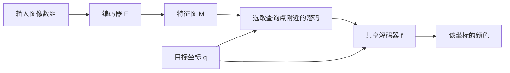
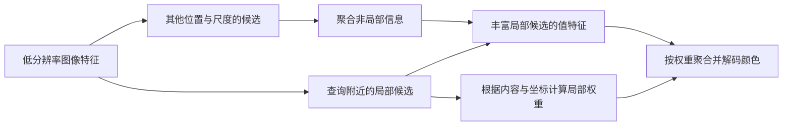

# 从LIIF开始的零基础学习手册——教科书式重编

本书面向只掌握整数、负数、分数和四则运算的计算机专业学生。不预设你学过线性代数、微积分、概率论或深度学习：需要的数学在使用之前逐步引入。目标是能读懂任意倍率图像超分辨率的基本问题、主要表示方法和实验依据，并能独立复算小例子。

这是依据项目内论文与已说明数学约定编写的原创学习教材。教学网络和手工数字均明确标注，不能当作论文实测。它没有替代大学完整数学课程，也没有声称已训练或复现论文模型。论文版本与材料缺口仍以各论文卡和[LIIF学习包交付验收](../PUBLICATION_SCOPE.md)为准；本轮重编未开展新一轮前沿检索。

## 怎么使用这本书

全书18章，72道逐步例题，54道章末练习及完整解答。每章按问题、定义、推导、例题、核对、易错点与练习组织。先自己算，再读解答；一章的退出条件是能解释数值的来源，而不只是认得名词。无需按固定天数赶进度。

- 按章节阅读：[00_教材导航](%E9%9B%B6%E5%9F%BA%E7%A1%80%E6%95%99%E6%9D%90/00_%E6%95%99%E6%9D%90%E5%AF%BC%E8%88%AA.md)，适合Obsidian逐章学习。
- 随时查概念：[术语与符号速查](%E9%9B%B6%E5%9F%BA%E7%A1%80%E6%95%99%E6%9D%90/%E6%9C%AF%E8%AF%AD%E4%B8%8E%E7%AC%A6%E5%8F%B7%E9%80%9F%E6%9F%A5.md)，含中英文、定义、易混点和回读位置。
- 复习与做题：[各章重点与例题索引](%E9%9B%B6%E5%9F%BA%E7%A1%80%E6%95%99%E6%9D%90/%E5%90%84%E7%AB%A0%E9%87%8D%E7%82%B9%E4%B8%8E%E4%BE%8B%E9%A2%98%E7%B4%A2%E5%BC%95.md)，可直达每道例题及每章答案。
- 阅读论文时填写：[论文阅读与实验对照工作表](%E8%AE%BA%E6%96%87%E9%98%85%E8%AF%BB%E4%B8%8E%E5%AE%9E%E9%AA%8C%E5%AF%B9%E7%85%A7%E5%B7%A5%E4%BD%9C%E8%A1%A8.md)。

建议先完成第1–8章，再做第18章核心综合题（暂跳18.6）；随后读第9–10章理解LIIF，第11–16章进入不同方法分支，最后用第17章审查自己的论文笔记，再回读18.6。后续章节允许回查，但没有要求先背全部缩写。

## 全书符号约定

图像形状写H×W×C：高、宽、图像通道。行索引i、列索引j均从0开始；几何位置写(x,y)，x向右、y向下。特征图高宽记作Hf、Wf，特征通道数D与RGB通道数C分开。N默认是查询位置数，第13章积分小节另将它局部定义为分段或采样位置数；第6、8章以K统计按颜色通道展开后的标量总数，而注意力章的K是键矩阵。遇到同名字母应按该节定义和形状区分。向量默认列向量，注意力矩阵逐行堆向量时会明确说明。

归一化坐标域采用[-1,1]，像素中心由边界等分推导；LIIF的缩放相对坐标、cell以及论文代码中可能出现的(y,x)顺序会单独说明。同一个希腊字母在不同章可能有局部定义，例如第18章的α是教学模型参数，而第15章的α是不透明度；请依该章定义，不按字形猜含义。

## 章节目录

1. [图像与像素](%E9%9B%B6%E5%9F%BA%E7%A1%80%E6%95%99%E6%9D%90/%E7%AC%AC01%E7%AB%A0_%E5%9B%BE%E5%83%8F%E4%B8%8E%E5%83%8F%E7%B4%A0.md)
2. [函数与坐标](%E9%9B%B6%E5%9F%BA%E7%A1%80%E6%95%99%E6%9D%90/%E7%AC%AC02%E7%AB%A0_%E5%87%BD%E6%95%B0%E4%B8%8E%E5%9D%90%E6%A0%87.md)
3. [向量矩阵与张量](%E9%9B%B6%E5%9F%BA%E7%A1%80%E6%95%99%E6%9D%90/%E7%AC%AC03%E7%AB%A0_%E5%90%91%E9%87%8F%E7%9F%A9%E9%98%B5%E4%B8%8E%E5%BC%A0%E9%87%8F.md)
4. [插值采样与逆问题](%E9%9B%B6%E5%9F%BA%E7%A1%80%E6%95%99%E6%9D%90/%E7%AC%AC04%E7%AB%A0_%E6%8F%92%E5%80%BC%E9%87%87%E6%A0%B7%E4%B8%8E%E9%80%86%E9%97%AE%E9%A2%98.md)
5. [从线性函数到神经网络](%E9%9B%B6%E5%9F%BA%E7%A1%80%E6%95%99%E6%9D%90/%E7%AC%AC05%E7%AB%A0_%E4%BB%8E%E7%BA%BF%E6%80%A7%E5%87%BD%E6%95%B0%E5%88%B0%E7%A5%9E%E7%BB%8F%E7%BD%91%E7%BB%9C.md)
6. [损失梯度与训练](%E9%9B%B6%E5%9F%BA%E7%A1%80%E6%95%99%E6%9D%90/%E7%AC%AC06%E7%AB%A0_%E6%8D%9F%E5%A4%B1%E6%A2%AF%E5%BA%A6%E4%B8%8E%E8%AE%AD%E7%BB%83.md)
7. [卷积与特征图](%E9%9B%B6%E5%9F%BA%E7%A1%80%E6%95%99%E6%9D%90/%E7%AC%AC07%E7%AB%A0_%E5%8D%B7%E7%A7%AF%E4%B8%8E%E7%89%B9%E5%BE%81%E5%9B%BE.md)
8. [评价指标与实验设计](%E9%9B%B6%E5%9F%BA%E7%A1%80%E6%95%99%E6%9D%90/%E7%AC%AC08%E7%AB%A0_%E8%AF%84%E4%BB%B7%E6%8C%87%E6%A0%87%E4%B8%8E%E5%AE%9E%E9%AA%8C%E8%AE%BE%E8%AE%A1.md)
9. [隐式表示与LIIF基础](%E9%9B%B6%E5%9F%BA%E7%A1%80%E6%95%99%E6%9D%90/%E7%AC%AC09%E7%AB%A0_%E9%9A%90%E5%BC%8F%E8%A1%A8%E7%A4%BA%E4%B8%8ELIIF%E5%9F%BA%E7%A1%80.md)
10. [LIIF局部集成与单元解码](%E9%9B%B6%E5%9F%BA%E7%A1%80%E6%95%99%E6%9D%90/%E7%AC%AC10%E7%AB%A0_LIIF%E5%B1%80%E9%83%A8%E9%9B%86%E6%88%90%E4%B8%8E%E5%8D%95%E5%85%83%E8%A7%A3%E7%A0%81.md)
11. [频率采样与LTE](%E9%9B%B6%E5%9F%BA%E7%A1%80%E6%95%99%E6%9D%90/%E7%AC%AC11%E7%AB%A0_%E9%A2%91%E7%8E%87%E9%87%87%E6%A0%B7%E4%B8%8ELTE.md)
12. [注意力与CiaoSR](%E9%9B%B6%E5%9F%BA%E7%A1%80%E6%95%99%E6%9D%90/%E7%AC%AC12%E7%AB%A0_%E6%B3%A8%E6%84%8F%E5%8A%9B%E4%B8%8ECiaoSR.md)
13. [函数空间与SRNO](%E9%9B%B6%E5%9F%BA%E7%A1%80%E6%95%99%E6%9D%90/%E7%AC%AC13%E7%AB%A0_%E5%87%BD%E6%95%B0%E7%A9%BA%E9%97%B4%E4%B8%8ESRNO.md)
14. [二维高斯的数学基础](%E9%9B%B6%E5%9F%BA%E7%A1%80%E6%95%99%E6%9D%90/%E7%AC%AC14%E7%AB%A0_%E4%BA%8C%E7%BB%B4%E9%AB%98%E6%96%AF%E7%9A%84%E6%95%B0%E5%AD%A6%E5%9F%BA%E7%A1%80.md)
15. [高斯表示与渲染](%E9%9B%B6%E5%9F%BA%E7%A1%80%E6%95%99%E6%9D%90/%E7%AC%AC15%E7%AB%A0_%E9%AB%98%E6%96%AF%E8%A1%A8%E7%A4%BA%E4%B8%8E%E6%B8%B2%E6%9F%93.md)
16. [四叉树与自适应增密](%E9%9B%B6%E5%9F%BA%E7%A1%80%E6%95%99%E6%9D%90/%E7%AC%AC16%E7%AB%A0_%E5%9B%9B%E5%8F%89%E6%A0%91%E4%B8%8E%E8%87%AA%E9%80%82%E5%BA%94%E5%A2%9E%E5%AF%86.md)
17. [怎样读懂并比较论文](%E9%9B%B6%E5%9F%BA%E7%A1%80%E6%95%99%E6%9D%90/%E7%AC%AC17%E7%AB%A0_%E6%80%8E%E6%A0%B7%E8%AF%BB%E6%87%82%E5%B9%B6%E6%AF%94%E8%BE%83%E8%AE%BA%E6%96%87.md)
18. [从输入到输出的综合练习](%E9%9B%B6%E5%9F%BA%E7%A1%80%E6%95%99%E6%9D%90/%E7%AC%AC18%E7%AB%A0_%E4%BB%8E%E8%BE%93%E5%85%A5%E5%88%B0%E8%BE%93%E5%87%BA%E7%9A%84%E7%BB%BC%E5%90%88%E7%BB%83%E4%B9%A0.md)

---

## 第01章 图像与像素：先弄清计算机究竟保存了什么

### 1.1 学习起点与目标

打开一张照片时，我们看见的是人物、树木和建筑；程序接收到的却是有固定排列规则的一组数字。后面的“缩小图像”“预测颜色”“训练模型”，最终都要落实为对这些数字的读取、计算与写入。因此本章先不讲神经网络，只回答三个问题：数字放在哪里，一个位置要放几个数字，图像变大后又需要多少数字。

本章只要求会四则运算。读完后，你应能从一张小数表中准确取出指定像素，区分像素数和通道数值总量，解释0到255与0到1两种表示，并计算放大后的尺寸。这里所有小图与数字均为原创教学例子，不是论文实验数据。

### 1.2 从方格纸到数字图像

设想一张横竖排列整齐的方格纸。为了记录一幅最简单的黑白图，我们可以为每格存一个数：0表示这一编码约定中的黑，255表示白，中间的数表示介于二者之间的灰。把格子排列和格内的数一起保存，就得到一个简化的**灰度图像**（grayscale image）。灰度指每个位置只有一个表示明暗的通道，并不是只能选纯黑和纯白。

在数字图像中，我们把一个网格位置称为**像素**（pixel）。说“一幅图有12个像素”，是在数位置，而不是在数颜色种类。相邻两个位置即使数字完全相同，仍是两个像素。反过来，一张RGB图的一个像素虽然有三个通道数值，也仍只算一个位置。

需要分开“像素位置”和“它代表的区域”。在数组中，像素用一组整数编号来定位；在几何上，我们常用一个小方格表示它覆盖的区域，再用方格中心代表它的位置。真实相机的成像过程还涉及光学系统、传感器感光区域和处理步骤。为了先学会计算，本书使用规则网格这个模型；第2章会给像素中心和覆盖大小精确的坐标。

看下面这张小灰度图：

| 行号\列号 | 0 | 1 | 2 |
|---|---:|---:|---:|
| 0 | 0 | 40 | 80 |
| 1 | 120 | 160 | 200 |

它有2行、3列。约定图像**高度**为$H$、**宽度**为$W$，则$H=2$、$W=3$。本书始终先写高再写宽，因此尺寸写作$H\times W=2\times3$。不少软件界面会先显示宽、再显示高；看到“1920×1080”时，必须先确认它的约定，不能只凭两个数的顺序猜测。

### 1.3 索引：一个像素的地址

**索引**（index）就是位置编号。本书用$i$表示行索引、$j$表示列索引，从0开始计数。图像有$H$行时，行号为$0,1,\ldots,H-1$；有$W$列时，列号为$0,1,\ldots,W-1$。省略号表示依次增加1，中间的数没有全部写出。

把上面的图像命名为$A$，记号$A[i,j]$表示“取数组$A$中第$i$行、第$j$列的数”。例如$A[1,0]=120$，而$A[0,1]=40$。方括号中的两个数有固定顺序，不能交换。编号从0开始，是地址约定；它不意味着少了一行。行号0和1正好对应两行。

数组的行列编号还不是后面使用的几何坐标。我们已经规定：列增大时向右，行增大时向下。第2章的几何坐标记为$(x,y)$，其中$x$向右、$y$向下；数组地址仍写$[i,j]$，先行后列。现在先牢牢记住这两个顺序不同即可。

> [!tip] 读取小图时的固定动作
> 先确认尺寸约定，再确认索引起点；读$A[i,j]$时先找行，再沿该行找列。画出行列编号，比凭视觉数“第几个”更可靠。

### 1.4 通道：一个位置为什么可以存三个数

**通道**（channel）是在每个像素位置保存的一类数值。常见RGB图像有红（Red）、绿（Green）、蓝（Blue）三个通道，通道数记为$C=3$。例如一个像素写为$(255,0,0)$，在常见RGB显示约定下表示强红、无绿、无蓝；$(255,255,255)$表示白，$(0,0,0)$表示黑。

这里的三个数字必须按同一颜色编码约定解释。有些图像库使用BGR顺序；若把BGR当成RGB，同一组三个数就会被分配给不同颜色。通道名、顺序和数值范围共同决定解释方式，不能只看数组里“恰好有三个数”。本书的颜色例子统一采用RGB顺序。

RGB图像可以写成$A[i,j,c]$，第三个索引$c$指定通道：$c=0$为R，$c=1$为G，$c=2$为B。$A[i,j]$表示取出这一像素的整组三个数，$A[i,j,1]$只取绿色通道。图像一共有$H\times W$个像素位置，却有$H\times W\times C$个通道数值。

“颜色通道”和后面网络中的“特征通道”也要区分。RGB通道有预先规定的颜色含义；后面的特征通道是描述图像的中间数值，不一定分别对应红、绿、蓝或某个人能命名的物体。现在只需知道，通道是排列与分组方式，不能一见到多通道就把它们全部当颜色。

下面先用**字节**（byte）计量存储量。1字节包含8个二进制位，每个位只能记录0或1；可以先把1字节理解为由8个这样的记录位置组成的一组存储空间。题目若规定“每个数用1字节”，就按数值个数逐个累加字节数。第1.5节再解释这8个位为什么能表示256种状态。

#### 例 01-1：像素数、通道数值数与原始存储量

**已知。** 一张未压缩RGB图有3行、4列，每个通道数值恰好用1字节保存。不计文件头、行填充或其他元数据。

**求。** 像素数、通道数值总数，以及题设下保存这些数值所需的字节数。

**逐步解答。** 每行4个位置，共3行，因此像素数为$3\times4=12$。每个位置有R、G、B三个数，因此共有$12\times3=36$个数。每个数1字节，保存这些数值需要36字节。

**核对。** 可以按行反算：每行4个像素，每个像素3字节，所以一行12字节；3行共36字节。两种数法一致。

**易错点。** 36是通道数值数，不是像素数。36字节也不是同一图像保存成PNG或JPEG后的必然文件大小；文件格式还可能包含压缩、元数据等内容，已经超出本题假设。

#### 例 01-2：在RGB小图中准确取值

**已知。** 尺寸为$2\times3$的图像如下，表中每格都按$(R,G,B)$排列。

| $i\backslash j$ | 0 | 1 | 2 |
|---|---|---|---|
| 0 | (10,20,30) | (40,50,60) | (70,80,90) |
| 1 | (100,110,120) | (130,140,150) | (160,170,180) |

**求。** $A[1,2]$、$A[1,2,1]$和$A[0,1,0]$，并说明$A[2,1]$是否合法。

**逐步解答。** 行1是第二行，列2是第三列，所以$A[1,2]=(160,170,180)$。在这一像素中，通道1是绿色，因此$A[1,2,1]=170$。行0、列1的整组数是$(40,50,60)$，其中通道0是红色，故$A[0,1,0]=40$。

图像只有2行，合法行号是0和1；$A[2,1]$把行号写成2，超出了数组边界。不能把“有2行”误读成“行号最大为2”。

**核对。** 图像共有6个像素、18个通道数值。查出的170和40都来自这些数值，没有因为取通道而改变图像的位置编号。

**易错点。** $A[1,2]$和$A[2,1]$不只顺序不同；本题中前者有效、后者越界。把地址交换会产生错误，而不是自动得到“转过来的同一点”。

### 1.5 数值范围、位数与归一化

一个**比特**（bit）有两种状态，可记为0或1。两个比特有$2\times2=4$种组合；8个比特有八个2相乘，即$2^8=256$种组合。指数$2^8$在这里就是“2连续相乘8次”的简写。若用无符号整数依次编号这256种状态，取值是0到255，包含两个端点。常见的一个字节（byte）包含8个比特。

这解释了为什么许多图像使用0到255，但它不是所有图像都必须遵守的规则。图像也可能用更高位数整数或浮点数保存。**浮点数**在这里可先理解为能保存小数近似值的一类计算机数值表示；后面的手算通常先按精确分数计算，显示小数时再说明保留位数。

为了使不同计算使用便于处理的数值范围，经常把无符号8位编码值$p$除以255：

$$u=\frac{p}{255}.$$

其中$p$是原来的一个通道编码值，$u$是重标度后的数，$p\in[0,255]$对应$u\in[0,1]$。符号$\in$读作“属于”，方括号$[0,1]$表示从0到1并包含端点的范围。这种按固定规则缩放数值的做法常被称为**归一化**（normalization）。归一化有许多具体定义，看到这个词时应问“究竟用了哪条公式”。

除以255改变的是数值单位或范围，不会凭空增加图像信息，也不等于把编码值变成与物理光强成正比的数。常见颜色编码会对光强做非线性变换；**非线性**在此仅指二者通常不满足一个固定倍数加常数的关系。要计算物理光的平均值，可能还要按具体编码规则做相应转换。本书用0到1的教学灰度值时，会把计算规则直接写清，不把它冒称为真实相机的全部成像过程。

#### 例 01-3：范围变换及舍入

**已知。** RGB编码为$(0,128,255)$。按除以255变换到0到1；反向转换时，将$255u$按通常的四舍五入取整数。

**求。** 变换后的三个数；若另有$u=0.5$，反向转换得到多少。

**逐步解答。** 第一个数为$0/255=0$；第二个为$128/255\approx0.5019608$；第三个为$255/255=1$。所以得到$(0,128/255,1)$，显示到7位小数时为$(0,0.5019608,1)$。

对于$u=0.5$，先算$255\times0.5=127.5$，再按题设四舍五入得到128。注意“除以255”与“取整数”是两步不同操作。若直接截掉小数，本题会得到127，那是另一种舍入规则。

**核对。** 对分数$128/255$用精确算术反向计算，得到$255\times128/255=128$。这里写出的0.5019608只是显示近似值。

**易错点。** 128并不精确对应0.5；0到255共有256个整数，但把最大值变成1时应除以255。若除以256，最大值只会变成$255/256$，与本题指定范围不同。

### 1.6 放大尺寸与增加信息是两件事

在本书中，“放大$r$倍”默认指高度、宽度分别乘以同一个倍率$r$。若结果都是整数，则输出尺寸为$(rH)\times(rW)$，像素数为$r^2HW$。平方$r^2$表示$r\times r$，它来自两个空间方向各乘一次。RGB通道数仍为3，不能因为图像变大就把通道数也乘$r$。

更大的数组要求填入更多数，但输入没有因此提供更多独立观测。新增值可以用固定计算规则估计，也可以由学习得到的模型预测；两者如何计算将在后续章节展开。此时只需把“要输出多少个数”与“这些数是否可靠”分开。超分辨率（super-resolution）关心从低分辨率观测估计高分辨率图像，而不仅是让文件的尺寸字段变大。

#### 例 01-4：纠正只把像素数乘4的错误

**已知。** 输入RGB图像高48、宽64，沿两个方向都放大4倍。

**求。** 输出尺寸、输入与输出像素数、输出通道数值数。一名同学说“像素数是$48\times64\times4=12288$”，指出具体漏算了什么。

**逐步解答。** 输出高为$48\times4=192$，宽为$64\times4=256$，尺寸是$192\times256$。输入像素数为$48\times64=3072$，输出像素数为$192\times256=49152$。比值$49152/3072=16$。输出RGB通道数值数为$49152\times3=147456$。

错误算式只计入一个方向的4倍变化，漏掉另一方向的4倍。因此正确因子是$4\times4=16$。从“每一个原位置对应一个4行4列的输出位置组”这个数数方法，也可以得到16倍；这只是数量核对，不表示真实算法必须把每个原像素复制成一个方块。

**易错点。** 本题的尺寸均为整数。若倍率使长宽出现小数，必须另外规定输出尺寸或舍入方法，第2章会处理这个问题。

### 1.7 章末小结与术语

本章最重要的关系是：$H\times W$数位置，$H\times W\times C$数通道数值；索引从0开始时最大行号是$H-1$，最大列号是$W-1$。像素值、通道顺序和数值编码要一起解释。重标度只改变表示方式，输出数组更大也不等于获得了更多真实观测。

| 术语 | 本章中的准确含义 | 自检问题 |
|---|---|---|
| 像素 pixel | 图像网格上的一个位置及其记录 | RGB一个位置算几个像素？ |
| 通道 channel | 每个位置保存的一类数值 | 取绿色值需要哪个索引？ |
| 索引 index | 数组位置的整数编号 | 两行图的最大行号为何是1？ |
| 高度/宽度 | 行数$H$/列数$W$ | 软件显示尺寸的顺序是否相同？ |
| 归一化 normalization | 必须由具体公式定义的数值变换 | 此处除的是255还是256？ |
| 分辨率 | 本书语境中主要指图像网格尺寸 | 像素数与显示器物理尺寸是否相同？ |

可继续查看 [像素与采样](../02_%E6%A6%82%E5%BF%B5/%E5%83%8F%E7%B4%A0%E4%B8%8E%E9%87%87%E6%A0%B7.md)、[图像超分辨率](../02_%E6%A6%82%E5%BF%B5/%E5%9B%BE%E5%83%8F%E8%B6%85%E5%88%86%E8%BE%A8%E7%8E%87.md)。本章已经给出后续计算必需的定义，概念卡用于回查。

### 1.8 章末练习

#### 练习 01-1

一张灰度图高5、宽7，每位置1个数，每数用2字节保存，不计文件额外开销。求像素数、通道数值数、原始数值所需字节数。随后改为RGB而保持相同高宽与每数2字节，重新计算。

#### 练习 01-2

灰度数组两行依次是$[2,4,6,8]$和$[10,12,14,16]$。按从0开始的$[i,j]$规则，求$A[1,2]$、$A[0,3]$。分别判断$A[2,0]$、$A[1,4]$是否有效，并说明越界的是哪个方向。

#### 练习 01-3

一张高12、宽20的RGB图，沿两个方向放大3倍。求输出高宽、像素数与通道数值数。另把输入中的编码值51除以255，求精确结果，并说明这一步是否增加了图像位置数。

### 1.9 练习解答

**解答 01-1。** 灰度图像素数$5\times7=35$，每位置1个数，所以仍为35个数，字节数$35\times2=70$。RGB的像素位置没有变化，仍是35；通道数值数变成$35\times3=105$，字节数$105\times2=210$。变化的是每个位置记录的数值数量，不能把RGB图像素数改写成105。

**解答 01-2。** $A[1,2]$是第二行第三个数14；$A[0,3]$是第一行第四个数8。图像有2行、4列，合法行号为0、1，合法列号为0、1、2、3。因此$A[2,0]$的行越界，$A[1,4]$的列越界。先画编号再取值，可避免把自然语言中的“第2行”写成行号2。

**解答 01-3。** 输出高$12\times3=36$、宽$20\times3=60$，像素数$36\times60=2160$，RGB数值数$2160\times3=6480$。原像素数240，$2160/240=9$，与$3^2$一致。编码值变换为$51/255=1/5=0.2$；除以255不改变位置数，只改变同一位置数值的表示范围。

下一章：[第02章_函数与坐标](%E9%9B%B6%E5%9F%BA%E7%A1%80%E6%95%99%E6%9D%90/%E7%AC%AC02%E7%AB%A0_%E5%87%BD%E6%95%B0%E4%B8%8E%E5%9D%90%E6%A0%87.md)。

---

## 第02章 函数与坐标：把“第几格”变成可计算的位置

### 2.1 本章解决什么问题

第1章用$A[i,j]$读取已有数组。可是放大图像后，新网格上的位置未必对应旧数组的某个整数地址。例如两个原像素中心之间新增一个位置，程序该怎样说明它在哪里？我们需要把“数组中的编号”和“图像空间中的位置”分开。前者使用整数索引，后者可以使用小数或分数坐标。

本章先补齐函数与变量的语言，再从一段长度明确的区间推导像素中心公式。先修只有第1章和分数运算。完成后，应能独立写出任意给定高宽的网格中心，说明cell的两个分量，并在倍率产生非整数尺寸时报告真实的取整规则。

### 2.2 变量、函数和定义域

**变量**（variable）是为某类可以变化的数取的名字。写$x=3$表示当前给$x$取值3；写$x=4$则表示换了一个输入。变量名本身没有单位与意义，必须由上下文规定。后面$x$常表示横向位置，而某个单独的算术例子中$x$也可以只是普通数字。

**函数**（function）是一条对应规则：对允许的每个输入，给出唯一输出。记作$y=f(x)$，读为“把$x$代入函数$f$，得到$y$”。这里$f$是规则的名字，括号表示把后面的数作为输入，不是$f$乘以$x$。例如$f(x)=2x+1$要求先乘2再加1。式中的2和1固定不变，输入$x$可以变。

允许输入的集合叫**定义域**（domain）。若定义域规定为$[-1,1]$，则$-1$、0、$1/2$与1都是允许输入，2不是。一个数是否允许，和能否机械代入算式是两个问题。让输入遍历整个定义域，把函数实际能够取得的全部输出收集起来，得到的集合叫**值域**（range）。它不是任意一个能够装下输出的更大集合。例如$f(x)=2x+1$的定义域若为$[-2,3]$，输入从$-2$连续增加到3时，输出从$-3$连续增加到7，因此值域为$[-3,7]$。知道准确值域可以帮助检查算错或溢出的结果。

二维位置需要两个数，所以可以使用具有两个输入的函数$I(x,y)$。其中$x$说明横向位置，$y$说明纵向位置。例如$I(x,y)=20+6x+2y$是一条明确的教学规则：先分别计算横向、纵向贡献，再加20。这里的$I$不是数字1，而是函数名称。对于一张灰度图，可以把函数在各个像素中心的输出存成数组；RGB情况则让一次查询返回有固定顺序的三个通道数值。

#### 例 02-1：把函数当作明确步骤，而不是一个陌生符号

**已知。** 函数$f(x)=2x+1$，定义域为$[-2,3]$。

**求。** $f(-2)$、$f(0)$和$f(3)$；判断$f(4)$是否属于这次定义的问题。

**逐步解答。** 对$x=-2$，先算$2\times(-2)=-4$，再加1，得到$f(-2)=-3$。对$x=0$，得到$2\times0+1=1$。对$x=3$，得到$2\times3+1=7$。

数字4不在$[-2,3]$内，所以在本题给出的函数定义域上，没有要求定义$f(4)$。虽然同一算式可以算出9，但那是把规则扩展到更大的定义域之后才讨论的值。

**核对。** 输入从0增加到3，增加量为3；输出从1增加到7，增加量为6，正好是输入增加量的2倍，与系数2一致。

**易错点。** $f(3)$表示把3代入整条规则，不能写成$f\times3$，也不能只把$x$后的“加1”漏掉。

### 2.3 离散位置与连续坐标域

**离散**（discrete）在这里指位置来自一组分开的编号，例如列号$0,1,2,3$。**连续坐标域**则允许在一个区间内取任意实数位置，例如0.1、0.11和0.111。实数可以先理解为数轴上的数，其中既有整数和分数，也有后续会遇到的其他数。数学上允许的查询位置可以无限多，但计算机一次只计算有限个位置，并用有限精度表示它们。

不要把“输入坐标可以连续取值”和“输出一定平滑”当成同一件事。举一个规则：当$x<0$时输出0，当$x\geq0$时输出1。它可以接收任意实数$x$，但越过0时输出突然改变。我们说它在0处有跳变。第9、10章会用这一现象解释为什么只切换最近的局部信息可能产生边界问题。

因此，本书说“在连续域上查询图像”时，首先指能够指定原网格之外的位置；函数是否平滑、预测是否正确，要继续看函数的构造和证据。这个区分能防止把一个输入格式误当成结果保证。

### 2.4 用同一张地图表示不同尺寸的图像

如果用原数组列号作横向坐标，宽4的图是0到3，宽8的图是0到7，不容易比较同一个相对位置。我们采用一个固定范围：无论图像宽多少，都把横向覆盖范围规定为$[-1,1]$，纵向也规定为$[-1,1]$。这叫**坐标归一化**。它改变位置的数值表示，和第1章把颜色值除以255不是同一种变换。

本书把$x$规定为向右增加，把$y$规定为向下增加。左边界$x=-1$、右边界$x=1$；上边界$y=-1$、下边界$y=1$。画图时若习惯数学坐标的$y$向上，应先改正方向约定再读图像。两种约定都可以使用，但一个计算中必须始终一致。

接下来只推导横向。整个区间长度是$1-(-1)=2$。若宽度为$W$，将这段范围均分成$W$格，每格宽度为$2/W$。第$j$格之前有$j$格，所以它的左边界是

$$x_{\mathrm{left},j}=-1+\frac{2j}{W}.$$

右边界比左边界再向右一个格宽，即

$$x_{\mathrm{right},j}=-1+\frac{2(j+1)}{W}.$$

中心位于左右边界中间，既可以取两边界平均，也可以从左边界向右走半个格宽。因此

$$x_j=-1+\frac{2j}{W}+\frac{1}{W}=\frac{2j+1}{W}-1.$$

这里$j=0,\ldots,W-1$是列索引，$x_j$是该列的横向中心坐标，二者不是同一个数。对高度$H$进行同样推导，得到行$i$的纵向中心

$$y_i=\frac{2i+1}{H}-1,\qquad i=0,\ldots,H-1.$$

第$i$行、第$j$列像素的几何中心就是$(x_j,y_i)$。数组读取写$A[i,j]$，几何位置写$(x_j,y_i)$，先后顺序要按各自约定使用。

#### 例 02-2：从边界推导四个中心

**已知。** 横向范围为$[-1,1]$，图像宽$W=4$，使用像素中心约定。

**求。** 每格宽度、全部边界和四个中心。

**逐步解答。** 总长度2，分成4格，每格宽$2/4=0.5$。从左边界$-1$起，每次增加0.5，边界依次为$-1,-0.5,0,0.5,1$。相邻边界的中点给出中心：

| 列$j$ | 左边界 | 右边界 | 中心$x_j$ |
|---|---:|---:|---:|
| 0 | -1 | -0.5 | -0.75 |
| 1 | -0.5 | 0 | -0.25 |
| 2 | 0 | 0.5 | 0.25 |
| 3 | 0.5 | 1 | 0.75 |

**核对。** 相邻中心差均为0.5，4个单元的总宽为$4\times0.5=2$；最左与最右中心分别距边界半格，即0.25。

**错误方法分析。** 若把4个中心直接写成$-1,-1/3,1/3,1$，便把两端点作为中心，使用了另一种端点对齐约定。它不是本题把范围均分成4个像素区域后的中心。因此后面不能将这组中心与单元宽0.5混成同一个几何模型。

[本地插图 / Local figure](../PUBLICATION_SCOPE.md)

**图2-A　先找边界，再找中心。** 虚线把长度为2的区间分为四段，每段宽0.5；蓝点各在本段中间。蓝点的坐标是−0.75、−0.25、0.25、0.75，不能把边界−1、−0.5、0、0.5当成这四个中心。橙色箭头表示一个像素的覆盖宽度。此图按本章公式绘制，不是论文实验结果。

### 2.5 cell：位置之外，还要说明覆盖大小

**单元**（cell）在本书中表示一个目标输出像素在所用坐标域里覆盖的矩形区域。它有中心，也有宽高。若输出尺寸为$H_o\times W_o$，下标$o$表示output，即输出，则单元大小写成

$$\mathbf c=(c_x,c_y)=\left(\frac{2}{W_o},\frac{2}{H_o}\right).$$

此处粗体$\mathbf c$只是强调它由两个数按顺序组成；第3章会正式讲向量。本章按“先横向宽度、后纵向高度”的顺序存这两个数。论文或代码有时按$(c_h,c_w)$即先高后宽排列，转换时要交换顺序，不能只换变量名称却保留旧数值。

坐标和cell都没有米、厘米等物理长度单位，它们用的是所选归一化坐标单位。一张宽4的图每格宽0.5，一张宽8的图每格宽0.25，二者都覆盖同一个宽度2的区域。这就是“输出更多像素”在几何上的含义：把同一范围分得更细。

一个像素数值可用中心处的函数值来近似，也可在某些成像模型中表示其区域平均。两者不是必然相等。例如一个大像素中左半边黑、右半边白，仅查询中心点未必代表整个区域。此时同时提供中心和大小能描述更多信息；是否准确计算了区域平均，仍取决于具体规则。这里先建立cell的含义，第10章再讲LIIF如何使用它。

#### 例 02-3：完整列出一张二维输出网格

**已知。** 输出高$H_o=2$、宽$W_o=3$，采用上述范围、方向和像素中心规则。

**求。** 全部6个中心坐标、统一cell，以及数组$A[1,0]$对应的位置。

**逐步解答。** 横向中心由$(2j+1)/3-1$得到$-2/3,0,2/3$。纵向中心由$(2i+1)/2-1$得到$-1/2,1/2$。把每个行中心与每个列中心配对：

| 数组索引$[i,j]$ | 几何中心$(x,y)$ |
|---|---|
| [0,0] | $(-2/3,-1/2)$ |
| [0,1] | $(0,-1/2)$ |
| [0,2] | $(2/3,-1/2)$ |
| [1,0] | $(-2/3,1/2)$ |
| [1,1] | $(0,1/2)$ |
| [1,2] | $(2/3,1/2)$ |

cell为$(c_x,c_y)=(2/3,1)$。所以$A[1,0]$位于左下方，其坐标是$(-2/3,1/2)$。

**核对。** 三个横向单元总宽$3\times2/3=2$，两个纵向单元总高$2\times1=2$。没有把行数2误放进横向公式。

**易错点。** $(2/3,1)$是大小，不是某一个像素中心；它也不是图像数组的尺寸$2\times3$。这三类数分别回答“覆盖多大”“在什么位置”“有多少格”。

### 2.6 任意倍率仍需要整数输出尺寸

**倍率**是输出长度与输入长度的比。例如输入宽20、输出宽50，横向倍率为$50/20=2.5$。高与宽都能精确乘以2.5时，可以说两个方向都是2.5倍。若乘积不是整数，图像无法存半行或半列，就必须规定输出尺寸怎样取整。

常见选择包括向下取整、向上取整和四舍五入。向下取整是取不大于原数的最大整数；向上取整是取不小于原数的最小整数；本书说“四舍五入”时，对正数的半整数采用向上取到下一整数。某些编程环境对恰好一半的数会使用不同规则，复现时要检查实际实现。

所以“支持任意倍率”不意味着输出尺寸可以是任意实数。它通常意味着同一方法不必只接受少数固定倍率，但最终输出仍有明确的整数行列数。报告实验时，记录输入和输出实际尺寸，比只写一个倍率更容易核查。

#### 例 02-4：名义倍率与实际倍率

**已知。** 输入高3、宽5，名义倍率$r=2.5$；两个方向分别按上述四舍五入取整。

**求。** 输出尺寸、实际纵向与横向倍率，以及输出cell。

**逐步解答。** 名义高为$3\times2.5=7.5$，取整成8；名义宽为$5\times2.5=12.5$，取整成13。输出为$8\times13$。实际纵向倍率为$8/3\approx2.6667$，横向倍率为$13/5=2.6$，均不再精确等于2.5。输出cell为$(2/13,2/8)=(2/13,1/4)$。

**核对。** 输出有$8\times13=104$个位置，每个单元宽$2/13$、高$1/4$；横向13格和纵向8格分别覆盖长度2。输入宽高比为$5/3$，输出宽高比为$13/8$，取整使这个极小示例的比例也发生变化。

**易错点。** 不能把104个输出像素说成严格的$2.5^2$倍，因为$104/15$并不等于6.25。名义倍率只是决定尺寸的一步，实际离散网格才是最终处理对象。

### 2.7 章末小结与术语

函数给出输入到输出的规则，定义域规定哪些输入属于问题。索引定位数组元素，坐标定位几何位置；相同的一幅内容可以在不同尺寸的网格上取值。使用$[-1,1]$范围并把区域均分时，中心必须从边界加半格得到，不能直接把边界当中心。

| 词语或符号 | 本章定义 | 需要一起记录的约定 |
|---|---|---|
| 函数$f$ | 每个允许输入对应唯一输出的规则 | 定义域、输出含义 |
| 索引$i,j$ | 从0开始的行、列整数编号 | 数组先行后列 |
| 坐标$(x,y)$ | 横向与纵向位置 | 本书$x$向右、$y$向下 |
| 坐标归一化 | 把位置改用固定范围表示 | 此处两个方向均为$[-1,1]$ |
| cell | 输出像素覆盖区域的宽高 | 本书按$(c_x,c_y)$顺序 |
| 名义/实际倍率 | 尺寸生成参数/实际输出输入之比 | 取整规则与实际高宽 |

进一步回查：[连续坐标与单元](../02_%E6%A6%82%E5%BF%B5/%E8%BF%9E%E7%BB%AD%E5%9D%90%E6%A0%87%E4%B8%8E%E5%8D%95%E5%85%83.md)、[任意倍率超分辨率](../02_%E6%A6%82%E5%BF%B5/%E4%BB%BB%E6%84%8F%E5%80%8D%E7%8E%87%E8%B6%85%E5%88%86%E8%BE%A8%E7%8E%87.md)。

### 2.8 章末练习

#### 练习 02-1

宽$W=5$时，在$[-1,1]$范围内按本章规则计算全部5个中心和单元宽。指出中心是否包含0，是否包含两个边界。

#### 练习 02-2

输出尺寸为$H_o=4,W_o=2$。求数组位置$[i,j]=[2,1]$对应的$(x,y)$及cell。一名同学把$i=2$代入横向公式，算出了$x=1.5$；说明错误来自哪一步。

#### 练习 02-3

给定灰度教学函数$I(x,y)=20+6x+2y$，定义域为$[-1,1]\times[-1,1]$，即横、纵坐标分别落入$[-1,1]$。在$2\times3$输出网格上，求位置$[0,1]$和$[1,2]$的值。若再采用$1\times1$网格，其唯一中心和cell是什么？

### 2.9 练习解答

**解答 02-1。** 每格宽为$2/5=0.4$。第0格中心为$1/5-1=-0.8$；依次增加0.4，得到$-0.8,-0.4,0,0.4,0.8$。中心包含0，因为奇数个等宽单元有一个正好位于中央；不包含边界$-1,1$，两端中心分别距边界半格0.2。

**解答 02-2。** 横向使用列号$j=1$与宽$W_o=2$，所以$x=(2\times1+1)/2-1=0.5$。纵向使用行号$i=2$与高$H_o=4$，所以$y=(2\times2+1)/4-1=0.25$。cell为$(2/2,2/4)=(1,0.5)$。错误方法把行索引当成列索引；宽2图像只有列0和1，列2本来就不合法，所以算出超出范围的横坐标是错误配对的信号。

**解答 02-3。** 由例02-3的网格，$[0,1]$的坐标为$(0,-1/2)$，故输出$20+6\times0+2\times(-1/2)=19$。$[1,2]$的坐标为$(2/3,1/2)$，输出$20+6\times2/3+2\times1/2=25$。$1\times1$网格的两个方向都只有一格，中心均为$1/1-1=0$，cell为$(2,2)$。它的中心值为$I(0,0)=20$；这里只计算中心值，没有另外定义区域平均运算。

上一章：[第01章_图像与像素](%E9%9B%B6%E5%9F%BA%E7%A1%80%E6%95%99%E6%9D%90/%E7%AC%AC01%E7%AB%A0_%E5%9B%BE%E5%83%8F%E4%B8%8E%E5%83%8F%E7%B4%A0.md)。下一章：[第03章_向量矩阵与张量](%E9%9B%B6%E5%9F%BA%E7%A1%80%E6%95%99%E6%9D%90/%E7%AC%AC03%E7%AB%A0_%E5%90%91%E9%87%8F%E7%9F%A9%E9%98%B5%E4%B8%8E%E5%BC%A0%E9%87%8F.md)。

---

## 第03章 向量、矩阵与张量：先检查形状，再开始计算

### 3.1 为什么读图像论文需要这些词

第1章已经用数表表示图像，第2章已经用两个数表示位置。论文经常把一串颜色数、一个局部描述或一批像素一起计算，若每次都把所有数逐一写出来，表达会非常冗长。向量、矩阵和张量为这些有排列规则的数字提供了简洁名称，而“形状”帮助我们在计算之前判断输入和输出应该各有多少个数。

本章不要求学过线性代数。目标是能手算点积和小矩阵乘法，区分转置、逐元素相乘、矩阵相乘、拼接与平均，并准确读取$H\times W\times C$或$B\times C\times H\times W$这样的形状。暂时不讨论复杂的矩阵分解；后面的网络计算会反复使用本章掌握的几种操作。

### 3.2 标量与向量：一个数和有顺序的一组数

**标量**（scalar）就是单独一个数，例如温度25、某个灰度值0.6、图像宽度64。标量可以有不同意义和单位；“是标量”只说明它不是一组排列成多分量的数。

**向量**（vector）是按固定顺序排列的一组数。例如一个RGB像素可写为列向量

$$\mathbf p=\begin{bmatrix}10\\20\\30\end{bmatrix}.$$

竖排的三个分量依次是R、G、B，因此顺序不能随意改变。向量的**维度**在此指分量个数，这个向量是3维。一个二维位置也能写成列向量$\mathbf x=[x,y]^\mathsf T$；上标$\mathsf T$表示转置，完整定义在后面给出。先把它理解为把横排的两个数转成竖排。公式需要区分单独的横坐标$x$和包含横纵坐标的向量$\mathbf x$，本节用粗体标记后者；阅读其他章节或论文时，仍应先查看符号定义与形状。

两个长度相同的向量可以**逐元素相加**，即相同位置的分量分别相加；标量乘向量则是每个分量都乘同一个数。它们不会改变向量的分量数。对于长度不同的向量，本章不默认任何自动补齐或重复规则，必须先说明要如何处理。

两种“乘法”特别容易混淆：

1. **逐元素乘法**，又称Hadamard乘积，记为$\mathbf a\odot\mathbf b$，每个位置分别相乘，结果仍是向量。
2. **点积**（dot product），把相同位置相乘后再全部相加，结果是一个标量，记为$\mathbf a^\mathsf T\mathbf b$。

若向量有$D$个分量，点积写成

$$\mathbf a^\mathsf T\mathbf b=\sum_{k=0}^{D-1}a_kb_k=a_0b_0+a_1b_1+\cdots+a_{D-1}b_{D-1}.$$

求和符号$\sum$读作“把后面的各项加起来”。这里$k$是临时使用的分量索引，从0取到$D-1$；每取一个$k$就计算$a_kb_k$，最后相加。下标$k$不是把$a$乘以$k$。点积常用来形成“按一组系数计算的总和”，后面线性层和注意力都会用到它。

#### 例 03-1：同样两个向量，可以得到不同类型的结果

**已知。** $\mathbf a=[1,2,-1]^\mathsf T$，$\mathbf b=[3,0,4]^\mathsf T$。

**求。** $\mathbf a+\mathbf b$、$2\mathbf a$、$\mathbf a\odot\mathbf b$以及$\mathbf a^\mathsf T\mathbf b$。

**逐步解答。** 相加按位置进行，得到$[1+3,2+0,-1+4]^\mathsf T=[4,2,3]^\mathsf T$。每项乘2，得到$2\mathbf a=[2,4,-2]^\mathsf T$。逐元素相乘得到$[1\times3,2\times0,(-1)\times4]^\mathsf T=[3,0,-4]^\mathsf T$。点积还要把这三个乘积相加，得到$3+0-4=-1$。

**核对。** 前三个结果都是3维向量，最后一个结果只有一个数。即使逐元素乘法与点积都包含“对应位置相乘”，是否继续求和决定了输出类型。

**错误方法分析。** 若问题问点积，却答$[3,0,-4]$，并不是只差一个排版符号，而是漏掉了求和这一步。若把所有6个输入数直接相加，也没有执行点积的配对乘法。

### 3.3 矩阵与转置：把多个向量排列成表

**矩阵**（matrix）是按行和列排列的二维数表。例如

$$\mathbf A=\begin{bmatrix}1&2&0\\-1&3&1\end{bmatrix}$$

有2行、3列，形状记为$2\times3$。形状中的乘号描述排列尺寸；当我们用它计算元素总数时，才实际做$2\times3=6$。本章矩阵下标也从0开始，$A_{1,0}=-1$表示第二行第一列。

**转置**（transpose）交换行与列的位置，记为$\mathbf A^\mathsf T$。原矩阵的第0行成为转置矩阵的第0列；每个元素仍保留原来的数值，只是从位置$[i,j]$移动到$[j,i]$。上面的矩阵转置后为

$$\mathbf A^\mathsf T=\begin{bmatrix}1&-1\\2&3\\0&1\end{bmatrix},$$

形状变为$3\times2$。列向量$D\times1$经过转置，就成为$1\times D$的行向量。转置不是把每个数取倒数，也不是把列表倒着排。

论文中常见$\mathbf A\in\mathbb R^{m\times n}$。$\mathbb R$表示实数的集合，$\in$读作“属于”，整个记号表示“$\mathbf A$是一个$m$行$n$列的实数矩阵”。这是类型与形状说明，不要求你执行一次新的计算。

### 3.4 矩阵乘法：每个输出是一行与一列的点积

假设$\mathbf A$有$m$行、$D$列，$\mathbf B$有$D$行、$n$列。计算$\mathbf C=\mathbf A\mathbf B$时，$\mathbf C$的第$i$行、第$j$列来自$\mathbf A$的第$i$行与$\mathbf B$的第$j$列的点积：

$$C_{i,j}=\sum_{k=0}^{D-1}A_{i,k}B_{k,j}.$$

因为点积要逐项配对，$\mathbf A$的一行长度$D$必须等于$\mathbf B$的一列长度$D$。输出保留左边矩阵的行数$m$和右边矩阵的列数$n$，所以形状关系是

$$\underbrace{(m\times D)}_{\mathbf A}\;\underbrace{(D\times n)}_{\mathbf B}\longrightarrow\underbrace{(m\times n)}_{\mathbf C}.$$

中间两个$D$相等，是能否相乘的条件；外侧的$m,n$给出结果形状。矩阵乘法通常不等于逐元素乘法，次序一般也不能交换。只有先明确要执行哪种运算，数值计算才有意义。

#### 例 03-2：把一个矩阵乘积的每个元素都算出来

**已知。**

$$\mathbf A=\begin{bmatrix}1&2&0\\-1&3&1\end{bmatrix},\qquad
\mathbf B=\begin{bmatrix}2&1\\0&-1\\4&2\end{bmatrix}.$$

**求。** $\mathbf A\mathbf B$的形状和全部数值。

**逐步解答。** 左矩阵形状$2\times3$，右矩阵形状$3\times2$；中间维度3匹配，输出应为$2\times2$。按“一行与一列”逐项计算：

$$\begin{aligned}
C_{0,0}&=1\times2+2\times0+0\times4=2,\\
C_{0,1}&=1\times1+2\times(-1)+0\times2=-1,\\
C_{1,0}&=(-1)\times2+3\times0+1\times4=2,\\
C_{1,1}&=(-1)\times1+3\times(-1)+1\times2=-2.
\end{aligned}$$

所以$\mathbf C=\begin{bmatrix}2&-1\\2&-2\end{bmatrix}$。

**核对。** 每个输出恰好包含3个乘积项；总共有4个输出。若算出了6个输出或每个输出只有2个乘积，应该回头检查行列取法。

**易错点。** 不要把左矩阵的第0行与右矩阵的第0行相乘；本例这两行长度还分别是3和2，无法按点积一一配对。

### 3.5 从一个加权和到多个输出

第2章的$f(x)=2x+1$一次接收一个数。若输入有多个分量，可以让每个分量乘一个固定系数，再加起来。例如$y=1x_0-1x_1+2x_2+1$，每个输入对结果的作用由其前面的系数决定。这些系数可以称为**权重**（weight），最后额外加上的常数称为**偏置**（bias）。本章只把它们当已知数字，第5、6章才讨论如何选择或学习它们。

想同时得到多个不同的加权和，就把各组系数分别放在一个矩阵的各行，把各输出的偏置放在一个列向量中：

$$\mathbf y=\mathbf W\mathbf x+\mathbf b.$$

若输入$\mathbf x$有$D$个分量，输出$\mathbf y$有$m$个分量，则$\mathbf W$形状为$m\times D$，$\mathbf b$形状为$m\times1$。本节把权重矩阵$\mathbf W$写成粗体、图像宽度$W$写成非粗体，辅助区分二者；这不是全文统一依靠字体判定类型的规则。后面章节也可能用普通字体$W$表示权重矩阵，同一个字母在不同语境下表示什么，必须按所在公式的定义与形状判断。乘法先产生$m\times1$输出，随后同形状的偏置向量逐项相加。

#### 例 03-3：跟踪从3个输入到2个输出的全过程

**已知。**

$$\mathbf x=\begin{bmatrix}2\\1\\4\end{bmatrix},\quad
\mathbf W=\begin{bmatrix}1&-1&2\\0&3&1\end{bmatrix},\quad
\mathbf b=\begin{bmatrix}1\\-2\end{bmatrix}.$$

**求。** $\mathbf y=\mathbf W\mathbf x+\mathbf b$。

**逐步解答。** 形状先核对为$(2\times3)(3\times1)+(2\times1)$，因此最终2个输出。第一行点积为$1\times2+(-1)\times1+2\times4=9$；第二行点积为$0\times2+3\times1+1\times4=7$。加上各自的偏置，得到$\mathbf y=[9+1,7-2]^\mathsf T=[10,5]^\mathsf T$。

**核对。** 将第一个输出单独写回普通函数$y_0=x_0-x_1+2x_2+1$，代入后也是10。矩阵记号只是把多个这样的函数放在一起，运算规则没有改变。

**易错点。** 偏置向量有两个分量，各服务于一个输出；不是把两个偏置都加给每个输出。权重矩阵的2表示输出数，3表示每个输出接收多少输入。

### 3.6 张量、通道轴与批次轴

**张量**（tensor）在本书的计算语境中，指具有若干条索引轴的数值数组。一个灰度图有行、列两条轴；RGB图还增加通道轴；多张图一起存放，再增加“第几张图”的轴。每条轴有多少个位置，合起来就是形状。这里先学习数组的组织方式，不需要预先知道更抽象的张量理论。

若单张RGB图按$H\times W\times C$保存，其索引顺序为$[i,j,c]$。另一些程序按$C\times H\times W$保存，同一像素的同一通道就用$[c,i,j]$读取。轴顺序变了，元素总数不变，但读取地址必须一起改变。

把$B$张同样形状的图组成一组，称为一个**批次**（batch），$B$为批量大小。本章仅把批次理解为“放在一起的一组图”，后续才讨论为何一起训练。若用$B\times C\times H\times W$顺序，索引$[b,c,i,j]$依次选图像、通道、行、列，$b$从0到$B-1$。

**特征**（feature）是描述某个对象或区域的一组数。例如我们可以手工用“区域平均值、左右明暗差”描述一个小块，这就是一个2维特征。后面的网络也能计算特征，但特征分量不必有预先规定的人类名称。若每个空间位置保存$D$维特征，就形成$H_f\times W_f\times D$的**特征图**；下标$f$表示feature，避免把它与原图高宽混为一谈。

### 3.7 拼接与平均：它们保留的信息不同

**拼接**（concatenation）是把几组数按指定顺序接在一起。例如把$[1,10]$、$[2,20]$接起来得到$[1,10,2,20]$，原来4个分量全部保留。**平均**则把同一分量位置的数字相加，再除以组数；上例按分量平均后得到$[1.5,15]$，只剩2个分量。

它们不能互相替代。平均会把多个位置的差异压缩掉，拼接则保留各位置的分量，但长度增加。选择哪种操作，取决于后面希望怎样使用这些信息。第10章的“特征展开”会把相邻位置的特征拼接，因此必须先会数拼接后的维度。

#### 例 03-4：同时跟踪图像形状和特征拼接

**已知。** 第一部分：4张图，每张高2、宽3、通道数3，按$B\times C\times H\times W$保存。第二部分：一个$3\times3$位置组，每位置有2个特征数；按从上到下、每行从左到右，9个特征依次是$[1,10],[2,20],\ldots,[9,90]$。之后还要接上二维坐标$(0.25,-0.5)$与二维cell$(0.5,1)$。

**求。** 第一部分的形状与总数值数；第二部分拼接后的长度和前后内容；若先平均再接坐标与cell，长度又是多少。

**逐步解答。** 图像组的形状为$4\times3\times2\times3$，总数值数$4\times3\times2\times3=72$。每张图有$2\times3\times3=18$个数，4张共72，与前式一致。

9个2维特征拼接后有$9\times2=18$个数，依次为$[1,10,2,20,3,30,4,40,5,50,6,60,7,70,8,80,9,90]$。再接4个位置与大小信息，得到22个数，末尾为$[0.25,-0.5,0.5,1]$。

若先按分量平均，第一个分量为$(1+2+\cdots+9)/9=45/9=5$，第二个为450/9=50，得到$[5,50]$。再接坐标与cell，总长度为$2+2+2=6$。把22写成6，相当于把拼接误做成平均。

**推广与核对。** 若每位置有$D$个数，拼接并附加这4个数后长度为$9D+4$。代入$D=2$得到22；代入$D=64$则为580。这是长度计算，不要求64个分量分别有64种可命名的颜色含义。

### 3.8 章末小结与术语

先检查形状可以在动笔计算之前排除很多错误。点积的结果是标量；矩阵乘法每个输出来自一行与一列；转置交换轴位置；拼接增加分量数，平均通常保留每组分量数但汇总了组间差异。特征图和图像一样可以有空间轴，但其通道不一定是颜色。

| 术语 | 输入和输出的关系 | 常见误解 |
|---|---|---|
| 点积 | 两个同长度向量到一个数 | 忘记把逐项乘积相加 |
| 逐元素乘法 | 同形状数组到同形状数组 | 当成矩阵乘法 |
| 矩阵乘法 | $(m\times D)(D\times n)$到$m\times n$ | 随意交换次序 |
| 转置 | 行列交换，元素数不变 | 把数字次序整体倒过来 |
| 拼接 | 多组分量按顺序全部保留 | 把它算成平均 |
| 张量形状 | 按各轴顺序列出的长度 | 只记总数，不记轴含义 |

回查链接：[张量与特征图](../02_%E6%A6%82%E5%BF%B5/%E5%BC%A0%E9%87%8F%E4%B8%8E%E7%89%B9%E5%BE%81%E5%9B%BE.md)、[多层感知机](../02_%E6%A6%82%E5%BF%B5/%E5%A4%9A%E5%B1%82%E6%84%9F%E7%9F%A5%E6%9C%BA.md)。后一张卡涉及第5章内容，本章尚不要求掌握整个网络。

### 3.9 章末练习

#### 练习 03-1

给定$\mathbf A=\begin{bmatrix}1&2\\3&4\\5&6\end{bmatrix}$和$\mathbf x=[1,-1]^\mathsf T$。写出$\mathbf A^\mathsf T$，计算$\mathbf A\mathbf x$，分别说明结果形状。

#### 练习 03-2

令$\mathbf A=\begin{bmatrix}1&1\\0&1\end{bmatrix}$，$\mathbf B=\begin{bmatrix}1&0\\2&1\end{bmatrix}$。分别计算$\mathbf A\mathbf B$与$\mathbf B\mathbf A$，说明“形状相同”能否保证二者数值相同。

#### 练习 03-3

2张高4、宽5的RGB图共多少个通道数值？另有9个4维特征，拼接后再接2维坐标和2维cell，长度为多少？若先平均特征再拼接这些附加数，长度为多少？

### 3.10 练习解答

**解答 03-1。** 原矩阵是$3\times2$，转置为$\begin{bmatrix}1&3&5\\2&4&6\end{bmatrix}$，形状$2\times3$。矩阵乘向量的形状为$(3\times2)(2\times1)=3\times1$。三行分别得到$1-2=-1$、$3-4=-1$、$5-6=-1$，因此结果为$[-1,-1,-1]^\mathsf T$。

**解答 03-2。** $\mathbf A\mathbf B$的四项为$1\times1+1\times2=3$、$1\times0+1\times1=1$、$0\times1+1\times2=2$、$0\times0+1\times1=1$，所以为$\begin{bmatrix}3&1\\2&1\end{bmatrix}$。反向相乘的四项为1、1、2、3，得到$\begin{bmatrix}1&1\\2&3\end{bmatrix}$。二者都是$2\times2$，但左上和右下数值不同；矩阵乘法一般不能交换次序。

**解答 03-3。** 图像数值数为$2\times4\times5\times3=120$。9个4维特征拼接得到36维，再加4维，合计40维。平均先把9组压成一组4维特征，再加4维得到8维。前者保留各位置的所有特征数，后者保留各分量的平均，信息结构也不同。

上一章：[第02章_函数与坐标](%E9%9B%B6%E5%9F%BA%E7%A1%80%E6%95%99%E6%9D%90/%E7%AC%AC02%E7%AB%A0_%E5%87%BD%E6%95%B0%E4%B8%8E%E5%9D%90%E6%A0%87.md)。下一章：[第04章_插值采样与逆问题](%E9%9B%B6%E5%9F%BA%E7%A1%80%E6%95%99%E6%9D%90/%E7%AC%AC04%E7%AB%A0_%E6%8F%92%E5%80%BC%E9%87%87%E6%A0%B7%E4%B8%8E%E9%80%86%E9%97%AE%E9%A2%98.md)。

---

## 第04章 插值、采样与逆问题：新增位置的数值从哪里来

### 4.1 学习目标与计算边界

第2章已经解决“新像素中心在哪里”，第3章已经解决“如何组织和计算这些数”。现在进入真正的图像缩放：给定少量已知数值，如何给新增位置填值？这一章先用明确的固定规则计算，再解释为什么规则给出的结果不一定是原来的高清细节。

读完后，你应能从一维比例推导双线性插值，手算一张$2\times2$图到$4\times4$图的完整结果，说明边界处理和缩小规则怎样改变输出，并通过两个反例证明一个低分辨率结果可以对应多个不同原图。所有数值图像都是教学构造；本章不使用或假定任何已经训练好的网络。

### 4.2 采样与重采样：先分清知道什么、要求什么

**采样**（sampling）指在选定位置获得一个信号或函数的数值。例如对第2章的$I(x,y)$，在各像素中心求值并存入数组，就是一种点采样模型。真实像素还可能记录一个区域经过某种加权汇总后的结果；具体任务必须先写明采用点值还是区域汇总。

现在若只有已有网格上的数值，却想换到另一组位置，称为**重采样**（resampling）。它有两个步骤：先规定新位置，再规定如何根据已知数估计新位置的值。只说“把图放大2倍”，并没有完整说明第二步。

最简单的规则是**最近邻插值**（nearest-neighbor interpolation）：新位置使用距离它最近的已知位置的数值。如果两个或多个位置同样近，必须预先规定固定的取舍规则，例如一维序列始终选择索引较小的位置；不能临时选择更顺眼的结果。本章最近邻数值例题避开等距情况。它容易计算，但当新位置跨过两个已知点的中点时，选中的来源会突然改变。在数值不同的两点之间，这会出现阶梯式变化。

**插值**（interpolation）通常指在已知样本覆盖范围内部估计中间值。线性插值、双线性插值是其中两种具体规则。若查询位置超出了样本范围，问题成为**外推**（extrapolation）或需要另外指定边界规则；内部公式不能在没有说明的情况下自动承担全部边界行为。

### 4.3 一维线性插值：从路程比例推导权重

设一条水平线上有两个已知位置$x_0<x_1$，对应数值$a,b$。对内部位置$x$，先算它在两点之间走过的比例

$$t=\frac{x-x_0}{x_1-x_0}.$$

分母是两已知点之间的总距离，分子是查询点距左点的距离。内部点满足$0\leq t\leq1$：左端$t=0$，右端$t=1$，中点$t=1/2$。**线性插值**规定输出从$a$到$b$按这个比例匀速变化，因此

$$\hat s(x)=a+t(b-a)=(1-t)a+tb.$$

帽子$\hat s$表示估计值，提醒我们它来自所选规则。第二种写法把结果表示为**加权和**：两个权重是$1-t$和$t$。权重都非负、和为1，因此内部点的估计不会超过$a,b$的最小值和最大值。它还满足端点核对：$t=0$时输出$a$，$t=1$时输出$b$。

这个公式是我们选择的一条连接规则，不是由两个样本唯一决定的世界真相。两端之间也可能有曲线、峰或凹陷；仅凭两个端点无法知道这些中间形状。线性插值选择直线，是因为规则简单、确定，并且保持端点一致。

#### 例 04-1：同一个查询位置，线性与最近邻给出不同答案

**已知。** 位置$x_0=0$处数值$a=0$，位置$x_1=2$处数值$b=20$；查询位置$x=0.5$。

**求。** 线性插值与最近邻插值的结果，并核对权重。

**逐步解答。** 区间总长为2，查询点距左端0.5，比例$t=0.5/2=1/4$。左权重$1-t=3/4$，右权重$t=1/4$。线性估计为$(3/4)\times0+(1/4)\times20=5$。查询点距左端0.5、距右端1.5，最近邻选择左端，结果为0。

**核对。** 两个线性权重相加为1，结果5位于0和20之间；查询点靠近左端，左权重也更大。如果查询改到$x=2$，公式会精确返回20。

**易错点。** 不能直接把$x=0.5$当作权重$t=0.5$，因为本题区间长度是2而不是1。坐标与区间内的相对比例是不同量。

若把同一线性规则延伸到$x=3$，会得到$t=1.5$、权重$-0.5$和1.5、结果30。这属于外推，输出不再受两端数值范围限制。后面的整图例子使用边界夹取，不使用这种线性外推。

### 4.4 双线性插值：先横向，再纵向

二维图像中，一个内部查询点周围通常有四个已知角点。记左上、右上、左下、右下的数值分别为$a_{00},a_{10},a_{01},a_{11}$。这里第一个下标表示左右位置（0左、1右），第二个表示上下位置（0上、1下）；这是本小节的角点标签，不是数组$[i,j]$的行列顺序。

设左右坐标分别为$x_0,x_1$，上下坐标分别为$y_0,y_1$。查询点为$(x,y)$，其中$x$向右增加、$y$向下增加。定义

$$u=\frac{x-x_0}{x_1-x_0},\qquad v=\frac{y-y_0}{y_1-y_0}.$$

$u$是横向走过的比例，$v$是纵向走过的比例。第一步，在上边两个角之间做线性插值得到$t_{\mathrm{top}}=(1-u)a_{00}+ua_{10}$；同样在下边得到$t_{\mathrm{bottom}}=(1-u)a_{01}+ua_{11}$。第二步，在这两个中间结果之间按纵向比例$v$插值：

$$\begin{aligned}
\hat s(x,y)&=(1-v)t_{\mathrm{top}}+vt_{\mathrm{bottom}}\\
&=(1-u)(1-v)a_{00}+u(1-v)a_{10}+(1-u)va_{01}+uva_{11}.
\end{aligned}$$

这就是**双线性插值**（bilinear interpolation）。名字中的“双”表示分别对两个方向线性，而不是声称输出必定是一个只含$x$、$y$一次项的平面；展开式可能包含$uv$这样的交叉项。

四个权重按左上、右上、左下、右下顺序为

$$[(1-u)(1-v),\ u(1-v),\ (1-u)v,\ uv].$$

对于矩形内部点，它们都非负。权重和可以分组为$(1-v)[(1-u)+u]+v[(1-u)+u]=(1-v)+v=1$。RGB图像可以对R、G、B各自使用同一组位置权重；不同通道的数值分别加权，不先把三通道混成一个灰度值。

#### 例 04-2：避免用恰好抵消的平面数据掩盖计算错误

**已知。** 单位方格四角按左上、右上、左下、右下分别为$[0,10,20,50]$；查询点$(u,v)=(1/4,3/4)$。

**求。** 用“两次一维插值”和“四角权重”两种方式计算结果。

**逐步解答。** 上边插值为$(3/4)\times0+(1/4)\times10=2.5$；下边插值为$(3/4)\times20+(1/4)\times50=27.5$。纵向混合得到$(1/4)\times2.5+(3/4)\times27.5=0.625+20.625=21.25$。

再算四个权重，依次是$3/16,1/16,9/16,3/16$，即$0.1875,0.0625,0.5625,0.1875$。四角贡献依次为0、0.625、11.25、9.375，相加也是21.25。

**核对。** 权重之和为$16/16=1$，两种计算得到相同结果。查询点靠左下，所以左下权重$9/16$最大；若误把它分给右上角，数值通常会明显改变。

**易错点。** 不要把四角简单平均成20；平均只对应几何中心$u=v=1/2$。本例右下角50也不是另外三个角自然组成平面时的30，能帮助检查是否错误地省略了交叉作用。

### 4.5 整图缩放必须额外说明边界

使用第2章的中心约定时，宽2图的已知中心为$-0.5,0.5$；宽4输出的中心为$-0.75,-0.25,0.25,0.75$。最左输出中心$-0.75$在整幅图覆盖范围$[-1,1]$之内，却在已知中心范围$[-0.5,0.5]$之外。因此，不能只因“仍在图像里面”就把它当作已知样本矩形的内部点。

本章采用**边界夹取**（clamping）规则：查询横坐标小于最左中心时，用最左中心；大于最右中心时，用最右中心；纵向同理。等价地，将本例中心间的横纵比例夹取到$[0,1]$。这样，超出中心覆盖范围的部分沿边界保持常值。其他可选规则还有镜像或零填充，但选择不同，边界数值也可能不同。没有写明边界规则的完整插值问题，通常还缺少必要条件。

#### 例 04-3：完整算出一张2×2图放大到4×4

**已知。** 输入灰度图按行排列为$\begin{bmatrix}10&20\\30&40\end{bmatrix}$，使用$[-1,1]$像素中心规则；输出尺寸$4\times4$；中心范围外使用边界夹取。

**求。** 16个输出值。

**逐步解答。** 输入横纵中心均为$[-0.5,0.5]$，输出横纵中心均为$[-0.75,-0.25,0.25,0.75]$。中心间距为1，因此夹取前的横向比例为$x+0.5$，得到$[-0.25,0.25,0.75,1.25]$；夹取后是$[0,0.25,0.75,1]$。纵向比例同样为$[0,0.25,0.75,1]$。

先计算上边与下边的四个横向结果：上边$[10,12.5,17.5,20]$，下边$[30,32.5,37.5,40]$。然后按四个纵向比例混合：

| 输出行对应$v$ | 第0列$u=0$ | 第1列$u=0.25$ | 第2列$u=0.75$ | 第3列$u=1$ |
|---|---:|---:|---:|---:|
| 0 | 10 | 12.5 | 17.5 | 20 |
| 0.25 | 15 | 17.5 | 22.5 | 25 |
| 0.75 | 25 | 27.5 | 32.5 | 35 |
| 1 | 30 | 32.5 | 37.5 | 40 |

以输出$[1,2]$为例，它对应$u=0.75,v=0.25$，数值为$0.75\times17.5+0.25\times37.5=22.5$。这一步展示的是纵向混合，上边17.5和下边37.5已经包含横向插值。

**核对。** 四个输出角分别等于输入角值，原因是本题夹取了边界中心坐标。全部输出处于10到40之间，符合非负、和为1的权重性质。输出16个位置，是输入4个位置的4倍，与两个方向各放大2倍一致。

**易错点。** 这个表是“像素中心＋边界夹取＋双线性”共同决定的结果。换成端点对齐、镜像边界或其他重采样规则，就不应无条件期待同一张输出表。

### 4.6 缩小、模糊与噪声如何形成观测

从大数组变成小数组也需要规则。例如把一维序列相邻两个数取平均，得到一个数，这种做法同时汇总了邻域、减少了记录数量。也可以每隔一个位置只保留一个数；两种方法即使输出长度相同，结果也可能不同。对序列$[0,2,0,2]$，两两平均得到$[1,1]$，只保留第0、2个数则得到$[0,0]$。

**模糊**（blur）可先用邻域加权平均理解：某个位置的输出受到周围多个输入影响。例如规定左、中心、右权重为$1/4,1/2,1/4$，三个输入$[0,100,0]$使中心输出为50。权重怎样选、边界怎样处理，都属于规则本身。真实光学模糊未必完全等于这一简单模型，但这个例子能明确说明相邻信息是如何混合的。

**噪声**（noise）在本章指观测中额外出现的扰动。若理想值为50而测到51，可把误差$+1$当作这次的加性扰动。真实噪声的来源与规律可能更复杂，但它并不自动提供被丢弃细节的准确答案。

论文中常把从清晰大图到观测小图的过程称为**退化**（degradation）。一个简化流程可以是“高分辨率数组→模糊→缩小→加入噪声”。实际任务还可能包含其他处理；对同一个算法，换一种退化规则就相当于换了输入和目标的关系。读超分辨率论文时必须记录作者具体用了哪一种关系。

### 4.7 逆问题为什么可能没有唯一答案

**正向问题**是已知原图和退化规则，求观测图。**逆问题**（inverse problem）是已知观测图及某些退化信息，反过来求原图。正向计算可以完全明确，但这并不保证逆向能唯一恢复。若两个不同输入经过同一规则产生相同输出，仅凭输出就无法分辨最初是哪一个。

为了从多个候选中选一个，需要额外条件，例如偏好较平滑的图像，或者参考某类图像常见的结构。这些额外偏好或知识称为**先验**（prior）。先验帮助选择估计，但不等于当前输入已经包含了所有细节。之后神经网络会通过数据学习某些规律；判断规律是否适用于新图像，是另一个必须检验的问题。

#### 例 04-4：给出两个不同高清序列，却得到同一个低清序列

**已知。** 退化规则是相邻两项取平均。候选序列为$X_1=[0,2,0,2]$和$X_2=[1,1,1,1]$。

**求。** 两个低清结果，并判断从低清$[1,1]$能否唯一恢复原序列。

**逐步解答。** 对$X_1$，第一对平均为$(0+2)/2=1$，第二对也为1，因此输出$[1,1]$。对$X_2$，两对平均均为$(1+1)/2=1$，同样得到$[1,1]$。两个输入明显不同：一个交替变化，一个完全恒定，但观测相同。

因此答案不唯一。更一般地，只要一对数的和为2，平均值就是1，例如$[0.5,1.5]$。仅知道平均值无法单独确定这两个数，说明缺失的是对内部差异的约束。

**核对。** 将两候选再执行一遍规定的正向操作，都精确匹配观测。这比只说“它们看起来可能”更有证明力。

**易错点。** 若选择常量候选$X_2$，只能说它更符合某个平滑偏好，不能说观测证明了原图一定是常量。锐利候选也同样不能仅凭“看起来有细节”被认定为真实原图。

### 4.8 章末小结与术语

一次完整重采样应明确输入样本位置、输出查询位置、插值规则和边界规则。线性和双线性插值按相对距离分配权重，权重属于几何规则；它们不是从两端或四角唯一推导出的真实细节。缩小可能把多个值压成更少的观测，因此逆向估计经常存在多个可行答案。

| 术语 | 本章定义 | 必须说明的条件 |
|---|---|---|
| 采样 sampling | 在选定位置取得或记录数值 | 点值还是区域汇总 |
| 插值 interpolation | 依据已知样本估计内部位置的值 | 所选具体规则 |
| 外推 extrapolation | 在已知样本覆盖范围外估计 | 允许范围和边界假设 |
| 双线性 bilinear | 横、纵方向各做一次线性插值 | 四角次序、坐标方向 |
| 退化 degradation | 原图形成观测图的处理过程 | 模糊、缩小、噪声等实际步骤 |
| 先验 prior | 用于选择候选解的额外知识或偏好 | 适用对象及可能失效情形 |

回查：[双线性插值](../02_%E6%A6%82%E5%BF%B5/%E5%8F%8C%E7%BA%BF%E6%80%A7%E6%8F%92%E5%80%BC.md)、[退化模型与逆问题](../02_%E6%A6%82%E5%BF%B5/%E9%80%80%E5%8C%96%E6%A8%A1%E5%9E%8B%E4%B8%8E%E9%80%86%E9%97%AE%E9%A2%98.md)、[像素与采样](../02_%E6%A6%82%E5%BF%B5/%E5%83%8F%E7%B4%A0%E4%B8%8E%E9%87%87%E6%A0%B7.md)。

### 4.9 章末练习

#### 练习 04-1

已知$x_0=1,a=4$，$x_1=5,b=20$，查询$x=2.5$。计算线性插值权重与结果；说明直接把2.5作为右权重错在哪里。

#### 练习 04-2

四角按左上、右上、左下、右下为$[2,6,10,18]$，查询$(u,v)=(0.5,0.25)$。分别用两次一维插值与四角权重求值，并检查权重和。

#### 练习 04-3

低清一维序列为$[3,7]$，已知退化是相邻两项取平均。验证高清候选$[2,4,6,8]$和$[3,3,5,9]$是否都符合观测。另按$[-1,1]$像素中心规则，把这两个低清样本用线性插值加边界夹取放大到4项，求输出并再两两平均。插值放大是否必然精确逆转这一退化？

### 4.10 练习解答

**解答 04-1。** 总距离为$5-1=4$，查询点距左端$2.5-1=1.5$，所以$t=1.5/4=0.375=3/8$。左权重$5/8$、右权重$3/8$，结果$(5/8)\times4+(3/8)\times20=2.5+7.5=10$。2.5是坐标，不是经过减去起点、除以区间长度后的相对比例；直接用作权重还会得到负的左权重，与内部点条件不符。

**解答 04-2。** 横向上边为$(2+6)/2=4$，下边为$(10+18)/2=14$；纵向结果$0.75\times4+0.25\times14=3+3.5=6.5$。四角权重为$[0.375,0.375,0.125,0.125]$，和为1；贡献为$[0.75,2.25,1.25,2.25]$，同样相加为6.5。两个计算方法使用的是同一公式的不同组织方式。

**解答 04-3。** 第一个候选两两平均为$[(2+4)/2,(6+8)/2]=[3,7]$；第二个为$[(3+3)/2,(5+9)/2]=[3,7]$，因此都符合观测。低清中心在$-0.5,0.5$，4项输出中心在$-0.75,-0.25,0.25,0.75$；夹取后的相对比例为$0,0.25,0.75,1$。插值输出为$[3,4,6,7]$。再两两平均得到$[3.5,6.5]$，并不等于原观测$[3,7]$。这说明这个固定插值规则甚至不保证精确逆转题设的两两平均退化；不要把所有“放大”操作自动看成某个“缩小”操作的逆运算。结论只针对题目指定的规则，不能扩展成所有方法都不可能满足观测一致性。

上一章：[第03章_向量矩阵与张量](%E9%9B%B6%E5%9F%BA%E7%A1%80%E6%95%99%E6%9D%90/%E7%AC%AC03%E7%AB%A0_%E5%90%91%E9%87%8F%E7%9F%A9%E9%98%B5%E4%B8%8E%E5%BC%A0%E9%87%8F.md)。下一章：[第05章_从线性函数到神经网络](%E9%9B%B6%E5%9F%BA%E7%A1%80%E6%95%99%E6%9D%90/%E7%AC%AC05%E7%AB%A0_%E4%BB%8E%E7%BA%BF%E6%80%A7%E5%87%BD%E6%95%B0%E5%88%B0%E7%A5%9E%E7%BB%8F%E7%BD%91%E7%BB%9C.md)。

---

## 第05章 从线性函数到神经网络

### 5.1 本章从哪里开始

前面我们已经学过函数、向量和矩阵乘法。现在要回答一个新问题：如果不知道“输入图像应该怎样变成清晰图像”的精确公式，能否先规定一种包含可调数字的计算结构，再用样本决定这些数字？神经网络采用的就是这种思路。

本章暂时不求“怎样学出参数”，而是把**参数已经给定时，网络到底怎样算一个答案**完整讲清。学完应能：区分输入与参数；计算一层矩阵运算；解释激活函数的作用；手算一个两层网络，并统计其参数个数。先修为 [第02章_函数与坐标](%E9%9B%B6%E5%9F%BA%E7%A1%80%E6%95%99%E6%9D%90/%E7%AC%AC02%E7%AB%A0_%E5%87%BD%E6%95%B0%E4%B8%8E%E5%9D%90%E6%A0%87.md) 与 [第03章_向量矩阵与张量](%E9%9B%B6%E5%9F%BA%E7%A1%80%E6%95%99%E6%9D%90/%E7%AC%AC03%E7%AB%A0_%E5%90%91%E9%87%8F%E7%9F%A9%E9%98%B5%E4%B8%8E%E5%BC%A0%E9%87%8F.md)。如果还不能计算一个矩阵的一行与列向量的点积，先完成第03章相应例题。

本章的 $x$ 表示一般输入数值，$\mathbf x$ 表示输入列向量，**并不特指图像横坐标**。到了LIIF章节，坐标会成为网络输入的一部分；那时仍要区分“整个输入向量”与“其中一个坐标分量”。下面所有小网络都是原创教学模型，其数字不是论文参数。

### 5.2 从固定公式到带参数的公式

函数 $f(x)=2x+1$ 规定了输入与输出的关系。输入为3时，先乘2，再加1，得到7。现在把2和1换成两个可以调整的数：

$$
\hat y=wx+b.
$$

$x$ 是输入，$\hat y$ 是预测输出，帽子表示“这是模型给出的估计”；$w$ 是**权重**，控制输入对输出的影响；$b$ 是**偏置**，控制与输入无关的加法项。$w,b$ 合称**参数**（parameters）。不同参数组合对应不同函数。例如 $w=0,b=5$ 给出常数函数，任何输入的输出都是5。

“可调整”并不意味着每次输入变化都要调整。**训练**是利用样本决定参数；**推理**是固定参数后，计算新输入对应的输出。本章做的是推理。与参数相对，学习率、训练轮数等由训练过程之外设定的量称为**超参数**，第06章再讲它们怎样影响学习。

#### 例 05-1：换输入与换参数有什么区别

**已知：** 模型 $\hat y=wx+b$，固定 $w=2,b=1$。输入依次为 $-1,0,3$。然后只把 $b$ 改为 $-2$，再次计算输入3的输出。

**求：** 四个输出，并判断每一步改变了什么。

**解：**

1. 输入 $-1$：$\hat y=2\times(-1)+1=-1$。
2. 输入0：$\hat y=2\times0+1=1$。
3. 输入3：$\hat y=2\times3+1=7$。前三步只改变输入，仍在使用同一个函数。
4. 改偏置后：$\hat y=2\times3-2=4$。输入仍为3，但函数已从 $2x+1$ 变为 $2x-2$。

**核对：** 偏置减少3，固定输入的输出也减少3：$7-3=4$。

**易错点：** “网络收到一张新图像”与“网络更新参数”是不同事件。不能把每次查询都叫作训练。

### 5.3 一层网络怎样同时处理多个输入

一张图像或一个局部特征通常包含多个数，因此需要向量形式：

$$
\mathbf a=W\mathbf x+\mathbf b.
$$

若输入有 $D_{\mathrm{in}}$ 个分量、输出有 $D_{\mathrm{out}}$ 个分量，则

$$
\mathbf x\in\mathbb R^{D_{\mathrm{in}}},\quad
W\in\mathbb R^{D_{\mathrm{out}}\times D_{\mathrm{in}}},\quad
\mathbf b,\mathbf a\in\mathbb R^{D_{\mathrm{out}}}.
$$

$\mathbb R$ 表示实数集合；上标在这里说明向量长度或矩阵形状，不是乘方。矩阵的**每一行负责产生一个输出分量**。该行与全部输入做点积，再加上该输出自己的偏置。这里的 $\mathbf a$ 先称为加权结果，后面可能还要经过非线性函数。

深度学习资料常把这个步骤叫作“线性层”。严格说，带非零偏置的 $W\mathbf x+\mathbf b$ 是**仿射变换**；只有不带偏置的 $W\mathbf x$ 才满足线性代数中线性映射的全部条件。读论文时不必因用词停住，但应知道“线性层”是常用名称，不能据此忘掉偏置。

若每个输出都允许使用全部输入分量，这种层也称为**全连接层**（fully connected layer）。矩阵里的某个权重在当前时刻恰为0，并不改变允许连接的结构；它只表示该项当前的直接贡献为0。

#### 例 05-2：完整计算一层，而不是只报形状

**已知：**

$$
\mathbf x=\begin{bmatrix}2\\-1\\3\end{bmatrix},\quad
W=\begin{bmatrix}1&2&0\\-1&1&2\end{bmatrix},\quad
\mathbf b=\begin{bmatrix}1\\-2\end{bmatrix}.
$$

**求：** $\mathbf a$、输出维度和可学习参数总数。

**解：** 输入为3维，$W$ 为 $2\times3$，所以 $W\mathbf x$ 为2维。

第一行产生第一个输出：

$$a_0=1\times2+2\times(-1)+0\times3+1=1.$$

第二行产生第二个输出：

$$a_1=(-1)\times2+1\times(-1)+2\times3-2=1.$$

因此 $\mathbf a=[1,1]^T$。上标 $T$ 表示转置，此处把横着写的两个数理解为列向量。权重矩阵有 $2\times3=6$ 个参数，偏置有2个，共8个。输入的3个数不是这一层的模型参数。

**核对：** 先不加偏置可得 $W\mathbf x=[0,3]^T$；再加 $[1,-2]^T$，仍得到 $[1,1]^T$。

**易错点：** 不能做逐元素乘法来代替矩阵乘法。$2\times3$ 的矩阵与3维向量形状不同，矩阵运算的规则是“行与列做点积”。

### 5.4 为什么只有加权求和还不够

把两个没有非线性步骤的层接起来：

$$
\mathbf y=W_2(W_1\mathbf x+\mathbf b_1)+\mathbf b_2
=(W_2W_1)\mathbf x+(W_2\mathbf b_1+\mathbf b_2).
$$

右侧仍可写成一个新的仿射变换 $W'\mathbf x+\mathbf b'$。中间多了一层，并没有改变这类函数的基本形式。以一维为例，$a=2x+1$、$y=3a-4$ 合起来只是 $y=6x-1$。

先认识一个直线无法完整表示的简单函数。数 $x$ 的**绝对值**记为 $|x|$，表示它在数轴上到0的距离，因此结果不为负。当 $x\geq0$ 时，$|x|=x$；当 $x<0$ 时，$|x|=-x$。例如 $|3|=3$、$|-3|=3$、$|0|=0$。负数前面再加负号会得到正数，所以 $-(-3)=3$。画出输入与绝对值的关系，得到在0处转折的两段直线；一个固定的 $wx+b$ 无法在整个实数轴上都等于这个函数。

因此，我们在层之间加入**激活函数**（activation function）：对一个加权结果再做一项非线性处理。常见例子是整流线性单元 **ReLU**：

$$
\operatorname{ReLU}(a)=\max(0,a)
=\begin{cases}0,&a\leq0,\\a,&a>0.\end{cases}
$$

$\max(0,a)$ 表示从0和 $a$ 中取较大者。ReLU不是把数取绝对值：输入 $-3$ 的ReLU是0，而绝对值是3。对向量使用ReLU时，分别处理每个分量，不把整条向量合成一个数。

#### 例 05-3：用两个ReLU构造绝对值

**已知：** $h_0=\operatorname{ReLU}(x)$，$h_1=\operatorname{ReLU}(-x)$，输出 $y=h_0+h_1$。

**求：** 输入 $-2,0,3$ 时的全部中间结果，并解释为什么对任意实数 $x$ 都有 $y=|x|$。

| 输入 $x$ | $h_0=\max(0,x)$ | $h_1=\max(0,-x)$ | 输出 $y$ |
|---|---:|---:|---:|
| −2 | 0 | 2 | 2 |
| 0 | 0 | 0 | 0 |
| 3 | 3 | 0 | 3 |

**推导：** 当 $x\geq0$ 时，第一支输出 $x$，第二支为0，和为 $x=|x|$。当 $x<0$ 时，第一支为0，第二支为 $-x$，和为 $-x=|x|$。两种情况覆盖全部实数，所以不只是三个样本恰好算对。

**错误方法：** 若把ReLU误删，得到 $y=x+(-x)=0$。输入3时错误输出为0，无法得到绝对值3。这说明非线性步骤改变了整个模型能够表示的函数。

**核对：** 输入0时两种分支公式都给出0。在0的左侧，输入每增加0.1，输出减少0.1；在0的右侧，输入每增加0.1，输出增加0.1。两侧变化方向不同，但越靠近0，输出都越靠近0，函数值没有突然跳跃。

### 5.5 MLP是怎样把这些步骤组合起来的

**多层感知机**（multilayer perceptron，MLP）是由若干仿射层与非线性步骤组合而成的网络。可以先理解一个只有一层隐藏表示的例子：

$$
\mathbf h=\operatorname{ReLU}(W_1\mathbf x+\mathbf b_1),\qquad
\hat{\mathbf y}=W_2\mathbf h+\mathbf b_2.
$$

**隐藏层**是输入与最终输出之间的计算结果；$\mathbf h$ 是中间向量，也可称为隐藏特征。一个隐藏分量有时被叫作“神经元”的输出，但它在本教材中就是一项数值计算，不需要借助生物神经系统来解释。**网络宽度**通常指某层的分量数，**深度**与层数有关，但不同论文对是否计入输出层、激活层的习惯可能不同，必须查其结构说明。

下面把一次前向计算的先后关系画出来。矩形里的中间数需要等前一步算完才能得到；这幅图不表示训练过程。


#### 例 05-4：从输入算到输出并统计参数

**已知：**

$$
\mathbf x=\begin{bmatrix}1\\-2\end{bmatrix},\quad
W_1=\begin{bmatrix}1&1\\-1&2\\2&0\end{bmatrix},\quad
\mathbf b_1=\begin{bmatrix}0\\1\\-1\end{bmatrix},\quad
W_2=\begin{bmatrix}2&-1&3\end{bmatrix},\quad b_2=0.5.
$$

输出层不再加ReLU。这是一般标量教学模型，输出不要求处于图像颜色的 $[0,1]$ 范围。

**求：** 隐藏层、最终输出以及参数个数。

**第一步，检查形状。** $W_1$ 是 $3\times2$，把2维输入变成3维结果；$W_2$ 是 $1\times3$，把3维隐藏向量变成一个数。

**第二步，算第一层。**

$$
\mathbf a_1=W_1\mathbf x+\mathbf b_1
=\begin{bmatrix}1-2+0\\-1-4+1\\2+0-1\end{bmatrix}
=\begin{bmatrix}-1\\-4\\1\end{bmatrix}.
$$

**第三步，过ReLU。** $\mathbf h=[0,0,1]^T$。两个负数变成0，正数1保留。

**第四步，算输出。** $\hat y=2\times0-1\times0+3\times1+0.5=3.5$。

**第五步，数参数。** 第一层 $3\times2+3=9$ 个；第二层 $1\times3+1=4$ 个；总计13个。激活函数本身没有可学习参数。

**结果核对：** 本次输入使前两个隐藏分量为0，因此它们对最后加权和的直接贡献为0。不过，不能从这一次输入推断两个分量对所有输入都无用。

### 5.6 “特征”究竟是什么

在例05-4中，$\mathbf h$ 是由输入计算出的三个数。这三个数是**特征**：后续计算使用的中间描述。它们不必分别对应“边缘”“纹理”“物体类别”等固定人类词语。训练会调整前后各层参数，让这些中间数有助于完成指定任务。

理解“可学习特征”时，要同时记住两件事：一个输入固定后，中间特征由确定的运算算出；训练期间，产生这些特征的参数又可以改变。特征值不是参数。对于两张不同图像，同一网络可产生不同特征，参数仍保持相同。

把原始图像变成特征的部分常称为**编码器**（encoder）；把特征变成任务输出的部分常称为**解码器**（decoder）。这两个词描述它们在流程中的职责，不规定必须由某一种网络构成。第07章介绍用卷积产生图像特征；第09章再把图像特征与坐标共同交给LIIF解码器。

到这里，我们只证明某个给定网络如何计算，尚未证明它在新图像上预测准确。能算出输出、能拟合训练样本、能处理未见样本，是三个需要分别检查的问题。

### 5.7 章末小结与术语核对

| 术语 | 本章可直接使用的含义 |
|---|---|
| 模型 | 带有指定计算结构和参数的一类函数 |
| 参数 | 训练中可调整的权重、偏置等数值 |
| 仿射层 | 计算 $W\mathbf x+\mathbf b$，每行产生一个输出 |
| 激活函数 | 层间的非线性处理，例如逐分量ReLU |
| MLP | 多个仿射层与非线性步骤的组合 |
| 隐藏特征 | 网络内部算出的中间向量，随输入改变 |
| 前向计算 | 固定参数后，按计算图从输入算到输出 |
| 训练 / 推理 | 利用样本调整参数 / 固定参数计算输出 |

本章最关键的检查习惯是：**先写输入输出形状，再逐项计算；最后把输入数、中间数和参数分开**。相关知识卡为 [多层感知机](../02_%E6%A6%82%E5%BF%B5/%E5%A4%9A%E5%B1%82%E6%84%9F%E7%9F%A5%E6%9C%BA.md)、[张量与特征图](../02_%E6%A6%82%E5%BF%B5/%E5%BC%A0%E9%87%8F%E4%B8%8E%E7%89%B9%E5%BE%81%E5%9B%BE.md)、[训练与推理](../02_%E6%A6%82%E5%BF%B5/%E8%AE%AD%E7%BB%83%E4%B8%8E%E6%8E%A8%E7%90%86.md)。

### 5.8 章末练习

#### 练习 05-1

给定 $\hat y=3x-2$，计算 $x=-1,0,2$ 的输出。若希望同一输入2的输出由4变为5，只改变偏置，应改成多少？说明这属于改变输入还是改变参数。

#### 练习 05-2

给定 $\mathbf x=[3,2]^T$、$W=\begin{bmatrix}1&-1\\2&0\end{bmatrix}$、$\mathbf b=[1,-2]^T$。求 $\mathbf h=\operatorname{ReLU}(W\mathbf x+\mathbf b)$，并统计参数数量。不得省略矩阵乘法过程。

#### 练习 05-3

给定 $h=\operatorname{ReLU}(2x-1)$、$y=-h+3$。计算 $x=0,1,2$ 的输出；按 $x\leq0.5$ 和 $x>0.5$ 两种情况写出 $y$ 的公式。若删掉ReLU，输入0会得到什么错误结果？

### 5.9 练习答案与检查过程

**05-1。** 三个输出依次为 $3(-1)-2=-5$、$3(0)-2=-2$、$3(2)-2=4$。固定 $x=2,w=3$ 时要有 $6+b=5$，所以 $b=-1$。改变的是偏置参数；不是通过更换输入“碰巧”得到5。

**05-2。** 第一行给 $3-2+1=2$，第二行给 $6+0-2=4$，因此加权结果为 $[2,4]^T$。两项都非负，ReLU后仍为 $[2,4]^T$。权重4个、偏置2个，共6个；隐藏结果里的2和4不计入参数。

**05-3。** 当输入0时，$2x-1=-1$，所以 $h=0,y=3$；输入1时 $h=1,y=2$；输入2时 $h=3,y=0$。若 $x\leq0.5$，有 $2x-1\leq0$，输出恒为3；若 $x>0.5$，输出为 $-(2x-1)+3=4-2x$。在分界0.5处两式都给3，可以核对连续性。删除ReLU后，所有位置都使用 $4-2x$，输入0错误地得到4，说明原网络的分段行为消失了。

完成后进入 [第06章_损失梯度与训练](%E9%9B%B6%E5%9F%BA%E7%A1%80%E6%95%99%E6%9D%90/%E7%AC%AC06%E7%AB%A0_%E6%8D%9F%E5%A4%B1%E6%A2%AF%E5%BA%A6%E4%B8%8E%E8%AE%AD%E7%BB%83.md)：下一章会用小数据真正计算一次参数更新。

---

## 第06章 损失梯度与训练

### 6.1 为什么网络需要一个“好坏标准”

第05章已经会算网络输出，但参数全由题目给定。本章说明参数怎样根据样本改变。我们仍只使用很小的教学模型，不运行论文训练。先修为 [第05章_从线性函数到神经网络](%E9%9B%B6%E5%9F%BA%E7%A1%80%E6%95%99%E6%9D%90/%E7%AC%AC05%E7%AB%A0_%E4%BB%8E%E7%BA%BF%E6%80%A7%E5%87%BD%E6%95%B0%E5%88%B0%E7%A5%9E%E7%BB%8F%E7%BD%91%E7%BB%9C.md)；学完应能计算损失、解释导数和梯度、沿两层计算链求导，并完成一次前向—反向—更新。

一个训练样本通常包括输入 $x$ 与目标 $t$。$t$ 是希望模型输出的参考值；模型用当前参数得到预测 $\hat y$。在图像超分辨率中，输入可由高清图像按规定退化生成，目标可以是原高清图像中的颜色值。这里的“目标”是训练时提供的参考，不保证它是给定低分辨率输入唯一可能对应的真实图像，第04章已经讨论过这种非唯一性。

**损失函数**（loss function）把预测与目标的差别变成一个数。训练算法试图降低这个数。它必须足够明确：比较哪些分量，怎样计算差别，最后求和还是平均。只说“误差小一点”还不能确定算法。

### 6.2 从误差到L1与平方损失

对一个数，先定义带符号误差 $e=\hat y-t$。正误差表示预测偏大，负误差表示偏小。直接把多个误差相加可能互相抵消，例如 $1+(-1)=0$，却并不代表两个预测都正确。

因此可取绝对值，或先平方。对 $K$ 个被比较的标量，常见定义为

$$
L_1=\frac1K\sum_{k=1}^{K}|\hat y_k-t_k|,\qquad
L_{\mathrm{MSE}}=\frac1K\sum_{k=1}^{K}(\hat y_k-t_k)^2.
$$

$\sum$ 表示把下标从1到 $K$ 的各项相加。$L_1$ 这里指**平均绝对误差**，有的资料把绝对误差之和也叫L1损失，所以必须查看具体归一化。MSE是**均方误差**：先逐项平方，再平均，不是“平均误差再平方”。本节的 $K$ 是标量数量；若一张图像的所有像素、所有通道都参与平均，$K=HWC$。RGB时 $C=3$，故 $K=3HW$。后面用 $N$ 表示查询像素的位置数；若每个位置比较三个颜色分量，则 $K=3N$，不能把位置数与通道标量数混用。

为了使后面的导数更简洁，本章单个样本的训练示例采用

$$\ell=\frac12(\hat y-t)^2.$$

前面的 $1/2$ 是人为选定的比例因子，不能与没有 $1/2$ 的MSE混为一谈。它不改变单个样本的最优预测值，但会把梯度乘上 $1/2$；同一学习率下更新步长也会改变。

#### 例 06-1：为什么不能先把误差求平均

**已知：** 目标 $\mathbf t=[1,3]^T$，预测 $\hat{\mathbf y}=[2,2]^T$，按两个标量平均。

**求：** 带符号误差、平均误差、L1与MSE。

**解：** 误差为 $[2-1,2-3]^T=[1,-1]^T$。平均误差为 $(1-1)/2=0$。平均绝对误差为 $(|1|+|-1|)/2=1$。均方误差为 $(1^2+(-1)^2)/2=1$。

**核对与错误分析：** 两个预测都与目标相差1，L1与MSE都不应为0。若错误地算成 $[(1-1)/2]^2=0$，就让正负误差抵消了。正确顺序必须是“逐项处理差别，再汇总”。

**延伸：** 若将同样的两个误差复制一次，得到四个误差，平均损失仍为1，求和损失则由2变为4。这正是注明平均范围的必要性。

### 6.3 导数：参数轻轻改变，损失怎样改变

先只考虑一个参数 $w$。把其他量固定后，损失也是 $w$ 的函数，写为 $L(w)$。我们想知道把 $w$ 增大一点时，损失会上升还是下降。

取一个非零小变化 $h$，比较变化前后：

$$\frac{L(w+h)-L(w)}{h}.$$

分子是损失变化量，分母是参数变化量，它描述这段小区间的平均变化率。若当 $h$ 越来越接近0时，这个比值趋向一个确定的数，就把该数称为 $L$ 在 $w$ 处的**导数**，记为 $L'(w)$ 或 $\mathrm dL/\mathrm dw$。定义不是把 $h=0$ 直接代入分式，否则会出现除以0。

导数为正，表示在当前位置足够小地增大参数通常会增大损失；导数为负则表示足够小地增大参数通常会减小损失。“足够小”不能省略，因为曲线弯曲后，远处的变化方向可能已经不同。

#### 例 06-2：不用背口诀，推导一个平方函数的导数

**已知：** $L(w)=(w-2)^2$，当前位置为 $w=1$。

**求：** 用差商说明此处导数为 $-2$。

**解：** 当前位置 $L(1)=1$。变化后

$$L(1+h)=(-1+h)^2=1-2h+h^2.$$

所以，当 $h\ne0$ 时，

$$\frac{L(1+h)-L(1)}h=\frac{-2h+h^2}{h}=-2+h.$$

取 $h=0.1$ 得 $-1.9$，取 $h=0.01$ 得 $-1.99$，取 $h=-0.01$ 得 $-2.01$。无论从正还是负的小变化接近0，比值都趋近 $-2$。

**核对：** 从1稍微增大到1.01，离最优位置2更近，损失由1降为 $0.99^2=0.9801$，方向确实与负导数一致。导数 $-2$ 是变化率，不是新的参数值，也不是当前损失值。

对一般 $w$ 做同样展开，可以得到 $L'(w)=2(w-2)$。这条结论来自展开与极限，而不是“平方总会让导数变成2”这样的不完整记忆。

### 6.4 多个参数时，梯度是什么

若损失依赖 $w,b$ 两个参数，就可以在固定 $b$ 时只改变 $w$，得到对 $w$ 的**偏导数** $\partial L/\partial w$；也可以固定 $w$ 只改变 $b$，得到 $\partial L/\partial b$。符号 $\partial$ 用于提醒我们：这里只改变其中一个变量。

把所有参数的偏导数按与参数相同的顺序排成向量，就得到**梯度**：

$$\nabla L=\begin{bmatrix}\partial L/\partial w\\\partial L/\partial b\end{bmatrix}.$$

最基本的**梯度下降**（gradient descent）更新为

$$
w_{\mathrm{new}}=w_{\mathrm{old}}-\eta\frac{\partial L}{\partial w},\qquad
b_{\mathrm{new}}=b_{\mathrm{old}}-\eta\frac{\partial L}{\partial b}.
$$

$\eta>0$ 称为**学习率**，控制沿负梯度走多远。两个偏导数都应在同一组旧参数上计算，再一起更新，不能更新了 $w$ 后又拿新 $w$ 去混算同一步的 $b$ 梯度。

为了求复合计算的导数，我们用**链式法则**。先看变化量为什么要相乘。符号 $\Delta w$ 读作“$w$ 的变化量”，即新值减旧值；$\Delta\hat y$ 与 $\Delta L$ 同理。若 $w$ 改变后先使预测变化，再使损失变化，并且本次 $\Delta w$、$\Delta\hat y$ 均不为0，那么

$$\frac{\Delta L}{\Delta w}=\frac{\Delta L}{\Delta\hat y}\times\frac{\Delta\hat y}{\Delta w}.$$

右侧中间的 $\Delta\hat y$ 可以约去，所以它等于左侧。第一段比值表示“预测每改变一单位，损失改变多少”，第二段表示“参数每改变一单位，预测改变多少”；两段相乘就是总变化倍率。

给一个能核对的微小变化：固定 $x=2,b=0,t=3$，用 $\hat y=wx+b$ 和 $L=\tfrac12(\hat y-t)^2$。把 $w$ 从0.5改为0.51，预测由1变为1.02，损失由2变为 $\tfrac12(-1.98)^2=1.9602$。因此 $\Delta w=0.01$、$\Delta\hat y=0.02$、$\Delta L=-0.0398$。两段倍率为 $-0.0398/0.02=-1.99$ 与 $0.02/0.01=2$；乘积 $-3.98$ 正好等于总倍率 $-0.0398/0.01$。这还是小区间的平均变化率，尚不是严格导数。

当变化量趋于0、相应导数存在时，就得到链式法则：若 $L$ 先依赖预测 $\hat y$，而预测又依赖 $w$，则

$$\frac{\partial L}{\partial w}=\frac{\partial L}{\partial\hat y}\frac{\partial\hat y}{\partial w}.$$

它把整条计算链拆为相邻步骤的局部变化率再相乘。现在解释这两段导数怎样得到。固定目标 $t$，令原误差为 $e=\hat y-t$；预测增加 $h$ 后，误差变成 $e+h$。损失的差商是

$$\frac{\tfrac12(e+h)^2-\tfrac12e^2}{h}=\frac{eh+\tfrac12h^2}{h}=e+\frac h2.$$

当 $h$ 趋于0时，结果趋向 $e$。另一方面，固定 $x,b$，令权重从 $w$ 增加到 $w+h$，预测变化为 $[(w+h)x+b]-(wx+b)=hx$，除以 $h$ 就得到 $x$。若只把偏置增加 $h$，预测也增加 $h$，比值为1。因此

$$
\frac{\partial L}{\partial\hat y}=\hat y-t=e,\quad
\frac{\partial\hat y}{\partial w}=x,\quad
\frac{\partial\hat y}{\partial b}=1.
$$

于是 $\partial L/\partial w=ex$，$\partial L/\partial b=e$。这也说明相同误差不一定产生相同权重梯度：还要看输入 $x$。

#### 例 06-3：完整执行一次梯度下降

**已知：** 单个训练样本 $x=2,t=3$；模型 $\hat y=wx+b$；初始 $w=0.5,b=0$；损失 $L=\frac12(\hat y-t)^2$；学习率 $\eta=0.1$。

**求：** 更新后的参数、预测与损失。

**第一步，前向计算。** $\hat y=0.5\times2+0=1$，误差 $e=1-3=-2$，损失 $L=\frac12(-2)^2=2$。

**第二步，计算梯度。** $\partial L/\partial w=ex=(-2)\times2=-4$，$\partial L/\partial b=e=-2$。

**第三步，同时更新。**

$$w_{\mathrm{new}}=0.5-0.1(-4)=0.9,\qquad b_{\mathrm{new}}=0-0.1(-2)=0.2.$$

**第四步，用新参数重新前向。** $\hat y_{\mathrm{new}}=0.9\times2+0.2=2$，新损失为 $\frac12(2-3)^2=0.5$，从2降到0.5。

**核对：** 旧预测偏小，权重与偏置都向使输出增大的方向更新，符合此处输入为正的条件。

**错误方法为什么会失败：** 若把学习率擅自改为1，其他条件不变，则 $w_{\mathrm{new}}=4.5,b_{\mathrm{new}}=2$，新预测为11，新损失为 $\frac12(11-3)^2=32$。虽然方向来自梯度，但步子过大，越过了低损失区域。不能把“梯度下降”理解为任意学习率下每一步都下降。

### 6.5 反向传播只是把链式法则有组织地用起来

多层网络中，一个参数会通过多项中间运算影响损失。**反向传播**（back-propagation）按与前向计算相反的顺序传播导数，重复利用中间结果，最终得到各参数的梯度。反向传播负责“计算梯度”，梯度下降等**优化器**（optimizer）负责“利用梯度改变参数”；这两个动作不是同一个步骤。

ReLU在正输入处的导数为1，在负输入处为0。在输入恰为0处，左右变化率不同，通常没有唯一普通导数；程序需要规定使用某个值，常见选择为0。本章数值例题避开该分界。L1绝对值在误差0处也有类似不可微点，不能套用一条不分正负的导数公式。

#### 例 06-4：手算两层网络的全部梯度

**已知：** 输入 $x=2$，目标 $t=4$；

$$a=w_1x+b_1,\quad h=\operatorname{ReLU}(a),\quad \hat y=w_2h+b_2,$$

初始参数 $w_1=0.5,b_1=0,w_2=3,b_2=0$，损失 $L=\frac12(\hat y-t)^2$，学习率 $\eta=0.01$。

**求：** 四个参数的梯度与更新后损失。

**前向：** $a=0.5\times2=1$，所以 $h=1$；$\hat y=3\times1=3$；$e=-1$，$L=0.5$。

**从输出往回：**

1. $\partial L/\partial\hat y=e=-1$。
2. 输出层权重梯度为 $eh=-1\times1=-1$，偏置梯度为 $e=-1$。
3. 隐藏值梯度为 $ew_2=-1\times3=-3$。
4. $a=1>0$，ReLU导数为1，因此 $\partial L/\partial a=-3\times1=-3$。
5. 第一层权重梯度为 $(-3)x=-6$，第一层偏置梯度为 $-3$。

全部梯度均用旧参数得到。更新后

$$w_1'=0.56,\quad b_1'=0.03,\quad w_2'=3.01,\quad b_2'=0.01.$$

**重新前向核对：** $a'=0.56\times2+0.03=1.15>0$，$h'=1.15$，$\hat y'=3.01\times1.15+0.01=3.4715$。新损失为

$$L'=\frac12(3.4715-4)^2=0.139656125.$$

它小于原损失0.5。若在求第一层梯度时使用已更新的 $w_2'=3.01$，就会得到与本步骤不一致的梯度；那不是题目规定的同时更新算法。

### 6.6 从一个样本扩展到一批图像

**训练集**是用于估计参数的样本集合。**批次**（batch）是一次用于计算更新的一组样本，批量大小记为 $B$。若每个样本损失为 $\ell_b$，一种常见批次损失为 $L_B=\frac1B\sum_{b=1}^{B}\ell_b$，其梯度也是这些样本梯度的平均。小批量梯度可能与全训练集梯度不完全一致，所以训练曲线可以上下波动。

**一次更新**通常叫一步（step）。**一轮**（epoch）通常表示遍历训练集一次。假设有10个样本，每批4个，并保留最后不足一批的样本，一轮包含4、4、2三个批次，即3次更新。若规定丢弃最后不足一批的样本，则一轮更新数不同，报告时要说明。

实际深度学习还会使用Adam等优化器。Adam利用过去梯度的统计量调节各参数更新；它并不是把“前向、损失、反向”这条链换掉。本章掌握梯度下降已足够理解这条基本链；不要把本文手算更新式当成Adam的完整算法。

训练集误差下降，说明模型更好地符合这些训练目标；对未用于训练的图像能否准确预测，还需独立评估。这就是**泛化**问题。选择网络宽度、学习率、训练轮数等，应借助验证集；最终测试集的使用规则在第08章详细说明。

### 6.7 章末小结与术语

| 术语 | 含义与检查点 |
|---|---|
| 损失 | 对预测与目标差别的明确数值定义，须注明平均范围 |
| 导数 | 单个变量微小变化时函数的局部变化率 |
| 偏导数 | 固定其余变量，只改变一个变量得到的变化率 |
| 梯度 | 按全部参数的固定顺序排列的偏导数向量 |
| 链式法则 | 复合计算沿依赖关系将相邻变化率相乘 |
| 反向传播 | 有组织地计算各参数梯度的过程 |
| 优化器 | 根据梯度等信息决定参数怎样更新 |
| 学习率 | 控制更新尺度的超参数，不是训练得到的网络权重 |
| 批次 / 更新步 / 轮次 | 一组样本 / 一次参数更新 / 遍历训练集一次 |

闭环是：**给定参数与输入 → 计算预测 → 计算损失 → 计算梯度 → 同时更新参数 → 再检查预测与损失**。更多概念连接到 [损失函数](../02_%E6%A6%82%E5%BF%B5/%E6%8D%9F%E5%A4%B1%E5%87%BD%E6%95%B0.md)、[训练与推理](../02_%E6%A6%82%E5%BF%B5/%E8%AE%AD%E7%BB%83%E4%B8%8E%E6%8E%A8%E7%90%86.md)。

### 6.8 章末练习

#### 练习 06-1

目标为 $[0,2,4]$，预测为 $[1,2,2]$。按三个标量平均，求L1、MSE，以及“平均带符号误差的平方”。说明第三个值为什么不是MSE。

#### 练习 06-2

单样本 $x=1,t=2$，模型 $\hat y=wx+b$，初始 $w=b=0$，损失为 $\frac12(\hat y-t)^2$，学习率0.1。完成一次同时更新，写出更新前后损失。

#### 练习 06-3

使用例06-4的网络与初始参数，但输入改为 $x=-2$，目标仍为4。求四个参数的梯度。解释为什么第一层本步梯度为0，以及这是否表示这些参数对所有样本都无用。

### 6.9 练习答案与检查过程

**06-1。** 误差为 $[1,0,-2]$；绝对值为 $[1,0,2]$，所以L1为 $3/3=1$；平方为 $[1,0,4]$，所以MSE为 $5/3$。平均带符号误差为 $-1/3$，平方为 $1/9$。它先抵消误差再平方，运算顺序与MSE不同，因此不能代替MSE。

**06-2。** 旧预测为0，误差为−2，旧损失为2。梯度 $\partial L/\partial w=(-2)\times1=-2$、$\partial L/\partial b=-2$。因此 $w'=0.2,b'=0.2$，新预测0.4，误差−1.6，新损失 $\frac12\times2.56=1.28$。两个梯度均在旧参数0、0处求得。

**06-3。** 隐藏层加权结果 $a=0.5(-2)+0=-1$，ReLU后 $h=0$，输出 $\hat y=3\times0+0=0$，误差−4。输出权重梯度为 $eh=-4\times0=0$，输出偏置梯度为−4。虽然 $\partial L/\partial h=ew_2=-12$，但此处ReLU导数为0，所以 $\partial L/\partial a=0$，第一层权重、偏置梯度也都为0。本样本在当前参数下没有使第一层发生更新；正输入样本可能激活这一支，因此不能推广为“这些参数永远无用”。

下一章 [第07章_卷积与特征图](%E9%9B%B6%E5%9F%BA%E7%A1%80%E6%95%99%E6%9D%90/%E7%AC%AC07%E7%AB%A0_%E5%8D%B7%E7%A7%AF%E4%B8%8E%E7%89%B9%E5%BE%81%E5%9B%BE.md) 会把这些可学习计算搬到图像的二维网格上。

---

## 第07章 卷积与特征图

### 7.1 为什么不把整张图像只当成一条长向量

第05章的MLP能够处理向量。把一张 $H\times W$、有 $C$ 个通道的图像展平成长度 $HWC$ 的向量，确实可以送入一个全连接层。然而，这样并没有自动利用图像的局部关系：相邻像素通常比相距很远的像素更直接相关，相似的局部结构也可能出现在不同位置。

**卷积神经网络**（convolutional neural network，CNN）在空间各位置重复使用同一组局部运算。它有两项重要设计：每次先看一个局部窗口，称为局部连接；不同位置共用同一组参数，称为参数共享。参数共享指的是权重相同，不是各位置输出相同，因为各窗口的输入不同。

先修为第03章的乘加与张量、第05章的参数和激活函数、第06章的训练。学完应能：对一张小图手算输出；区分卷积核、输入通道、输出通道；计算填充与步幅影响的尺寸；说明感受野与特征图。全章图片形状均写为**高 $H$ × 宽 $W$**，数组行、列索引为 $[i,j]$，从0开始。

### 7.2 先定义本章到底计算哪一种运算

设单通道图像为 $X$，大小为 $H\times W$；一个大小为 $k\times k$ 的小参数矩阵为 $K$，称为**卷积核**（kernel）。先考虑不填充边界、每次移动一格的情况。输出位置 $[i,j]$ 的值定义为

$$
Y[i,j]=\sum_{u=0}^{k-1}\sum_{v=0}^{k-1}K[u,v]X[i+u,j+v]+b.
$$

$u,v$ 是窗口内部的行、列偏移；$b$ 是这一输出通道的偏置。操作顺序是：从输入取出一个 $k\times k$ 窗口；核与窗口按对应位置相乘；把全部乘积加起来；最后加一次偏置。偏置不是在窗口的每个位置都加一次。

这里**没有把核翻转**，严格名称为**互相关**（cross-correlation）。深度学习语境中常把这种可学习的局部运算称作“卷积”；数学卷积则涉及核的翻转。本章坚持上述不翻转约定，避免同一道手算题出现两个不同答案。后文说卷积层时沿用深度学习常用称呼。

如果 $k=2$，窗口必须完整落入图像。高为3时，窗口起始行只能为0或1；若从2开始，窗口还需要第3行，已越界。由此得到输出高度 $3-2+1=2$。宽度同理。

#### 例 07-1：把四个窗口全部算完

**已知：** 单通道输入和核为

$$
X=\begin{bmatrix}1&2&0\\0&3&1\\2&1&4\end{bmatrix},\qquad
K=\begin{bmatrix}1&0\\0&-1\end{bmatrix},\qquad b=0.
$$

不填充，步幅为1，不翻转核。

**求：** 输出 $Y$，以及对 $Y$ 逐元素使用ReLU的结果。

**解：** 输出形状为 $(3-2+1)\times(3-2+1)=2\times2$。四个位置分别为

$$
\begin{aligned}
Y[0,0]&=1\times1+0\times2+0\times0-1\times3=-2,\\
Y[0,1]&=1\times2+0\times0+0\times3-1\times1=1,\\
Y[1,0]&=1\times0+0\times3+0\times2-1\times1=-1,\\
Y[1,1]&=1\times3+0\times1+0\times1-1\times4=-1.
\end{aligned}
$$

所以

$$Y=\begin{bmatrix}-2&1\\-1&-1\end{bmatrix},\qquad
\operatorname{ReLU}(Y)=\begin{bmatrix}0&1\\0&0\end{bmatrix}.$$

**核对：** 此核计算每个窗口左上数减右下数，例如左上窗口为 $1-3=-2$，与完整乘加一致。

**错误方法：** 若擅自把核翻转成 $\begin{bmatrix}-1&0\\0&1\end{bmatrix}$，这道题的四个结果都会变号。它不是“等价写法”，而是改变了已给定参数下的运算约定。

### 7.3 边界填充与步幅必须明确

**填充**（padding）是在原图边界外规定额外数值。例如**零填充**把边界外设为0；**复制边界**重复最靠近的边界值；**反射填充**按某种镜像规则延拓。不同规则会影响边界输出，不能只写“加了padding”就认为结果唯一。本章数值题只使用明确给出的零填充。

**步幅**（stride）是窗口起点每次移动的格数。步幅1逐格滑动；步幅2每次跳两格。假设上下左右各填充 $p$ 格、核边长为 $k$、步幅为正整数 $s$，并且核内部没有间隔采样，则输出高度为

$$
H_{\mathrm{out}}=\left\lfloor\frac{H+2p-k}{s}\right\rfloor+1.
$$

$\lfloor a\rfloor$ 表示不超过 $a$ 的最大整数。推导是：填充后的总高度为 $H+2p$；最后允许的窗口起始行不超过 $H+2p-k$；起点依次为 $0,s,2s,\ldots$；这些起点的个数就是上式。输出宽度以 $W$ 代替 $H$ 同算。这里假设至少能放下一个核，不讨论超出合法输入范围的情况。

公式中的“核内部没有间隔采样”对应普通卷积。某些模型还使用空洞或膨胀卷积，在核采样点之间留出间隔；那需要修改有效核尺寸，本章不把未定义的参数混进同一公式。

#### 例 07-2：零填充并不总让输出尺寸等于输入

**已知：** $X=\begin{bmatrix}1&2\\3&4\end{bmatrix}$，$K$ 为 $2\times2$ 的全1矩阵，偏置0，步幅1，四周各零填充1格。

**求：** 完整输出。

**第一步，写出填充后的数组。**

$$X_p=\begin{bmatrix}0&0&0&0\\0&1&2&0\\0&3&4&0\\0&0&0&0\end{bmatrix}.$$

**第二步，算形状。** $H_{\mathrm{out}}=(2+2-2)/1+1=3$，宽同样为3。输出不是 $2\times2$。

**第三步，逐窗口求和。** 第一行分别为 $0+0+0+1=1$、$0+0+1+2=3$、$0+0+2+0=2$。第二行分别为 $0+1+0+3=4$、$1+2+3+4=10$、$2+0+4+0=6$。第三行分别为 $0+3+0+0=3$、$3+4+0+0=7$、$4+0+0+0=4$。

$$Y=\begin{bmatrix}1&3&2\\4&10&6\\3&7&4\end{bmatrix}.$$

**核对：** 中心窗口包含全部四个原像素，因此中心值必须为10。四角窗口各只包含一个原像素，因此对应1、2、3、4。

**易错点：** “有填充”与“尺寸不变”不是同义词。普通 $3\times3$ 核、步幅1、填充1会保持尺寸；本题 $2\times2$ 核使用同样填充则会增大尺寸。

### 7.4 多通道：一个输出核要看所有输入通道

RGB图像每个位置有3个通道。神经网络内部也可能有更多通道，称为特征通道。设输入通道数为 $C_{\mathrm{in}}$，输出通道数为 $C_{\mathrm{out}}$。一个普通卷积层的权重形状为

$$C_{\mathrm{out}}\times C_{\mathrm{in}}\times k\times k.$$

这里暂以 $X[c,i,j]$ 明确标记通道、行、列，而不是把数据真的变成一种新图像坐标。若将输出用作后续编码器特征，其每位置特征维度就是 $D=C_{\mathrm{out}}$。每个输出通道有一组覆盖全部输入通道的核：先分别做各输入通道的局部乘加，再沿输入通道相加，最后加该输出通道的一个偏置。普通卷积层的参数总数为

$$C_{\mathrm{out}}(C_{\mathrm{in}}k^2+1),$$

其中 $+1$ 对应每个输出通道的偏置；若结构明确不用偏置，需去掉这项。这个参数量不包含图像高宽，体现了空间位置共享参数。但计算多少个输出仍与高宽有关。

#### 例 07-3：$1\times1$ 卷积也能做有用的计算

**已知：** 输入有两个通道，不是RGB照片，而是教学用数表：

$$X_0=\begin{bmatrix}1&2\\3&4\end{bmatrix},\qquad
X_1=\begin{bmatrix}10&20\\30&40\end{bmatrix}.$$

使用两个输出通道的 $1\times1$ 核，步幅1、不填充。第0个输出通道的输入权重为 $(2,-0.1)$，偏置0.5；第1个输出通道的输入权重为 $(-1,0.2)$，偏置0。

**求：** 两个输出通道和参数总数。

**解：** 每个位置独立混合该位置的两个通道。

$$Y_0[i,j]=2X_0[i,j]-0.1X_1[i,j]+0.5.$$

例如左上为 $2\times1-0.1\times10+0.5=1.5$；右下为 $2\times4-0.1\times40+0.5=4.5$。完整结果为

$$Y_0=\begin{bmatrix}1.5&2.5\\3.5&4.5\end{bmatrix}.$$

另一通道为 $Y_1=-X_0+0.2X_1$，故

$$Y_1=\begin{bmatrix}1&2\\3&4\end{bmatrix}.$$

参数个数为 $2(2\times1^2+1)=6$：4个权重、2个偏置。

**核对：** 输入空间是 $2\times2$，输出空间仍是 $2\times2$，通道由2变为2。$1\times1$ 核没有混合相邻空间位置，但混合了同一位置的不同通道；不能因为空间窗口小就说它什么都没有做。

### 7.5 特征图、感受野与编码器

卷积层的输出是按照空间位置排列的数值集合，称为**特征图**（feature map）。若有 $C_{\mathrm{out}}$ 个输出通道，可以把每个位置看成一个 $C_{\mathrm{out}}$ 维向量。整个特征图就是这些向量在二维网格上的排列。某些通道会对某些模式响应，但不能预先断言“第1通道一定识别水平边缘”。这些响应由训练得到。

一个输出能依赖原始输入的哪些位置，构成它的**感受野**（receptive field）。单个 $3\times3$ 运算直接看3行3列；两层接起来时，第二层会查看第一层的邻居，而每个邻居又查看自己的输入邻域，所以范围扩大。这里讨论的是结构允许影响输出的**理论感受野**；某位置是否真的有很大影响，还取决于参数、激活和输入。

为了算多层范围，记 $r_\ell$ 为第 $\ell$ 层的理论感受野边长，$J_\ell$ 为这一层相邻输出中心在原始输入中相距多少格，称为“跳距”。大写 $J$ 与数组列索引小写 $j$ 不同。初始为 $r_0=1,J_0=1$。普通核与步幅给出

$$r_\ell=r_{\ell-1}+(k_\ell-1)J_{\ell-1},\qquad J_\ell=J_{\ell-1}s_\ell.$$

前式的含义是：本层在前层已有感受野的基础上，又向相邻的 $k_\ell-1$ 个间隔延伸；这些间隔在原图中的长度为 $J_{\ell-1}$。

#### 例 07-4：层数、步幅、感受野与参数量

**已知：** 输入为单通道 $9\times9$ 图像。两层均用 $3\times3$ 核、填充1。第一层输出2个通道，第二层输出1个通道，每个输出通道均带偏置。比较设置A“两层步幅均1”和设置B“第一层步幅2、第二层步幅1”。

**求：** 每层空间尺寸、最终理论感受野和参数量。

**设置A：** 第一层空间尺寸为 $(9+2-3)/1+1=9$，第二层仍为9。$r_1=1+2=3,J_1=1$；$r_2=3+2\times1=5$。中心输出理论上能依赖原图的 $5\times5$ 范围。

**设置B：** 第一层空间尺寸为 $\lfloor(9+2-3)/2\rfloor+1=5$，第二层仍为5。$r_1=3,J_1=2$；$r_2=3+2\times2=7$。最终中心输出的理论感受野为 $7\times7$。

**参数量：** 两种设置的核和通道数相同。第一层有 $2(1\times9+1)=20$ 个参数；第二层有 $1(2\times9+1)=19$ 个；总计39个。改变步幅不改变这组参数数目，却改变输出数量、空间采样和感受野。

**核对与限制：** 我们说的是中心区域。靠近边缘的理论窗口有一部分可能落在填充区，不能将这些补入的0称为新的真实图像信息。ReLU等逐位置运算不会扩大理论空间感受野，但会改变实际依赖强度。

### 7.6 从卷积层走向图像编码器

把若干卷积、激活等运算组合起来，可以从输入图像得到用于后续任务的特征图，这部分称为**图像编码器**。编码器不一定缩小图像：若各层尺寸设置保持不变，输出特征网格可以与输入同高同宽；若使用步幅或其他下采样操作，网格也可能更小。

**池化**（pooling）是一种固定的局部汇总方式，例如窗口内取平均值或最大值。它与带可学习核权重的卷积不同，也不是每个CNN都必须具备。超分辨率任务特别关心空间细节，不能仅凭“分类网络常缩小特征图”就为所有超分辨率编码器规定同样结构。

另一常见结构是**残差连接**（residual connection）：把某个分支计算 $F(X)$ 与输入相加，得到 $Y=X+F(X)$。此处相加必须先保证形状相容；每个位置每个通道对应相加。它让分支可以学习相对输入的改变量。这个结构名称本身并不能证明模型一定更好，仍需按第08章的实验规则检验。

LIIF随后会使用编码器产生的局部特征向量，并把它们与查询坐标一起送给解码器。现在先记住职责：卷积核是共享的可学习参数；特征图是使用这些参数对一张输入计算出的结果；不同输入通常产生不同特征图。

### 7.7 章末小结与术语

| 术语 | 需要说清的内容 |
|---|---|
| 核 | 局部乘加使用的参数数表，包含空间和通道维度 |
| 互相关 | 本章实际使用的无核翻转滑动乘加 |
| 填充 | 边界外数值的定义，必须指定具体规则 |
| 步幅 | 窗口起点相邻移动的格数 |
| 参数共享 | 各空间位置重复使用同一组核与偏置 |
| 输出通道 | 一组独立核产生的空间结果，多个通道形成特征向量 |
| 特征图 | 按空间排列的中间数值表示，不等于原始RGB |
| 理论感受野 | 网络结构允许某输出依赖的输入范围 |
| 编码器 | 将输入转为后续任务特征的网络部分 |

常见误区是把通道数、图像空间尺寸、核尺寸混为一谈。每次看网络结构，应分别记录这三类数字。知识卡见 [卷积神经网络](../02_%E6%A6%82%E5%BF%B5/%E5%8D%B7%E7%A7%AF%E7%A5%9E%E7%BB%8F%E7%BD%91%E7%BB%9C.md)、[张量与特征图](../02_%E6%A6%82%E5%BF%B5/%E5%BC%A0%E9%87%8F%E4%B8%8E%E7%89%B9%E5%BE%81%E5%9B%BE.md)。

### 7.8 章末练习

#### 练习 07-1

输入 $X=\begin{bmatrix}1&0&2\\2&1&0\\0&3&1\end{bmatrix}$，核 $K=\begin{bmatrix}1&1\\0&-1\end{bmatrix}$，偏置1，不填充，步幅1，不翻转核。求完整输出与ReLU后的输出。

#### 练习 07-2

输入 $H=7,W=8,C_{\mathrm{in}}=3$。使用4个输出通道、$3\times3$ 核、四周填充1、步幅2，每个输出通道有偏置。求输出高宽和参数个数。有同学认为“输入高宽不同，所以输出高宽一定不同”，请用计算检查这个判断。

#### 练习 07-3

原图边长足够大，依次使用 $3\times3$、$3\times3$、$1\times1$ 三层核，步幅均1。求最终理论感受野。最后的 $1\times1$ 层能否改变通道数？能否单独扩大空间感受野？

### 7.9 练习答案与检查过程

**07-1。** 四个窗口按顺序为：$1+0-1+1=1$、$0+2-0+1=3$、$2+1-3+1=1$、$1+0-1+1=1$。因此输出 $\begin{bmatrix}1&3\\1&1\end{bmatrix}$，全部为正，ReLU不改变结果。每个输出的偏置只加一次；核中左下角权重0对应的项虽然不写也必须识别其位置。

**07-2。** 高为 $\lfloor(7+2-3)/2\rfloor+1=4$；宽为 $\lfloor(8+2-3)/2\rfloor+1=4$，所以输出高宽实际相同，都是4。该同学的判断不成立：输入宽度多1并不保证步幅2后的输出宽度多1。参数总数为 $4(3\times9+1)=112$。取整使“输入每增加一格，输出也一定增加一格”的直觉在这里失效。

**07-3。** 从 $r_0=1,J_0=1$ 开始，第一层 $r_1=3$，第二层 $r_2=5$，第三层加 $(1-1)\times1=0$，因此 $r_3=5$。$1\times1$ 层可通过选择输出核组数改变通道数并混合通道，但它只看前层同一空间位置，不能单独扩大理论空间感受野。

下一章进入 [第08章_评价指标与实验设计](%E9%9B%B6%E5%9F%BA%E7%A1%80%E6%95%99%E6%9D%90/%E7%AC%AC08%E7%AB%A0_%E8%AF%84%E4%BB%B7%E6%8C%87%E6%A0%87%E4%B8%8E%E5%AE%9E%E9%AA%8C%E8%AE%BE%E8%AE%A1.md)，检查模型输出是否真的更准确，以及论文中的数字应该怎样比较。

---

## 第08章 评价指标与实验设计

### 8.1 “误差下降”还没有说完评价条件

前面已经能计算网络输出与训练损失。本章进一步问：怎样评价输出图像？两篇论文中的数字能否直接比较？为什么一张看起来更锐利的图像，PSNR可能反而较低？

先修为第04章的退化与逆问题、第06章的损失与训练、第07章的模型结构。学完应能明确一个指标比较的标量集合，手算PSNR，区分不同汇总方式，并为一次模型比较写出可检查的条件。

**评价指标**（evaluation metric）是用来描述模型表现的量。训练时使用的损失与最终报告的指标可以相同，也可以不同。例如训练优化平均绝对误差，评价报告PSNR。指标是一种观察角度，不自动等于“恢复了全部真实细节”。

本文小数图像都明确按规定数值域计算，不默认它们等于物理光强。将8位数值除以255只是改变数值标度，并不自动完成sRGB到线性光强的变换。

### 8.2 计算PSNR之前，先学指数与对数

**指数**表示重复乘法的推广。$10^2=10\times10=100$，$10^0=1$，$10^{-2}=1/100=0.01$。正数底数还允许分数指数，例如 $10^{1/2}=\sqrt{10}$。平方根是“哪个非负数的平方等于给定数”。

**对数**回答指数运算的反问题：$\log_{10}a$ 表示“10的多少次方等于正数 $a$”。因此 $\log_{10}100=2$、$\log_{10}0.01=-2$。对数的输入在实数范围内必须为正，不能直接计算 $\log_{10}0$ 或负数的实对数。

另一个常见底数是常数 $e\approx2.71828$。自然指数写成 $e^a$ 或 $\exp(a)$，以 $e$ 为底的对数记为 $\ln a$。因此 $\exp(\ln2)=2$。第12章的注意力将使用 $\exp$；PSNR本章使用的是 $\log_{10}$，不能把两种底数静默互换。

可以通过指数规则理解对数规则。例如 $10^p10^q=10^{p+q}$，所以对正数 $a,b$ 有 $\log_{10}(ab)=\log_{10}a+\log_{10}b$。同样，$\log_{10}(a/b)=\log_{10}a-\log_{10}b$。这解释了为什么倍数变化在对数尺度上表现为加减变化。

#### 例 08-1：把对数读成一道反向的指数题

**已知：** 数值 $1,10,100,0.1,0.01$。

**求：** 它们的常用对数，并计算 $10\log_{10}100$、$10\log_{10}200$。

**解：** 因为它们分别是 $10^0,10^1,10^2,10^{-1},10^{-2}$，对数依次为 $0,1,2,-1,-2$。第一项为 $10\times2=20$。

对于第二项，把200拆成 $2\times100$：

$$10\log_{10}200=10(\log_{10}2+2)\approx10(0.30103+2)=23.0103.$$

这里 $\log_{10}2\approx0.30103$ 可由计算器获得，不要求记住所有非整数对数。

**核对：** 200在100与1000之间，因此它的对数应在2与3之间；乘10后应在20与30之间。23.0103符合这个范围。输入从100翻倍到200，结果增加约3.0103，而不是翻倍到40。

### 8.3 MSE的平均范围与PSNR公式

设参考图像的全部待比较标量为 $t_1,\ldots,t_N$，预测为 $\hat y_1,\ldots,\hat y_N$。**均方误差**为

$$\mathrm{MSE}=\frac1K\sum_{k=1}^{K}(\hat y_k-t_k)^2.$$

这里的 $K$ 是参与比较的通道标量总数，不是随意填写的“图像数量”。若比较一张 $H\times W$、有 $C$ 个通道的图像，$K=HWC$；RGB全部三个通道参与时 $K=3HW$，只比较一个亮度通道时 $K=HW$。若另用 $N$ 表示查询位置数，每位置比较三个颜色数时就有 $K=3N$。若裁去边界，则还应使用裁剪后的高宽。必须先确定哪些数进入计算，再确定分母。

**峰值信噪比**（peak signal-to-noise ratio，PSNR）定义为

$$\mathrm{PSNR}=10\log_{10}\left(\frac{L^2}{\mathrm{MSE}}\right).$$

$L$ 是评价约定中的峰值标度：对于数值范围 $[0,1]$，常取 $L=1$；对于 $[0,255]$，常取 $L=255$。它通常由数据表示和协议规定，不是对每张预测图随意取一个最大像素来提高分数。MSE与 $L^2$ 的单位相同，其比值没有单位；对数结果以**分贝**（dB）表示。因误差被平方，这里使用 $10\log_{10}$ 的功率比形式。

对相同 $L$，MSE越小，分母越小，比值越大，PSNR越高。MSE为0意味着被比较的每个标量都精确相等，数学上记PSNR为正无穷。有的程序为避免数值问题加入很小的数，这时输出是实现约定下的有限数，必须说明，不能把它当作上述原始定义。

#### 例 08-2：同时算L1、MSE和PSNR，并核对数值标度

**已知：** 单通道 $2\times2$ 参考图与预测图为

$$T=\begin{bmatrix}0&1\\0.5&0.5\end{bmatrix},\qquad
\hat Y=\begin{bmatrix}0.1&0.9\\0.6&0.4\end{bmatrix}.$$

使用全部四个标量，$L=1$。随后将两张图的所有数值都乘255，不做整数取整，并相应设置 $L'=255$。

**求：** 两种数值标度下的损失与PSNR。

**第一步，误差。** 逐位置误差为 $[0.1,-0.1,0.1,-0.1]$。平均绝对误差为 $(0.1+0.1+0.1+0.1)/4=0.1$；MSE为 $(0.01+0.01+0.01+0.01)/4=0.01$。

**第二步，PSNR。** $L^2/\mathrm{MSE}=1/0.01=100$，所以PSNR为20dB。

**第三步，改变标度。** 每个误差变成 $\pm25.5$，L1变为25.5，MSE变为 $25.5^2=650.25$。此时

$$\mathrm{PSNR}'=10\log_{10}\frac{255^2}{650.25}=10\log_{10}100=20\mathrm{dB}.$$

**核对：** 分子和分母都乘了 $255^2$，比值不变。若只把像素乘255而忘记把 $L$ 改成255，分数就错了。若增加整数取整，还会额外改变误差；本题明确没有取整，因此可以得到完全一致的PSNR。

### 8.4 数据集平均分数有不止一种算法

一张图得到一个MSE和一个PSNR。面对多张图，可以先分别算PSNR再平均，也可以先汇总平方误差再计算PSNR。由于对数是非线性运算，这两种结果通常不同。

如果图像大小也不同，直接平均每图MSE与将全部像素误差合在一起平均还会出现第二种差别：前者让每张图权重相同，后者让拥有更多标量的图权重更大。这些规则没有写清楚时，即使表格都叫“平均PSNR”，也可能不能直接比较。

#### 例 08-3：平均30dB为什么不等于合并误差后的分数

**已知：** 两张图像有相同的被比较标量数量，均取 $L=1$；第一张MSE为0.01，第二张MSE为0.0001。

**求：** 逐图PSNR的算术平均，与先合并MSE再算PSNR的结果。

**解：** 第一张PSNR为 $10\log_{10}100=20$ dB；第二张为 $10\log_{10}10000=40$ dB。逐图PSNR平均为 $(20+40)/2=30$ dB。

两张图的标量数相同，合并MSE为

$$\mathrm{MSE}_{\mathrm{pool}}=(0.01+0.0001)/2=0.00505.$$

因此合并误差后计算的分数为

$$10\log_{10}(1/0.00505)\approx22.9671\mathrm{dB}.$$

**核对：** 30与22.9671不同，不是计算器错误，而是运算顺序不同。误差较大的第一张图对合并MSE影响很大。报告时应写“逐图PSNR平均”或明确其他汇总规则，不应挑较高的数字当作同一个评价结果。

### 8.5 PSNR与视觉感受分别告诉我们什么

PSNR逐项比较参考值与预测值，最终汇总平方误差。它并不直接记录误差出现在哪些位置、是否沿着边缘分布，或者纹理看起来是否自然。例如参考向量 $[0,0,1,1]$，预测 $[0.1,0.1,0.9,0.9]$ 与 $[0.2,0,1,1]$ 的MSE都为0.01，但误差分布不同。仅凭相同MSE无法说两幅图的局部观感完全相同。

**结构相似性**（structural similarity，SSIM）是另一类参考图指标，通常在局部窗口中比较亮度、对比度与共同变化。亮度可先理解为局部平均值；对比度描述数值围绕平均值变化的程度；共同变化描述两幅局部图案是否以相似方式起伏。SSIM实现还涉及窗口、边界、通道、常数和汇总方式，因此本教材不在尚未给出全部实现约定时，提供一个伪装成通用算法的手算分数。

**保真度**关注与参考或真实内容是否一致；**感知质量**关注人眼认为是否自然、清晰等。两者可能有取舍：新生成的纹理看起来很锐利，却未必与真实参考纹理逐像素一致。又因为逆问题存在非唯一性，单凭一张输出看起来合理，也不能证明被遮蔽或丢失的细节已经真实恢复。评判时应同时查看定量结果和明确条件下的图像示例，而不是只选漂亮的局部截图。

### 8.6 训练、验证与测试如何分工

**训练集**用于计算梯度和更新网络参数；**验证集**用于选择超参数、模型结构、保存哪一次训练的参数等；**测试集**用于在选择工作结束后，估计这套最终方案对未用于选择的数据的表现。

即使没有对测试图像直接反向传播，如果反复查看测试分数来挑模型、学习率或停止轮数，也把测试信息用于选择了。这称为一种**数据泄漏**：用于最终评价的信息提前参与了决策。不能再把该测试结果当成完全未参与选择的估计。

图像任务还需要避免同源内容跨集合泄漏。若先把一张照片切成许多相邻小块，再随机把这些块分给训练和测试，网络可能在训练中已经见过几乎相同的纹理。通常应先按原始图像或相应独立来源划分，再在各集合内部裁块；实际数据集若有特定官方协议，应按协议记录。

**消融实验**是保持其他条件尽可能一致，只移除或替换某个设计，考察它带来的变化。若添加模块同时增加参数量、训练时间与数据增强，结果变化不能全部归给某一个机制。消融是用于区分解释的实验设计，不是给任何“有模块分数更高”的表格自动加上因果证明。

#### 例 08-4：把“更好”改成有条件的比较

**已知：** 这是教学用假想实验。模型A和B对**同一张测试图像**采用相同退化、倍率、RGB数值范围、裁边和实现规则，得到PSNR分别为30.0与30.3dB。在同一设备、同一输入输出尺寸和相同计时范围下，三次计时为：A的 $[9,10,11]$ ms；B的 $[12,13,14]$ ms。A参数量为1.0百万，B为1.5百万。

**求：** 精度、平均延迟、参数量怎样变化，以及能够写出什么结论。

**第一步，精度。** 增益为0.3dB。对这一张图、相同 $L$，由PSNR公式相减可得

$$0.3=10\log_{10}\frac{\mathrm{MSE}_A}{\mathrm{MSE}_B}.$$

所以 $\mathrm{MSE}_B/\mathrm{MSE}_A=10^{-0.3/10}\approx0.93325$，即这张图上的MSE约减少6.67%。这里明确是同一张图，不能把任意数据集“平均PSNR”的差直接解释为全数据平均MSE的同样比例。

**第二步，代价。** A平均耗时 $(9+10+11)/3=10$ ms，B为13ms，增加30%；参数量增加 $(1.5-1.0)/1.0=50\%$。

**第三步，限定结论。** 可以说：“在这张测试图像与这套共同协议下，B的PSNR更高，平均延迟和参数量也更大。”不能说：“B在所有图片和设备上更好。”三次计时只是一份很小的教学样本，也不足以证明运行时间差异在各种负载下稳定。

**错误比较：** 若A的30.0来自RGB通道，B的30.3来自另一种亮度通道协议，前面的MSE比例推导就失去共同基准；先统一测量对象，比继续计算小数更重要。

### 8.7 一份实验记录至少包含哪些条件

下面的表不是额外背诵任务，而是给数字补上含义。缺少任一关键条件，读者可能无法判断数字比较的对象。

| 条件 | 需要记录的具体内容 |
|---|---|
| 数据 | 数据集、版本、划分、测试图数量、是否与训练同源 |
| 退化 | 如何从高清得到低清，是否加噪声、模糊、压缩 |
| 尺寸 | 输入和输出高宽、倍率、取整或裁剪规则 |
| 数值 | RGB还是亮度通道、范围、是否裁边、是否限幅/取整 |
| 模型 | 编码器、解码器、参数量、比较时是否采用相同骨干 |
| 训练 | 数据量、训练步数、损失、随机种子、模型选择规则 |
| 汇总 | 每图计算后平均还是合并误差，缺失样本怎样处理 |
| 效率 | 设备、软件、预热、是否计数据传输、输入输出尺寸、重复次数 |

**预热**是正式计时前先执行若干次，使初始化或缓存等一次性开销不被误当作每次稳定运行成本；是否包含这些开销取决于你要测的使用场景，必须说明。并行设备的任务提交与实际完成可能分开，所以计时还需确认任务真的完成。这里解释计时含义，并未在本项目实测任何论文模型。

表中几个常见词也要落实到具体操作。**骨干**（backbone）指承担主要特征提取的基础网络，超分辨率论文常在同一骨干上比较不同解码方式。**随机种子**是初始化伪随机数生成过程的设定，可帮助重复相同的抽样或初始化，但还需控制其他运行条件，不能单凭同一种子保证所有设备结果完全一致。**限幅**是把超出范围的数压回边界，例如将1.2限到1；**取整**是把实数转换成整数。二者都会改变评价时实际比较的数值，因此必须写进协议。

读论文时可以使用 [论文阅读与实验对照工作表](%E8%AE%BA%E6%96%87%E9%98%85%E8%AF%BB%E4%B8%8E%E5%AE%9E%E9%AA%8C%E5%AF%B9%E7%85%A7%E5%B7%A5%E4%BD%9C%E8%A1%A8.md)。如果某项条件原文没有提供，填写“未说明”，而不是根据常见习惯替作者补上。

### 8.8 章末小结与术语

| 术语 | 本章含义 |
|---|---|
| 指数 / 对数 | 已知底数和次数求值 / 已知底数和值反求次数 |
| MSE | 所选标量逐项误差平方的平均 |
| PSNR | 将峰值标度平方与MSE之比转为对数分贝 |
| SSIM | 在规定局部窗口与实现下衡量结构相似性的参考图指标 |
| 协议 | 数据、退化、通道、裁边、汇总等评价规则的集合 |
| 验证集 | 用于模型和超参数选择的数据 |
| 测试集 | 在选择结束后用于最终评价的数据 |
| 数据泄漏 | 评价信息提前参与训练或选择，影响独立性 |
| 消融 | 用受控变化检验某项设计影响的实验 |
| 延迟 | 一次规定任务完成所需时间，区别于单位时间处理量 |

计算能力与阅读能力在本章结合起来：不仅要会算一个分数，还要能说清这个分数比较了哪些数、代表哪个范围的证据。相关知识卡：[PSNR与SSIM](../02_%E6%A6%82%E5%BF%B5/PSNR%E4%B8%8ESSIM.md)、[保真与感知质量](../02_%E6%A6%82%E5%BF%B5/%E4%BF%9D%E7%9C%9F%E4%B8%8E%E6%84%9F%E7%9F%A5%E8%B4%A8%E9%87%8F.md)、[计算量与延迟](../02_%E6%A6%82%E5%BF%B5/%E8%AE%A1%E7%AE%97%E9%87%8F%E4%B8%8E%E5%BB%B6%E8%BF%9F.md)。

### 8.9 章末练习

#### 练习 08-1

参考值 $[0,1]$，预测值 $[0.2,0.8]$，按两个标量平均，$L=1$。求L1、MSE与PSNR。若将MSE减为原来一半，PSNR增加多少？

#### 练习 08-2

两张图的标量数相同，MSE分别为0.1和0.001，$L=1$。求逐图PSNR平均值及合并MSE后的PSNR。必须写出两种运算顺序。

#### 练习 08-3

某学生在100张图上训练，在另20张图上每轮挑最高分的参数，然后在这20张图上报告“从未参与选择的测试成绩”。请指出这20张图实际上扮演的角色，设计一种更合适的数据划分，并说明为何不能把一张大图的相邻裁块随意分到训练和最终测试中。

### 8.10 练习答案与检查过程

**08-1。** 误差为 $[0.2,-0.2]$，所以L1为0.2，MSE为0.04。PSNR为 $10\log_{10}25\approx13.9794$ dB。MSE减为0.02后，比值由25变成50，PSNR增量为 $10\log_{10}2\approx3.0103$ dB，新值约16.9897dB。不是13.9794翻倍。

**08-2。** 两张图分别为 $10\log_{10}10=10$ dB和 $10\log_{10}1000=30$ dB，逐图平均为20dB。合并MSE为 $(0.1+0.001)/2=0.0505$，对应 $10\log_{10}(1/0.0505)\approx12.9671$ dB。两种规则各自产生明确结果，不能混着使用。

**08-3。** 这20张图参与挑选参数，实际承担验证集角色。可以保留100张训练、20张验证，再收集或预先留出独立来源的测试图；也可以在总样本数有限时预先重新划分三组，明确各组用途，但不能在看到最终测试成绩后反复调整。相邻裁块可能共享同一纹理或场景，容易让测试近似于已见样本。应先按原始图像或独立来源划分，再分别裁块；具体样本量根据任务设计，而不是本题凭空规定一个具有保证的比例。

完成本章后，再进入 [第09章_隐式表示与LIIF基础](%E9%9B%B6%E5%9F%BA%E7%A1%80%E6%95%99%E6%9D%90/%E7%AC%AC09%E7%AB%A0_%E9%9A%90%E5%BC%8F%E8%A1%A8%E7%A4%BA%E4%B8%8ELIIF%E5%9F%BA%E7%A1%80.md)。此时你已经具备理解LIIF所需的输入、特征、网络、训练和评价语言。

---

## 第09章 隐式表示与LIIF基础

### 9.1 本章要解决的问题

前八章已经解释了图像数组、坐标、矩阵、神经网络和训练。现在设想一个具体要求：同一个模型，今天输出120×160的图像，明天输出240×320的图像。能否把“从输入图像提取信息”与“决定输出有多少像素”分成两步？LIIF（Local Implicit Image Function，局部隐式图像函数）就是理解这一思想的合适起点。

先修：第2章的像素中心坐标、第3章的向量与拼接、第5章的网络参数、第7章的特征图，以及第8章的训练和评价区别。读完本章，你应能根据一个小特征图，找到某个查询点最近的特征，计算相对坐标，并用给定解码函数算出一个输出值。本章暂时使用最基本的最近邻查询；第10章再加入论文的三项重要设计。

本章来源是项目中[LIIF会议版对照稿](../PUBLICATION_SCOPE.md)，尤其PDF第3–4页。所有手算网络均为教学构造，原论文没有报告这些小数值实验。

### 9.2 数组表示与坐标函数表示

一张灰度图像可以存成二维数组。例如一行三个像素是`[0.3,0.4,0.5]`。数组已经列出了这三个位置的值，但没有单独给出“两点之间是什么颜色”的规则。第4章的插值实际上就是补充这样一条规则。

另一种表示是给出一个函数。设横坐标为$x$，定义

$$g(x)=0.4+0.2x.$$

这里$g$是函数名称，$x$是查询位置，$g(x)$是该位置的灰度值。若在$x=-0.5,0,0.5$处求值，便得到同样的三个数。这里特意选择的是三个任意探测位置，不是第2章规定的三列像素中心；三列完整网格的中心应为$-2/3,0,2/3$。这段比较只说明“可以通过函数得到数值”，没有把两组采样位置说成同一组。若换一组位置，仍可使用同一个函数计算。

我们把给出全部网格值的方式称为**显式数组表示**；把信号存放在一个可求值函数中的方式称为**函数表示**。在本领域，**隐式神经表示**（implicit neural representation，INR）通常指用神经网络把坐标映射为颜色、距离等信号。这里“隐式”不表示数学上无法写出函数，只是图像没有直接以最终输出网格上的所有RGB值保存。这个术语有领域习惯，不能照搬代数课中“隐函数”的定义。

函数输入可以连续变化，实际输出图片仍然是有限数组。例如，选择120×160个像素中心，在每个中心求一次函数值，再把19200个结果按行列排好，就得到输出图像。**连续的是可查询的坐标域；保存的图像仍有确定的整数高宽。**

还要区分“函数有定义”与“预测准确”。函数在一个没有训练过的位置输出了数字，只能说明计算可以执行。该数字是否接近真实图像，要靠目标、数据和实验判断。

#### 例 09-1：同一个函数规则，不同图像内容

**已知。** 用一个数$z$表示某幅图像的局部内容，定义教学解码器，即把内容数值和查询位置变成预测值的函数：

$$g(z,x)=z+0.2x.$$

图像A的$z=0.4$，图像B的$z=0.6$。查询位置均为$-0.5,0,0.5$。

**求。** 两幅图像的三个输出；哪些数发生变化，哪些规则没有变化？

**逐步解答。** A在三个位置分别得到$0.4-0.1=0.3$、$0.4$、$0.4+0.1=0.5$。B分别得到$0.6-0.1=0.5$、$0.6$、$0.6+0.1=0.7$。解码规则中的系数0.2保持不变；代表图像内容的输入$z$改变了。

**结果核对。** 每个对应位置的输出均相差0.2，正好等于两个$z$的差。输出随$x$增加而增加，符合系数0.2为正。

**易错点。** 这里$z$是随图像改变的输入，不是本题中重新训练的模型参数。实际LIIF中的$z$通常是多维特征向量，而不是一个灰度数。

### 9.3 为什么还要输入图像特征

单独使用$f_\theta(x,y)$时，一套固定参数$\theta$对应一个固定的坐标到颜色映射。若想表示另一幅图，必须改变某些信息。可以为每张图分别拟合参数，也可以增加随图像变化的条件输入。LIIF采用后一类思路：不同图像产生不同局部特征，多个图像共享解码规则。

先定义本章各对象：

| 符号 | 含义 | 形状或类型 |
|---|---|---|
| $I_{LR}$ | 输入低分辨率图像 | $H\times W\times C$数组 |
| $E_\varphi$ | 编码器，由参数$\varphi$决定 | 图像到特征图的函数 |
| $M=E_\varphi(I_{LR})$ | 编码后的特征图 | $H_f\times W_f\times D$数组 |
| $M[i,j]$ | 第$i$行、第$j$列的局部特征 | $D$维向量 |
| $q=(x_q,y_q)$ | 想要预测颜色的位置 | 二维坐标 |
| $f_\theta$ | 所有图像共享的解码器 | 特征和坐标到颜色的函数 |
| $s(q)$ | 预测信号 | 灰度教学题为1个数；RGB任务为3个数 |

**编码器**把像素数组变成便于预测的特征图；**解码器**利用特征和坐标计算输出。名称说明分工，不意味着编码器一定压缩空间尺寸。本论文实验使用移除原有上采样模块的EDSR或RDN作为编码器。EDSR（Enhanced Deep Super-Resolution，增强的深度超分辨率网络）和RDN（Residual Dense Network，残差密集网络）是两种已有的卷积网络架构名称；这里先把它们理解为不同的特征提取器，不要求提前掌握其全部内部结构。输出特征网格可以与输入图像高宽相同；其他设计也可能改变尺寸，因此本书把$H_f,W_f$与$H,W$分开记。

**潜码**（latent code）在本章指特征图某个位置的$D$维向量。它是学习得到的数值描述，不必有“第一维是边缘、第二维是纹理”这样的固定含义。一个位置可以通过卷积感受野包含周围像素的信息，所以“局部潜码”也不等于“只看了这一个像素”。

整条计算链为：



推理时，通常先对整张输入图像计算一次$M$，随后反复查询不同坐标。这样不必为了每个输出像素重新完整编码输入图像。如何分批执行查询是实现问题，不改变这里的数学分工。

### 9.4 特征也有位置：绝对坐标与相对坐标

用一个$H_f\times W_f$网格表示特征图。按照第2章的像素中心约定，特征$M[i,j]$的坐标为

$$x_j=\frac{2j+1}{W_f}-1,\qquad y_i=\frac{2i+1}{H_f}-1.$$

索引$i,j$是整数；坐标$x_j,y_i$是所选连续坐标系中的位置。二者不是同一种数。例如$W_f=3$时，列索引为0、1、2，对应坐标为$-2/3,0,2/3$。

最基本查询先找离$q$最近的特征中心，记为$v^*=(x^*,y^*)$，取它的潜码$z^*$。这里星号表示“选中的那个”，不是乘号。距离采用二维欧氏距离：横向差的平方与纵向差的平方相加，再开平方。规则网格上，可以分别找横向最近中心和纵向最近中心；恰好并列时必须指定一致的选取规则。本章手算题避开并列位置。

绝对坐标说明查询点位于整张图的哪里；**相对坐标**说明它相对于选中特征中心位于哪里。先计算本坐标系下的差：

$$\Delta x=x_q-x^*,\qquad \Delta y=y_q-y^*.$$

为了把距离换成与特征网格相关的尺度，本章送入教学解码器的量统一定义为

$$\delta_x=W_f\Delta x,\qquad \delta_y=H_f\Delta y.$$

为什么这样定义？归一化域中的相邻特征横向相距$2/W_f$。乘以$W_f$后，这个间距变成2。LIIF论文PDF第3页使用与特征高宽相关的坐标范围；归一化横坐标$x$变为$W_f(x+1)$后，范围是$[0,2W_f]$，两点的差就是$W_f\Delta x$。纵向同理。

因此，本章的$\Delta$是归一化域中的原始位移，$\delta$是换尺度后的位移。二者不能在同一个已给定解码公式中随意替换。实际程序还可能按$(y,x)$组织坐标；本教材一律按$(x,y)$解释，并分别乘宽、高，避免把横向位移误乘高度。

#### 例 09-2：找到最近潜码并计算位移

**已知。** 特征网格$H_f=2,W_f=3,D=2$，各位置向量如下：

| 行/列 | 0 | 1 | 2 |
|---|---|---|---|
| 0 | $(1,10)$ | $(2,20)$ | $(3,30)$ |
| 1 | $(4,40)$ | $(5,50)$ | $(6,60)$ |

查询$q=(0.2,-0.1)$。向量在表格中写成横排只是为了易读，其两项仍是特征分量。

**求。** 最近位置、潜码、$\Delta$和$\delta$。

**逐步解答。** 三列中心是$-2/3,0,2/3$，距$x_q=0.2$分别约0.8667、0.2、0.4667，因此最近列为1。两行中心是$-0.5,0.5$，距$y_q=-0.1$分别为0.4、0.6，因此最近行为0。于是$v^*=(0,-0.5)$，$z^*=(2,20)^T$。

原始相对坐标为$\Delta=(0.2,0.4)$。按本章约定缩放后，$\delta_x=3\times0.2=0.6$，$\delta_y=2\times0.4=0.8$。

**结果核对。** 查询点位于该特征中心的右下方，所以两项位移均为正。横向乘3，纵向乘2，与网格宽、高一致。

**易错点。** 坐标$(0,-0.5)$与数组位置`[0,1]`不能互换。前者是几何位置，后者是行列索引。

### 9.5 从潜码和相对坐标得到颜色

在尚未加入特征展开和cell时，解码器输入是潜码与二维相对坐标的拼接：

$$t=[z^*;\delta_x;\delta_y]\in\mathbb R^{D+2},\qquad s(q)=f_\theta(t).$$

方括号与分号在这里表示按顺序接成一个列向量，不是求平均。$\mathbb R^{D+2}$表示有$D+2$个实数分量。实际LIIF用多层感知机产生RGB；为了可以手算，下面只预测一个灰度值，并把解码器换成明确给出的线性函数。

#### 例 09-3：一次完整的基础查询与一个坐标错误

**已知。** 使用例09-2的网格、潜码和查询，教学解码器为

$$f(z_1,z_2,\delta_x,\delta_y)=0.01z_1+0.001z_2+0.1\delta_x+0.2\delta_y.$$

**求。** 正确输出，以及误把$\Delta$直接放进该公式的输出。

**逐步解答。** 正确输入向量为$(2,20,0.6,0.8)^T$。四项贡献分别为0.02、0.02、0.06、0.16，相加得到$0.26$。若错误使用$(2,20,0.2,0.4)^T$，四项贡献变成0.02、0.02、0.02、0.08，结果是$0.14$。

**结果核对。** 两次计算的图像特征完全相同，差异只来自坐标单位。正确结果比错误结果大0.12，等于$0.1(0.6-0.2)+0.2(0.8-0.4)$。

**易错点。** 不能说某一种坐标单位天然更准确。这里的错误是没有遵守题目给定模型的输入约定。若从头在另一种坐标尺度下训练，参数也可以相应改变。

### 9.6 输出尺寸改变时，究竟改变了什么

指定输出$H_o\times W_o$后，建立该尺寸的像素中心网格。每个中心都执行刚才的查询步骤，最后按行列排列。输出尺寸改变会改变查询位置与查询数量；同一图像的编码特征和模型参数通常可以复用。

这里“通常”有明确范围：我们讨论的是给定一张输入图像、固定已训练LIIF模型、只改变所需输出尺寸。若输入图像、模型配置、预处理或特征计算策略改变，就需要重新判断哪些计算可复用。

#### 例 09-4：查询数量与参数数量是两回事

**已知。** 输入高48、宽64，输出每个方向放大2.5倍。假设编码器输出$48\times64\times64$特征图。另有一个用于计数的教学RGB解码器：直接把$D+2=66$维输入经过一个带偏置线性层，输出3维RGB。

**求。** 输出尺寸、查询次数、RGB数值总数、编码特征数、该线性解码器参数数。

**逐步解答。** 输出高$48\times2.5=120$、宽$64\times2.5=160$，均为整数。查询次数$N=120\times160=19200$；RGB数值数为$19200\times3=57600$。编码特征数为$48\times64\times64=196608$。线性层权重形状为$3\times66$，有198个权重，另有3个偏置，共201个参数。

**结果核对。** 换成240×320输出时，查询次数变为76800，增加4倍；同一个线性解码器仍是201个参数。执行次数增加不等于每次都新增一套权重。

**易错点。** 201只是本题单层解码器的参数数，不是论文LIIF的真实参数量。真实模型还包含编码器和多层解码器。

### 9.7 最近邻版本还缺少什么

当查询点移动时，最近特征可能从左边突然切到右边。即使位移只变化很小，选中的潜码也可能完全不同；两个局部预测不一致时，输出可能出现接缝。另一问题是：一个潜码可能没有充分利用邻域信息。还有一个问题：只输入像素中心，不一定能表达不同输出像素覆盖范围的差异。

第10章分别处理这三件事：特征展开补充邻域信息，局部集成融合多个局部预测，cell告诉解码器输出像素的大小。请先记住三个问题，再记住三个名称。

### 9.8 本章重点与术语

- 隐式神经表示：用神经函数由坐标求信号；LIIF还用局部特征作为条件。
- 编码器参数$\varphi$、解码器参数$\theta$、图像特征$M$、查询坐标$q$具有不同角色。
- 潜码是特征向量，不是预先规定的语义标签。
- 数组索引`[i,j]`、绝对坐标$(x,y)$、位移$\Delta$和换尺度位移$\delta$必须分清。
- 输出尺寸决定查询网格，不能据此推断新增细节一定真实。

对应概念：[隐式神经表示](../02_%E6%A6%82%E5%BF%B5/%E9%9A%90%E5%BC%8F%E7%A5%9E%E7%BB%8F%E8%A1%A8%E7%A4%BA.md)、[张量与特征图](../02_%E6%A6%82%E5%BF%B5/%E5%BC%A0%E9%87%8F%E4%B8%8E%E7%89%B9%E5%BE%81%E5%9B%BE.md)、[连续坐标与单元](../02_%E6%A6%82%E5%BF%B5/%E8%BF%9E%E7%BB%AD%E5%9D%90%E6%A0%87%E4%B8%8E%E5%8D%95%E5%85%83.md)。

### 9.9 章末练习

**练习 09-1。** $H_f=W_f=2$，查询$q=(-0.2,0.3)$。求最近特征中心、行列索引、$\Delta$和$\delta$。

**练习 09-2。** 沿用例09-3的函数，输入潜码$(4,10)^T$，换尺度后的相对坐标为$(-0.5,0.2)$。求输出。为什么题目必须说清这是$\delta$而不是$\Delta$？

**练习 09-3。** 一个模型对80×120输入生成160×240 RGB输出。忽略分批策略，每个输出像素查询一次。查询几次，产生多少个通道数值？能否仅凭这些数计算真实模型参数量？

#### 练习答案

**09-1。** 两方向中心均为$-0.5,0.5$。横向距左中心0.3、右中心0.7；纵向距上中心0.8、下中心0.2，因此选数组位置`[1,0]`，中心$(-0.5,0.5)$。$\Delta=(0.3,-0.2)$，再分别乘宽2、高2，得$\delta=(0.6,-0.4)$。查询位于该中心右上方，与符号一致。

**09-2。** 四项贡献为0.04、0.01、$-0.05$、0.04，总和0.04。如果给的是$\Delta$，还必须知道$H_f,W_f$再换尺度；当前题目已经给$\delta$，不能再乘一次网格尺寸。

**09-3。** 查询$160\times240=38400$次，产生$38400\times3=115200$个数。参数量还取决于编码器、层数、特征维度、每层权重形状等，题目没有这些信息，因此不能计算。应把“运行时产生多少值”与“模型储存多少参数”分开。

下一章：[第10章_LIIF局部集成与单元解码](%E9%9B%B6%E5%9F%BA%E7%A1%80%E6%95%99%E6%9D%90/%E7%AC%AC10%E7%AB%A0_LIIF%E5%B1%80%E9%83%A8%E9%9B%86%E6%88%90%E4%B8%8E%E5%8D%95%E5%85%83%E8%A7%A3%E7%A0%81.md)。返回[00_教材导航](%E9%9B%B6%E5%9F%BA%E7%A1%80%E6%95%99%E6%9D%90/00_%E6%95%99%E6%9D%90%E5%AF%BC%E8%88%AA.md)。

---

## 第10章 LIIF局部集成与单元解码

### 10.1 把三个问题分别解决

第9章建立了“选潜码—算位移—解码颜色”的基本链。本章在它上面逐项增加设计，最后手算一个包含这些步骤的查询。先修为第3章拼接、第4章双线性权重、第5章ReLU和第9章坐标约定。

| 基本版本的问题 | 本章设计 | 改变的对象 |
|---|---|---|
| 一个局部向量提供的信息可能不足 | 特征展开 | 解码器收到的特征向量 |
| 最近潜码切换时预测可能不一致 | 局部集成 | 同一查询点的多个预测及融合方式 |
| 同一中心可能对应不同大小的输出像素 | 单元解码 | 解码器的额外输入 |

“信息不足”“预测不一致”和“像素覆盖范围不同”是三个不同问题。把它们分开，才能理解消融实验移除某个设计后究竟改变了什么。本章依据[LIIF正文](../PUBLICATION_SCOPE.md)PDF第3–4页；论文消融见第6–7页。手算例题采用特意简化的共享解码函数，便于逐项核算。

### 10.2 特征展开：把邻居向量接到一起

**特征展开**（feature unfolding）在这里指：对特征图的每个位置，取它周围的3×3邻域，把9个向量按固定顺序接成一个长向量。若每个向量有$D$项，展开后有$9D$项。高宽仍然是$H_f\times W_f$；改变的是每个位置所携带的向量长度。

本教材的拼接顺序固定为从上到下、每行从左到右。论文在边界外用零向量填充，因而边角位置也能得到9个向量。这里的零填充服务于特征展开。局部集成在图像边界如何延拓是另一件事，不能把两者的边界规则混成一个开关。

展开后的中心项仍是原位置的特征，其他项把邻居特征直接提供给解码器。卷积编码器本来可能已融合邻域；特征展开提供的是额外的显式拼接途径，不能因此断言展开前每个向量完全不知道邻居。

#### 例 10-1：中心、边角与维度

**已知。** 先取$D=1$的3×3特征图：

$$M=\begin{bmatrix}1&2&3\\4&5&6\\7&8&9\end{bmatrix}.$$

邻域越界时填0，按行拼接。

**求。** 中心`[1,1]`与左上角`[0,0]`的展开向量；若真实特征$D=64$，再加入二维位移与二维cell，输入维度是多少？

**逐步解答。** 中心邻域就是整个矩阵，因此向量为$(1,2,3,4,5,6,7,8,9)^T$。左上角邻域的第一行都越界，第二行是$(0,1,2)$，第三行是$(0,4,5)$，拼接得到$(0,0,0,0,1,2,0,4,5)^T$。

当$D=64$时，9个位置共$9\times64=576$项，再加2项位移和2项cell，得到580维输入。

**结果核对。** 两个展开向量都恰有9项，中心项是第5项；分别为5和1，确实对应所查询的原位置。

**易错点。** 求平均会把9个$D$维向量变成1个$D$维向量；展开则保留$9D$项。也不能把580误写成580个输出像素，它是一次解码的输入维度。

### 10.3 局部集成：先作四次预测，再融合

#### 从最近邻的切换说起

假设左侧潜码给同一边界附近的点预测0.2，右侧潜码预测0.7。采用最近邻时，跨过分界线可能由0.2突然变成0.7。局部集成让附近多个潜码共同预测同一个查询位置，并随位置连续改变融合权重。这样，最终输出的变化不只依赖“当前选中谁”。

对于处在四个相邻特征中心围成矩形内的查询点，设左、右中心横坐标为$x_0,x_1$，上、下中心纵坐标为$y_0,y_1$，其中$x_1>x_0,y_1>y_0$。把查询位置换算成该矩形内的比例：

$$u=\frac{x_q-x_0}{x_1-x_0},\qquad v=\frac{y_q-y_0}{y_1-y_0}.$$

在矩形内部，$u,v$均在0到1之间。$u$越大越靠右，$v$越大越靠下。沿用第4章四角次序——左上、右上、左下、右下——权重为

$$w_{TL}=(1-u)(1-v),\quad w_{TR}=u(1-v),\quad
w_{BL}=(1-u)v,\quad w_{BR}=uv.$$

下标TL/TR/BL/BR分别来自top-left、top-right、bottom-left、bottom-right。四权重非负，和为1。左上角的权重等于查询点**右下侧**小矩形的面积占比，这就是论文所说的对角面积；查询点越靠近左上中心，对角矩形越大。

每个角都独立进行一次解码。四个预测记为$p_{TL},p_{TR},p_{BL},p_{BR}$。它们都是对**同一个查询位置**的预测，不是直接拿四个角点的原始RGB充数。最终输出为

$$\hat s(q)=w_{TL}p_{TL}+w_{TR}p_{TR}+w_{BL}p_{BL}+w_{BR}p_{BR}.$$

各个预测使用各自潜码和相对于各自中心的位移，解码器参数保持共享。RGB任务中，对三个通道使用同一组几何权重分别加权。

以上公式用于矩形内的清楚情形。边界附近缺少一侧中心时，必须明确如何延拓或处理邻域；论文描述镜像填充。下面的数值查询始终位于四个真实中心之间，因此不用隐含任何边界延拓。

#### 例 10-2：四个潜码、共享解码器和面积权重

**已知。** 一个2×2标量特征图的四个中心坐标是$(\pm0.5,\pm0.5)$。潜码按左上、右上、左下、右下为$(0.1,0.4,0.2,0.8)$。查询$q=(-0.25,0.25)$。本题暂不使用cell，也暂只取每个位置本身的标量特征。教学解码器为

$$p=f(z,\delta_x,\delta_y)
=z+0.05\operatorname{ReLU}(\delta_x)+0.1\operatorname{ReLU}(\delta_y),$$

其中$\operatorname{ReLU}(a)=\max(0,a)$，$\delta_x=2(x_q-x^*)$，$\delta_y=2(y_q-y^*)$。

**求。** 四次预测、四个权重和融合输出。

**逐步解答。** 矩形宽高都为1，因此$u=(-0.25+0.5)=0.25$，$v=(0.25+0.5)=0.75$。权重依次为0.1875、0.0625、0.5625、0.1875。对四个中心分别计算：

| 中心 | $z$ | $\delta_x$ | $\delta_y$ | 解码计算 | $p$ |
|---|---:|---:|---:|---|---:|
| 左上 | 0.1 | 0.5 | 1.5 | $0.1+0.05(0.5)+0.1(1.5)$ | 0.275 |
| 右上 | 0.4 | −1.5 | 1.5 | $0.4+0+0.1(1.5)$ | 0.55 |
| 左下 | 0.2 | 0.5 | −0.5 | $0.2+0.05(0.5)+0$ | 0.225 |
| 右下 | 0.8 | −1.5 | −0.5 | $0.8+0+0$ | 0.8 |

最后加权：

$$\hat s=0.1875(0.275)+0.0625(0.55)+0.5625(0.225)+0.1875(0.8)
=0.0515625+0.034375+0.1265625+0.15=0.3625.$$

**结果核对。** 权重和为1，输出0.3625介于四个预测的最小值0.225与最大值0.8之间。查询最靠近左下中心，左下权重0.5625最大。

**易错点。** 若直接对四个潜码插值，结果是$0.1875(0.1)+0.0625(0.4)+0.5625(0.2)+0.1875(0.8)=0.30625$，与正确解码后融合的0.3625不同。二者使用相同的权重，但融合对象不同。

### 10.4 单元解码：中心之外，还要知道像素有多大

**单元**（cell）在本文指输出像素在连续坐标域中覆盖的小矩形。它有中心，也有宽和高。按第2章约定，$H_o\times W_o$输出覆盖横纵长度均为2的范围，因此

$$c_x=\frac{2}{W_o},\qquad c_y=\frac{2}{H_o}.$$

这里$c_x$是宽、$c_y$是高。本书按$(x,y)$排序；论文图3写作$(c_h,c_w)$时是高、宽顺序，换顺序时应把对应数值一起换，不能只改变量名字。

我们进一步采用与第9章位移相同的特征网格尺度：

$$\hat c_x=W_fc_x,\qquad \hat c_y=H_fc_y.$$

帽号表示换尺度后的cell。编码器特征大小不变而输出网格变密时，$c$和$\hat c$都会减小。cell是输入条件，不是待训练参数，也不是“放大倍率”的无单位替代品；高宽可分别变化。

为什么有帮助？考虑一条中间亮、两侧暗的条带。一个很窄的像素完全落在亮条内；中心相同但更宽的像素会覆盖部分暗区。若理想测量采用区域平均，它们的亮度就不同。这里的区域平均是解释像素覆盖范围的教学模型；真实传感器、图像编码及训练目标可能更复杂。把cell输入MLP，也不等于证明MLP精确实现了面积积分。

#### 例 10-3：覆盖范围、cell和同一中心

**已知。** 一维条带在区间$[-0.25,0.25]$内亮度为1，外面亮度为0。采用覆盖区域内的平均亮度作为像素值。两个像素中心都在0：甲覆盖$[-0.5,0.5]$，乙覆盖$[-0.125,0.125]$。

另有特征网格$H_f=W_f=2$，比较4×4与12×12输出的cell。

**求。** 甲、乙的平均亮度，以及两种输出的原始cell和换尺度cell。

**逐步解答。** 甲总宽1，其中亮区宽0.5，因此平均亮度为$(1\times0.5+0\times0.5)/1=0.5$。乙总宽0.25且全部在亮区内，平均亮度为1。中心相同没有消除覆盖范围的差别。

4×4输出的$c_x=c_y=2/4=0.5$，换尺度后$\hat c_x=\hat c_y=2(0.5)=1$。12×12输出的$c_x=c_y=1/6$，换尺度后均为1/3。

**结果核对。** 输出每个方向由4格增至12格，格宽缩至原来的1/3；二维每格面积缩至1/9。不能把“宽缩小3倍”说成“面积也缩小3倍”。

**易错点。** 不能用输出高度去算横向cell。条带题是一个可精确求平均的例子，并非LIIF实现中显式计算了这个条带积分。

### 10.5 把三项设计接成一次可核对的查询

#### 例 10-4：13维输入如何得到一个输出像素

**已知。** 编码器已经给出2×2、$D=1$的特征图

$$M=\begin{bmatrix}0.1&0.4\\0.2&0.8\end{bmatrix}.$$

其中心坐标、查询$q=(-0.25,0.25)$与例10-2相同。目标输出为4×4。先作零填充3×3特征展开，再对四个角分别解码。定义一个13维输入的教学解码器：只读取展开向量的第5项（中心潜码$z$），其余8项系数设为0；并计算

$$f=z+0.05\operatorname{ReLU}(\delta_x)+0.1\operatorname{ReLU}(\delta_y)
+0.01\hat c_x+0.02\hat c_y.$$

这个特殊设置让我们能跟踪完整输入，又能手算结果；它不说明其他邻居特征在真实模型中无用。

**求。** 展开向量、输入维度、四个预测与最终输出。

**步骤一：展开。** 左上、右上、左下、右下的9维向量分别是

```text
左上：[0,   0,   0,   0,   0.1, 0.4, 0,   0.2, 0.8]
右上：[0,   0,   0,   0.1, 0.4, 0,   0.2, 0.8, 0  ]
左下：[0,   0.1, 0.4, 0,   0.2, 0.8, 0,   0,   0  ]
右下：[0.1, 0.4, 0,   0.2, 0.8, 0,   0,   0,   0  ]
```

**步骤二：拼接。** 每次输入9项展开特征、2项相对坐标、2项cell，共13项。比如左上输入的最后4项是$(0.5,1.5,1,1)$。没有再为不同角复制一套解码器参数。

**步骤三：解码。** cell贡献对四个角都相同，等于$0.01(1)+0.02(1)=0.03$。因此四个预测为例10-2的结果各加0.03，得到0.305、0.58、0.255、0.83。

**步骤四：融合。** 权重不变，最终

$$\hat s=0.1875(0.305)+0.0625(0.58)+0.5625(0.255)+0.1875(0.83)=0.3925.$$

**步骤五：放回网格。** 在4×4输出中，横向坐标$-0.25$对应列$j=1$，纵向坐标0.25对应行$i=2$，所以把这个数放到输出数组`[2,1]`。其他15个像素也要在各自中心执行查询；本题只完整展开了其中一个。

**结果核对。** 四权重和为1，因此给每个局部预测都增加0.03，融合结果也恰增加0.03：$0.3625+0.03=0.3925$。结果位于四个预测的范围内，且已经明确落到哪个输出像素。

**易错点。** 不能把一个查询点的四次局部预测误计为四个输出像素，也不能把13维输入误计为13个可训练参数。实际参数量取决于网络权重矩阵。

### 10.6 与论文训练和实验连接

这些计算说明模型如何在给定参数下产生输出，属于前向计算。训练时还需：从训练图像构造低分辨率输入；选目标坐标及对应RGB；生成特征；预测；计算损失；通过梯度更新编码器和解码器。网络通过大量样本学习如何使用展开特征、位移与cell。本章人为指定的小系数没有经历这一过程。

论文第5.1节报告使用L1损失和Adam优化器；训练倍率从指定范围采样。阅读它时，应将“训练时见过哪些倍率”和“测试时查询哪些倍率”分别记录。模型可执行一次×30查询，不能单凭计算流程证明输出细节真实。

还要用消融表检查设计效果。LIIF表3中，×30下完整LIIF为20.48 dB，移除cell的LIIF(-c)为20.51 dB。因此“cell对所有倍率都提高PSNR”不符合这个表。论文另外讨论视觉边缘与PSNR的差别，并以假设解释大倍率现象。教材必须保留这种区别，不能把一个动机直接当成全部实验结论。

### 10.7 本章重点与术语

- 特征展开增加每个潜码的输入信息量，不改变查询点数量。
- 局部集成先独立预测同一位置，再按几何权重融合；共享的是解码器参数。
- 对角面积权重与左上、右上、左下、右下的顺序必须对应。
- cell表示输出像素的宽高；与坐标一起换单位，并明确排列次序。
- 本章数值链可以核算实现思路，但不是LIIF精度或真实参数量的实验。

相关概念：[局部集成](../02_%E6%A6%82%E5%BF%B5/%E5%B1%80%E9%83%A8%E9%9B%86%E6%88%90.md)、[双线性插值](../02_%E6%A6%82%E5%BF%B5/%E5%8F%8C%E7%BA%BF%E6%80%A7%E6%8F%92%E5%80%BC.md)、[连续坐标与单元](../02_%E6%A6%82%E5%BF%B5/%E8%BF%9E%E7%BB%AD%E5%9D%90%E6%A0%87%E4%B8%8E%E5%8D%95%E5%85%83.md)。

### 10.8 章末练习

**练习 10-1。** $D=4$，采用3×3展开、二维相对坐标和二维cell。输入几维？若移除展开，输入几维？分别解释减少了哪些量。

**练习 10-2。** 仍用例10-4的特征与解码器，但查询移到$q=(0,0)$，输出仍为4×4。求四个局部预测和融合值。这里$q$是一个允许单独探测的连续位置，不是该4×4像素中心网格中的点。

**练习 10-3。** 仍查询$q=(-0.25,0.25)$，目标由4×4改为12×12，其他条件与例10-4相同。求新输出，并找出它在12×12网格中的行列索引。

#### 练习答案

**10-1。** 展开后$9\times4+2+2=40$维；移除展开为$4+2+2=8$维。减少的是八个额外邻居的特征，共$8\times4=32$项；坐标和cell共4项没有减少。

**10-2。** $u=v=0.5$，四权重均0.25。四组$\delta$为$(1,1),(-1,1),(1,-1),(-1,-1)$，cell贡献0.03。四个输出依次为$0.1+0.05+0.1+0.03=0.28$、$0.4+0+0.1+0.03=0.53$、$0.2+0.05+0+0.03=0.28$、$0.8+0+0+0.03=0.83$。融合为$(0.28+0.53+0.28+0.83)/4=0.48$。探测连续函数不要求所有探测点都属于某个输出网格，但生成图片时必须使用所指定网格的中心。

**10-3。** 位置与潜码不变，因此位移、权重以及无cell部分0.3625不变。新$\hat c_x=\hat c_y=1/3$，cell贡献$0.01/3+0.02/3=0.01$，结果0.3725。由$(2j+1)/12-1=-0.25$得$j=4$；由$(2i+1)/12-1=0.25$得$i=7$，故输出位置为`[7,4]`。新输出与旧输出差0.02来自本题给定cell系数，不能推广成真实LIIF的固定变化规律。

下一章：[第11章_频率采样与LTE](%E9%9B%B6%E5%9F%BA%E7%A1%80%E6%95%99%E6%9D%90/%E7%AC%AC11%E7%AB%A0_%E9%A2%91%E7%8E%87%E9%87%87%E6%A0%B7%E4%B8%8ELTE.md)。返回[00_教材导航](%E9%9B%B6%E5%9F%BA%E7%A1%80%E6%95%99%E6%9D%90/00_%E6%95%99%E6%9D%90%E5%AF%BC%E8%88%AA.md)。

---

## 第11章 频率、采样与LTE

### 11.1 本章从哪里开始

先修是第2章的函数与坐标、第3章的点积、第5章的MLP、第10章的局部集成。本章不要求已经学过三角函数或傅里叶变换。学完应能解释频率、振幅、相位各控制什么；手算几个正弦函数值；构造两个具有相同离散样本的不同连续函数；说明LTE给LIIF式解码器增加了什么输入。

第10章把相对坐标交给神经网络。现在考虑两块图像：一块近乎均匀，一块有密集条纹。仅写出坐标，并没有显式告诉网络纹理重复得多快。频率描述这种变化速度。它不是一个新颜色通道，而是一种组织信号变化的方式。本章先建立数学语言，最后才阅读LTE。

### 11.2 一圈、弧度与两个周期函数

角度描述转过多少。完整一圈可记为360度，也可记为$2\pi$弧度；$\pi\approx3.14159$。弧度的定义是圆弧长度除以半径，因此是长度比，没有米或像素的单位。半圈为$\pi$，四分之一圈为$\pi/2$。把角度$\theta$从度数换成弧度，应乘$\pi/180$。

在半径为1的圆上，从最右端出发，转过角度$\theta$。数学示意图通常以竖直向上为正，此时圆上点的横分量叫$\cos\theta$，竖分量叫$\sin\theta$。这里的辅助圆用来定义函数；本教材的图像坐标仍然是$x$向右、$y$向下，没有改变。正弦、余弦都是“输入角度，输出一个数”的函数，输出在$[-1,1]$内。

| 弧度$\theta$ | 0 | $\pi/2$ | $\pi$ | $3\pi/2$ | $2\pi$ |
|---|---:|---:|---:|---:|---:|
| $\cos\theta$ | 1 | 0 | -1 | 0 | 1 |
| $\sin\theta$ | 0 | 1 | 0 | -1 | 0 |

再转一圈会回到同一点，所以$\sin(\theta+2\pi)=\sin\theta$，余弦也满足同样关系。这叫周期性。会查这张表，就足以完成本章多数手算题；遇到非特殊角，可使用计算器，并选择弧度模式。

#### 例 11-1：把一条周期函数完整读出来

**已知：** 教学信号$s(x)=2\sin(6\pi x+\pi/2)$，$x$以任意统一的长度单位计；观察区间为$[0,1]$。求$x=0,1/12,1/6$时的值，并解释三个参数。

**解：** 先与$A\sin(2\pi f x+\phi)$比较，得到$A=2$、$f=3$、$\phi=\pi/2$。$A$叫振幅，表示围绕0上下摆动的最大幅度；$f$叫频率，单位是“周期/长度单位”；$\phi$叫相位，是$x=0$时已经走到的角度，单位为弧度。

逐点代入：$x=0$时角度是$\pi/2$，值为2；$x=1/12$时角度为$6\pi/12+\pi/2=\pi$，值为0；$x=1/6$时角度为$\pi+\pi/2=3\pi/2$，值为-2。每向前走$T=1/f=1/3$个长度单位，角度增加$2\pi$，所以函数重复。长度为1的区间包含3个完整周期。

**核对：** 结果都在$[-2,2]$，起点处于最高点而不是0。**易错点：** $6\pi$是角度随位置变化的系数，不是6个周期；频率要除以$2\pi$后读取。

### 11.3 振幅、频率、相位与坐标单位

对$f>0$，$A\sin(2\pi f x+\phi)$可写成$A\sin[2\pi f(x+\phi/(2\pi f))]$。相位变化相当于把图样沿横向平移；对应的位置平移量为$-\phi/(2\pi f)$。若频率为0，函数变成常数$A\sin\phi$，此时不能再用$1/f$计算周期。

必须同时说明坐标范围。若频率为3周期/坐标单位，在$[0,1]$上有3个周期，在$[-1,1]$上则有6个周期。把一张图的横坐标从像素编号改为$[-1,1]$，频率的数值也必须随之换算。频率不是脱离坐标单位的绝对数字。

二维纹理可从一个简单函数开始：

$$
s(x,y)=A\sin\bigl(2\pi(f_xx+f_yy)+\phi\bigr).
$$

$(x,y)$是图像中的位置；$f_x,f_y$分别描述沿横向、纵向移动一个坐标单位时增加多少个周期；$f_xx+f_yy$是频率向量与位置向量的点积。当$f_y=0$时，竖直移动不改变值，横向移动才改变值，因此形成竖条纹。“条纹方向”和“数值变化方向”是两个不同描述。

#### 例 11-2：判断二维条纹方向

**已知：** $s(x,y)=\sin(8\pi x)$，观察$0\le x\le1$、$0\le y\le1$。求$(1/16,0)$与$(1/16,1/2)$处的值，并判断条纹方向。

**解：** 与二维形式比较，$f_x=4,f_y=0,A=1,\phi=0$。两个点的横坐标相同，角度都为$8\pi/16=\pi/2$，所以输出都为1。固定$x$、改变$y$时颜色不变，这些相同值沿竖向延伸；因此是竖条纹，横向每移动$1/4$重复一次。

**核对：** 改查$(0,y)$应得到0，$(3/16,y)$应得到-1，说明真正快速变化发生在横向。**错误示范：** “$f_x$大，所以是横条纹”把频率方向误当成条纹延伸方向。

### 11.4 从连续函数取样，为什么会把不同纹理看成一样

采样是只记录若干位置的函数值。均匀采样的间隔记为$\Delta x$，采样频率为$f_s=1/\Delta x$，单位是“样本/长度单位”。样本值本身不会附带采样点之间发生了什么。不同连续函数在全部已采样位置相同，这种混淆叫混叠（aliasing）。

在理想、无噪声、无限均匀采样且信号频率有上限的条件下，要可靠区分最高频率$f_{\max}$，通常要求$f_s>2f_{\max}$。这就是采样定理中的关键关系。等号边界对相位很敏感；真实有限图像还存在边界、噪声、滤波和未知退化，不能只检查一个不等式就保证真实细节可恢复。

#### 例 11-3：亲手验证一次混叠

**已知：** 在$x_n=n/4$处采样，$n=0,1,2,3$。比较$s_1(x)=\sin(2\pi x)$与$s_5(x)=\sin(10\pi x)$。

**解：** 第一条函数的四个角度为$0,\pi/2,\pi,3\pi/2$，样本为$[0,1,0,-1]$。第二条的角度为$0,5\pi/2,5\pi,15\pi/2$；分别减去整圈$2\pi$的整数倍，得到相同的正弦值，仍为$[0,1,0,-1]$。

一般地，$10\pi(n/4)=2\pi(n/4)+2\pi n$，多出的$2\pi n$只增加整圈，不改变函数值。因此单凭这些样本无法判断原来是1周期/单位还是5周期/单位。查看一个未采样点$x=1/8$：前者为$\sqrt2/2$，后者为$-\sqrt2/2$，两条曲线确实不同。

**核对：** 已采样位置一致，新增查询位置不同，同时满足才是这道反例的关键。**易错点：** 神经网络可以依据训练数据偏向其中一种纹理，但这种偏好不意味着输入样本已唯一证明它。

[本地插图 / Local figure](../PUBLICATION_SCOPE.md)

**图11-A　样本相同，曲线仍然可以不同。** 蓝实线为1周期/单位，橙虚线为5周期/单位；四个黑点是题设真正保存的样本，分别在0、1/4、1/2、3/4。两曲线都经过它们，但在未采样位置明显不同。右端$x=1$没有黑点，因为本例未把它列入样本。不能仅根据四个样本判断哪条曲线才是原信号。

### 11.5 傅里叶特征：先做周期变换，再交给MLP

把坐标$x$变成$[\cos(2\pi f_1x),\sin(2\pi f_1x),\ldots]$，叫一种傅里叶特征映射：输入仍是位置，输出是一串周期函数的值。用多个频率及不同系数组合，可以表达丰富的变化。这里没有要求你计算整张图的离散傅里叶变换，也没有宣称有限个正弦就能精确表示所有图像。

LTE全称为Local Texture Estimator，中文称**局部纹理估计器**。它的出发点是：与其固定给所有图像同一组周期特征，不如由局部图像特征预测有用的振幅和频率。论文还讨论了某些普通ReLU MLP较易学习低频变化的现象，称为频谱偏置。这是依赖网络、训练方式和数据的学习倾向，不是“MLP绝对不能表示高频”的定理。

LTE固定版本PDF第3–4页式(4)–(8)给出关键流程。设一个局部潜码为$z_j$，相对坐标为$\delta=(\delta_x,\delta_y)^T$，先预测振幅向量$A_j$和频率矩阵$F_j$。若设有$L$个频率，则$F_j$可以按$L\times2$理解：每行是一个二维频率；$F_j\delta$得到$L$个数。余弦与正弦结果拼接后为$2L$维，再与同长度的$A_j$逐元素相乘。符号$\odot$表示对应位置相乘，不是矩阵乘法。

$$
h_j=A_j\odot
\begin{bmatrix}
\cos\bigl(\pi(F_j\delta+\eta_j)\bigr)\\
\sin\bigl(\pi(F_j\delta+\eta_j)\bigr)
\end{bmatrix}.
$$

这里$\eta_j$表示由目标单元尺寸产生的相位项，用本章简化记号代替论文$h_p(\hat c)$；实际输入的截断/缩放规则应看论文。注意公式使用$\pi$而非$2\pi$，所以不能把$F_j$的数值不加转换就叫作“每单位的周期数”。随后MLP处理$h_j$，多个局部预测按局部集成权重融合；最后还加入低分辨率图像的双线性上采样作为跳跃连接，即把一条直接分支的结果加到学习分支上。

#### 例 11-4：手算一个LTE形式的特征向量

**已知：** 这是教学构造，不是训练后的LTE参数。只用一个频率：$F=[2,0]$，$\delta=(1/4,0)^T$，$A=(2,3)^T$。先令$\eta=0$，再令$\eta=1/2$。求两种$h$。

**解：** $F\delta=2(1/4)+0=1/2$。第一种角度为$\pi/2$，拼接结果为$[0,1]^T$，逐元素乘振幅后$h=[0,3]^T$。第二种角度为$\pi(1/2+1/2)=\pi$，拼接结果为$[-1,0]^T$，所以$h=[-2,0]^T$。

**核对：** 输出是2维特征，不是RGB；之后还需要解码器。如果误用$2\pi F\delta$，第一种会错误得到$[-2,0]^T$。这说明常数、坐标单位和相位都必须逐项核对，不能只记住“用了sin/cos”。

### 11.6 小结、术语与论文定位

频率控制单位距离内重复多少次，振幅控制变化幅度，相位控制周期从哪里开始；采样只保留有限位置的值。LTE让局部图像内容决定一组周期特征，再用神经解码器输出颜色。学到更好的纹理先验与从有限样本唯一恢复真实纹理是两件事。

本章核心术语：弧度、正弦、余弦、周期、频率、振幅、相位、采样频率、混叠、傅里叶特征、频谱偏置、跳跃连接。相关卡片：[傅里叶特征](../02_%E6%A6%82%E5%BF%B5/%E5%82%85%E9%87%8C%E5%8F%B6%E7%89%B9%E5%BE%81.md)、[频谱偏置](../02_%E6%A6%82%E5%BF%B5/%E9%A2%91%E8%B0%B1%E5%81%8F%E7%BD%AE.md)、[采样混叠](../02_%E6%A6%82%E5%BF%B5/%E9%87%87%E6%A0%B7%E6%B7%B7%E5%8F%A0.md)。原论文方法定位：[LTE逐段读本](../PUBLICATION_SCOPE.md) PDF第3–4页；论文里的速度与精度结论须结合其实验协议，不由本章手算例题证明。

### 11.7 章末练习

#### 练习 11-1

对$s(x)=3\cos(4\pi x)$，求振幅、频率、周期、$s(0)$及$s(1/8)$。再说明在$[-1,1]$上有几个周期。

#### 练习 11-2

用$x_n=n/6$采样。证明$\sin(2\pi x)$与$\sin(14\pi x)$在这些位置的值相同，并指出“采样6次，所以最多能识别6个周期/单位”错在哪里。

#### 练习 11-3

一个教学傅里叶特征使用两个频率，$F=\begin{bmatrix}2&0\\0&2\end{bmatrix}$，$\delta=(1/4,0)^T$，相位为0，$A=(1,2,3,4)^T$。按“所有余弦在前、所有正弦在后”的顺序计算$h$。

### 11.8 练习答案

**11-1：** 与$A\cos(2\pi fx)$比较，$A=3$，$f=2$周期/单位，$T=1/2$。$s(0)=3$；$x=1/8$时角度为$\pi/2$，故$s=0$。区间$[-1,1]$长度为2，含$2\times2=4$个周期。先求区间长度，再乘频率，不把端点差忘掉。

**11-2：** 两个角度之差为$(14\pi-2\pi)n/6=2\pi n$，是整圈数，故正弦相同。采样频率为6样本/单位，而理想采样条件要求它严格高于最高信号频率的两倍；6样本/单位不等于能唯一表示6周期/单位。此反例中的7周期信号与1周期信号混叠。

**11-3：** 先算$F\delta=(1/2,0)^T$，角度为$(\pi/2,0)^T$。余弦为$(0,1)$，正弦为$(1,0)$，拼接为$(0,1,1,0)^T$。再逐元素乘$A$得到$(0,2,3,0)^T$。若按“cos1,sin1,cos2,sin2”交错排列，则必须同步重排振幅；题目已经固定拼接顺序，不能擅自换序。

上一章：[第10章_LIIF局部集成与单元解码](%E9%9B%B6%E5%9F%BA%E7%A1%80%E6%95%99%E6%9D%90/%E7%AC%AC10%E7%AB%A0_LIIF%E5%B1%80%E9%83%A8%E9%9B%86%E6%88%90%E4%B8%8E%E5%8D%95%E5%85%83%E8%A7%A3%E7%A0%81.md)。下一章：[第12章_注意力与CiaoSR](%E9%9B%B6%E5%9F%BA%E7%A1%80%E6%95%99%E6%9D%90/%E7%AC%AC12%E7%AB%A0_%E6%B3%A8%E6%84%8F%E5%8A%9B%E4%B8%8ECiaoSR.md)。

---

## 第12章 注意力与CiaoSR

### 12.1 学习目标与先修

本章使用第3章的点积和矩阵形状、第5章的线性变换、第8章的指数与对数、第10章的局部加权融合。目标是从给定特征开始，完整计算一次“生成查询、键和值→算分数→归一化→聚合”；解释为什么注意力可以改变融合权重；区分自注意力、交叉注意力和完整Transformer。

第10章中，LIIF的局部集成权重由查询点在邻域中的位置决定。无论邻域里是天空还是窗框，同一个相对位置会产生同样的几何权重。若希望相似纹理贡献更多，就需要一种能读取内容的权重生成方式。注意力（attention）是一类这样的计算机制。它不是人类视觉注意力的精确模型；这里的“注意”是通过可学习分数调整信息的贡献比例。

### 12.2 查询、键和值分别做什么

假设有若干候选位置，每个位置提供一个特征向量。我们要为一个目标位置聚合信息。可以把这个过程分成“如何挑选”和“挑选后取出什么”两部分：

- **查询（query）$q$：** 目标位置用来与候选比较的向量。
- **键（key）$k_m$：** 第$m$个候选用于参与比较的向量。
- **值（value）$v_m$：** 第$m$个候选实际提供、随后参与加权聚合的向量。

下标$m$只是在给候选编号，不表示像素行列。查询和键必须长度相同，才能作点积；值可以采用另一种长度。比如$q,k_m\in\mathbb R^{d}$，$v_m\in\mathbb R^{d_v}$。符号$\mathbb R^d$表示含$d$个实数的向量集合。这里向量都按列写。

它们通常来自已有特征的线性变换，例如$q=W_qf_q+b_q$、$k_m=W_kf_m+b_k$、$v_m=W_vf_m+b_v$。$f_q$和$f_m$是输入特征；$W$和$b$是训练得到的参数。键和值可以由同一候选特征分别变换，因为“用于匹配的信息”和“需要传递的信息”不必完全相同。

先算分数$a_m=q^Tk_m$。点积大只表示在这套学到的向量表达下匹配分数高，不自动等于语义相同，更不是“概率”。分数可为负数，也不一定相加为1。

### 12.3 softmax怎样把分数变成权重

设有$M$个分数，softmax定义为

$$
w_m=\frac{\exp(a_m)}{\sum_{r=1}^{M}\exp(a_r)}.
$$

$\exp(t)=e^t$，$e\approx2.71828$。分子与分母都为正，因此$w_m>0$；把全部权重加起来，分子总和恰好等于分母，所以$\sum_mw_m=1$。自然对数$\ln$与指数互为反函数，例如$\exp(\ln2)=2$。

聚合结果为$z=\sum_mw_mv_m$。若值是标量，这就是加权平均；若值是向量，同一个权重作用于它的每个分量。归一化必须针对“同一个查询所比较的候选集合”，而不是随意把整张表中所有分数一起除。某些注意力还把点积除以$\sqrt d$，称为缩放点积，用于控制分数随向量长度增大时的量级；是否采用这一项应看具体方法。

#### 例 12-1：从原始特征一路算到输出

**已知：** 教学模型的两个候选标量特征为$f_1=0,f_2=1$，查询特征$f_q=1$。指定$q=(\ln2)f_q$、$k_m=f_m$、$v_m=6f_m+3$。维度$d=1$，不需额外缩放。求注意力输出。

**步骤1，生成三个角色：** $q=\ln2$；键为$[0,1]$；值为$[3,9]$。键和值不是同一组数。

**步骤2，算分数：** $a_1=(\ln2)\times0=0$，$a_2=(\ln2)\times1=\ln2$。

**步骤3，变成权重：** 指数为$[1,2]$，总和3，故权重为$[1/3,2/3]$。

**步骤4，聚合值：** $z=(1/3)3+(2/3)9=1+6=7$。

**核对：** 两个权重之和为1；输出7位于值3和9之间，并更靠近权重较大的9。**易错点：** 若误把键$[0,1]$当成待聚合的值，会得到$2/3$，这回答了另一个计算问题。此例的参数是手工指定的，不代表CiaoSR实际训练权重。

#### 例 12-2：值是向量时，不是把所有数混成一个数

**已知：** $q=(\sqrt2,0)^T$，$k_1=(0,1)^T$、$k_2=(1,0)^T$；值为$v_1=(2,0)^T$、$v_2=(0,4)^T$。本题使用$a_m=q^Tk_m/\sqrt2$。

**解：** 点积依次为0和$\sqrt2$，缩放后分数为0和1。权重分别为$1/(1+e)\approx0.268941$及$e/(1+e)\approx0.731059$。于是

$$
z=0.268941\begin{bmatrix}2\\0\end{bmatrix}
+0.731059\begin{bmatrix}0\\4\end{bmatrix}
\approx\begin{bmatrix}0.537883\\2.924234\end{bmatrix}.
$$

**核对：** 输出仍为2维，不会因为候选有两个就变成4维。第一分量来自两个候选的第一分量，第二分量同理。输出各分量处在对应输入分量的最小值与最大值之间。不要把这条性质推广到后续任意线性层或MLP；经过这些层后，数值可以离开这个范围。

### 12.4 为什么实现中要减去最大分数

指数增长很快。直接计算$e^{1000}$会超过常见浮点数可表示范围。softmax有一个有用性质：给同一行所有分数减去相同常数$c$，权重不变，因为分子和分母都多了一个可约去的$e^{-c}$。通常取$c=\max_m a_m$，使最大的指数变为$e^0=1$。

这不是把匹配结果改成另一种结果，而是用等价形式改善数值计算。程序仍会有有限精度误差；非常小的指数可能舍入成0，但可避免正向溢出。

#### 例 12-3：稳定地算大分数

**已知：** 分数为$[1000,1000+\ln3]$，值为$[10,30]$，求输出。

**解：** 取最大分数$1000+\ln3$作为$c$。相减得到$[-\ln3,0]$，指数为$[1/3,1]$，总和为$4/3$。权重为$[1/4,3/4]$，输出为$10/4+90/4=25$。

**核对：** 如果先去掉共同的1000，分数变为$[0,\ln3]$，直接归一化$[1,3]$也得到相同权重。**错误示范：** 用“原始分数除以分数总和”会得到接近$[1/2,1/2]$，输出接近20；那不是softmax。归一化的是指数值。

### 12.5 从一个查询到许多查询

对每个输出位置重复上述步骤，就得到许多聚合向量。为提高计算效率，程序常把查询向量转成行，堆成$Q\in\mathbb R^{N\times d}$；把$M$个键堆成$K\in\mathbb R^{M\times d}$，把值堆成$V\in\mathbb R^{M\times d_v}$。单个向量仍按列定义，这里只是说明矩阵中采用“每行一个向量”的存储排列。

此时$QK^T$的形状为$N\times M$，第$n$行对应第$n$个查询对全部候选的分数。逐行softmax后仍为$N\times M$，再乘$V$，结果为$N\times d_v$。这一形状检查能帮助发现归一化轴错误或转置错误。

查询和候选来自同一组特征，通常叫自注意力；来自不同特征集合，通常叫交叉注意力。多头注意力使用几组不同的投影分别聚合，再组合结果。Transformer则是包含注意力、前馈网络、归一化、残差等部件的一类整体网络，不能把这三个名称互换。

这里的**前馈网络**指信息从输入向输出依次计算、没有反馈循环的一组层，Transformer中常在每个位置应用同一组MLP。**归一化层**按规定维度调整特征的中心和尺度，例如先减均值再除以带稳定项的标准差；它与“softmax把候选权重变成和为1”是不同操作。**残差连接**把模块的输入直接加到其输出上，形如$z_{new}=z+g(z)$，要求相加两项形状相同，作用是让模块学习对已有表示的修正。

#### 例 12-4：全局与局部注意力的分数表有多大

**已知：** 一幅$64\times64$特征图，每个位置都作为查询和候选。只统计一头注意力分数表，使用32位浮点数，每个数4字节。比较全局候选与每个查询只看16个候选的情况。

**解：** 位置数$N=64\times64=4096$。全局分数表有$4096^2=16\,777\,216$个数，占$67\,108\,864$字节。按$1\text{ MiB}=2^{20}$字节换算，是64 MiB。局部分数表有$4096\times16=65\,536$个数，占$262\,144$字节，即0.25 MiB，二者相差256倍。

**核对：** 这里只统计分数表，尚未包括Q/K/V、梯度、多头、批量和其他网络层。不能据此说整个模型显存或运行时间一定缩小256倍。局部候选少也可能失去远处有用信息，这是结构设计需要处理的取舍。

### 12.6 CiaoSR的两层信息聚合如何读

CiaoSR会议PDF第3–4页方法部分把问题分为两层。第一层仍然围绕查询点附近的局部特征，但融合权重不再只由几何面积决定；查询、键和值的构造还利用图像特征、相对坐标与目标尺度。第二层在值特征中嵌入非局部、尺度感知的注意力：查询附近没有的纹理线索，可以来自图像其他位置或其他尺度。这里“非局部”指超出当前小邻域，“尺度感知”指计算显式考虑分辨率或缩放信息。

可以按下列信息流阅读，而不是一次背下式(3)–(8)：



图中的名称是本教材的解释，不是复制作者代码模块名。原文式(4)是在局部候选上聚合，再由查询网络输出颜色；其记号没有要求我们把本章标准缩放因子强行补进原式。式(7)描述非局部信息聚合。读本对原文式(5)括号问题已单独说明，不能拿本章简化式静默“修复”原论文。

注意力允许权重依内容变化，不保证每次都会选对真实细节。相似纹理也可能来自不同对象。预测锐利、感知自然、与给定真值误差小是不同评价维度，仍须回到第8章的实验协议。

### 12.7 小结与术语

本章的计算链是：特征经过投影得到Q/K/V，查询与键生成分数，softmax按候选集合归一化，权重再聚合值。内容相关权重与几何权重解决的是不同设计问题。全局信息更丰富，计算和存储成本也可能更高。

核心术语：查询、键、值、投影、点积、softmax、缩放点积、自注意力、交叉注意力、多头、非局部、数值溢出。它们已在正文逐一解释。联系 [注意力](../02_%E6%A6%82%E5%BF%B5/%E6%B3%A8%E6%84%8F%E5%8A%9B.md)、[计算量与延迟](../02_%E6%A6%82%E5%BF%B5/%E8%AE%A1%E7%AE%97%E9%87%8F%E4%B8%8E%E5%BB%B6%E8%BF%9F.md)；原作定位见 [CiaoSR逐段读本](../PUBLICATION_SCOPE.md) PDF第3–4页方法、第7页表7的耗时与模型大小。表7的数值是作者报告，本章没有复现实测。

### 12.8 章末练习

#### 练习 12-1

分数为$[0,\ln2,\ln3]$，值为$[2,5,8]$。计算权重与聚合结果，并检查输出范围。

#### 练习 12-2

三个查询、五个候选，查询/键长度为4，值长度为2。分别写出Q、K、V、$QK^T$及最终输出的形状；说明softmax应在哪个候选方向上计算。

#### 练习 12-3

一维的两个邻居分别在0和1处，查询在0.1处。几何线性插值权重为$[0.9,0.1]$。某教学注意力模型的内容分数却是$[0,\ln9]$，两个值为$[10,30]$。分别求输出，并解释差异是否证明某一种方法必然更好。

### 12.9 练习答案

**12-1：** 指数为$[1,2,3]$，总和6，权重为$[1/6,2/6,3/6]$。加权和为$2/6+10/6+24/6=36/6=6$。权重和为1，输出6位于2与8之间。值不是按分数的大小直接排序后取最大值，而是全部参与加权。

**12-2：** Q为$3\times4$，K为$5\times4$，V为$5\times2$；$QK^T$为$3\times5$，输出为$3\times2$。每个查询一行，应在该行的5个候选间归一化。若改为沿三行归一化，就变成让不同查询竞争权重，计算意义已经改变。

**12-3：** 几何结果为$0.9\times10+0.1\times30=12$。内容分数指数为$[1,9]$，权重$[0.1,0.9]$，结果为$1+27=28$。前者偏向近邻，后者偏向匹配分数更高的候选。题目没有给真值，不能判断哪种更准确；即使给出一例真值，也不足以得出所有图像上的总体结论。

上一章：[第11章_频率采样与LTE](%E9%9B%B6%E5%9F%BA%E7%A1%80%E6%95%99%E6%9D%90/%E7%AC%AC11%E7%AB%A0_%E9%A2%91%E7%8E%87%E9%87%87%E6%A0%B7%E4%B8%8ELTE.md)。下一章：[第13章_函数空间与SRNO](%E9%9B%B6%E5%9F%BA%E7%A1%80%E6%95%99%E6%9D%90/%E7%AC%AC13%E7%AB%A0_%E5%87%BD%E6%95%B0%E7%A9%BA%E9%97%B4%E4%B8%8ESRNO.md)。

---

## 第13章 函数空间与SRNO

### 13.1 为什么“函数到函数”值得单独学习

先修：第2章的函数、第3章的矩阵乘法、第6章的导数以及第12章的注意力。完成本章后，你应能解释“算子”与普通函数的区别，用有限求和近似一个积分，计算三点上的投影，并说明线性注意力为什么能调整乘法顺序。先不要把“神经算子”当作更高级的神经网络名称；它首先是在说明模型的输入、输出分别是什么。

普通函数可以把一个数变成另一个数。例如$f(x)=2x$把位置$x$映射为亮度。现在把整条亮度曲线交给一个规则，让规则产生另一条曲线，例如把所有位置的亮度乘2。这个规则的输入是函数$f$，输出也是函数，写作$(Tf)(x)=2f(x)$。$T$叫**算子（operator）**；括号内$Tf$是输出函数，再在位置$x$取值。$T$不能仅凭一个位置的数值就代表整条输入曲线，除非这个特定规则恰好只需要该位置。

**函数空间（function space）**是满足某些条件的一组函数。例如定义在$[0,1]$上、数值连续的所有实值函数是一组；定义在同一区间、并且只允许$f(x)=a+bx$的所有函数是更小的一组，其中$a,b$可任意取实数。“空间”在这里不表示房间或图像的二维平面，而表示可作为研究对象的一类函数。不同函数是这个集合中的不同成员。

二维彩色图像可以抽象为函数$LOCAL_PATH]^2$；$\mathbb R^3$表示3个实数构成的向量。真实相机提供的是有限像素，不能据此唯一确定连续$I$。神经算子方法建立的是从输入图像函数到输出图像函数的**学习映射**，实现时依然要用有限网格、有限参数和有限计算。“函数到函数”不等于计算机真的保存了无限多个值，也不保证换任意采样网格都没有误差。

### 13.2 从有限求和走到积分

先考虑横轴长度为1的一维区间。若要汇总曲线$u(y)$下面的面积，可以把区间均分成$N$段，每段宽$\Delta y=1/N$。在每段内选一个代表点$y_j$，用高$u(y_j)$、宽$\Delta y$的矩形近似该小段面积，再相加。这样的有限和称为**黎曼和（Riemann sum）**。当分段足够细且函数适合取此极限时，得到积分：

$$
\int_0^1 u(y)\,dy=\lim_{N\to\infty}\sum_{j=0}^{N-1}u(y_j)\Delta y.
$$

$u$是实值函数；$y$是位置；$dy$提示对位置累积，不能把它当成另一个普通乘数删掉。左式表示有符号面积：低于横轴的部分贡献负值。若$y$单位是米、$u$单位是某种强度，积分单位就是“强度乘米”。有限的$N$只是近似，不能把极限符号自动理解成计算机已经做完无穷次加法。

对长度$L$的区间，均匀分段宽度是$L/N$，所以积分近似为$(L/N)\sum_j u(y_j)$；平均值则是积分再除以$L$。二维区域同理，小矩形的**面积**代替一维宽度。若区域面积为$A$且等面积取$N$个点，积分近似$(A/N)\sum_j u(y_j)$。只有面积为1，或我们明确使用归一化面积时，积分近似才直接出现$1/N$。教材采用$[-1,1]^2$时面积是4，不能悄悄把积分与平均值当作同一个量。

#### 例 13-1：四个采样值能怎样近似积分

**已知与目标：** 原创教学函数$u(y)=2y$，区间$[0,1]$；用4段中点近似积分，再求输出恒定函数$(Tu)(x)=\int_0^1u(y)dy$。

**逐步计算：** 每段宽度$1/4$，中点为$1/8,3/8,5/8,7/8$。函数值依次为$1/4,3/4,5/4,7/4$，总和为4。乘段宽后积分近似是$4\times1/4=1$。由于这是直线，中点矩形在每段左、右两侧的面积误差正好抵消，本例恰好等于真实积分。于是输出函数在所有$x$处均取1：$(Tu)(0)=1$，$(Tu)(0.7)=1$。

**核对与易错点：** 输入函数从0增加到2，平均值1合理。若只把4个值相加就写答案4，漏掉了每段宽度；采样数翻倍还会把答案错误地翻倍。对弯曲函数，中点近似一般不会在4段时恰好精确，不能从本例推广“4个点就能算任何积分”。

### 13.3 用少数简单函数拼出复杂函数

第3章中，向量可看成若干坐标的有序表。函数也能用较简单函数的加权组合近似，例如$\hat u(x)=a\phi_1(x)+b\phi_2(x)$，取$\phi_1(x)=1$、$\phi_2(x)=x$，得到一条直线。$\phi_1,\phi_2$叫**基函数（basis functions）**，$a,b$是系数。严格称为一组基时，它们应当互相不能由其余函数线性组合得到，并能张成我们讨论的那一类函数；这两项条件使表示不含无必要的重复。本例只能表示直线，不能精确表示所有曲线。

**内积（inner product）**是把两个对象变成一个标量、用来衡量它们方向关系的运算。实向量的常用内积就是点积$\langle a,b\rangle=\sum_j a_jb_j$。函数的常见内积是$\langle u,v\rangle=\int u(x)v(x)dx$，但区间和积分权重必须明确。零内积叫**正交**。正交不一定表示图上两条曲线像两根直线那样垂直；这里说的是上述乘积累积为0。

**投影（projection）**在本章指：在可用基函数的组合中，寻找与目标最接近的一个组合。“接近”用平方误差之和或平方误差的积分定义。在有限维最小二乘投影中，最优残差与所有允许调整的基方向正交。直觉是：如果残差仍沿某个可用方向有非零分量，就还能沿这个方向调整系数减小误差；最优时这种可用改进已经消失。

#### 例 13-2：把三个数投影到“常量加直线”上

**已知与目标：** 在$x=-1,0,1$三个点上，目标值为$u=[1,0,1]^T$。只允许$\hat u(x)=a+bx$，以三个点平方误差和最小为目标。这里的3个采样点只是离散教学模型。

**逐步计算：** 三个位置的预测为$a-b,a,a+b$，所以平方误差和为$E=(a-b-1)^2+a^2+(a+b-1)^2$。展开得到$E=3a^2-4a+2b^2+2$；把关于a的部分配成完整平方，得到$E=3(a-2/3)^2+2b^2+2/3$。平方不小于0，因此令$a=2/3,b=0$就使两个可调平方项同时为0，得到最小误差$2/3$。这解释了系数从哪里来，而不是凭公式猜出来。

两个基向量为$\phi_1=[1,1,1]^T$和$\phi_2=[-1,0,1]^T$，内积$-1+0+1=0$，所以正交。上述答案也等于正交投影的系数规则：“目标与该基的内积，除以该基与自己的内积”，即$a=(1+0+1)/3=2/3$、$b=(-1+0+1)/2=0$。预测三个值全为$2/3$，残差$u-\hat u=[1/3,-2/3,1/3]^T$。

**核对：** 残差与常量基的内积为$1/3-2/3+1/3=0$，与直线基的内积为$-1/3+1/3=0$；平方误差和为$1/9+4/9+1/9=2/3$。无法得到零误差，因为三个目标点构成弯折，任意直线都无法同时经过它们。

**易错点：** 系数公式依赖此处两个基正交。若直接换成$[1,1,1]^T$和$[0,1,2]^T$，它们内积为3，不能继续分别套公式；需联立求解。也不要说“投影后保留了全部信息”，残差正是被这组基丢掉的信息。

论文里可能遇到**希尔伯特空间（Hilbert space）**：它是带内积且满足完备性的一类空间。完备性粗略说是“彼此越来越接近、按其距离应当收敛的一列对象，极限仍留在空间里”。这为函数极限和投影提供数学条件。本章不要求证明完备性，也不依赖这个名词解题；先掌握内积、近似和残差比背名称有用。

### 13.4 核积分与线性注意力的连接

**核（kernel）**在此处是一个决定“输出位置$x$如何利用输入位置$y$”的函数，记为$\kappa(x,y)$。它不是操作系统内核，也不必是第7章中固定大小的卷积数组。用核汇总输入的算子可写为：

$$
(\mathcal Ku)(x)=\int_{\Omega}\kappa(x,y)u(y)\,dy.
$$

$x$是目标位置，$y$是被汇总的位置；$u(y)$可以是标量或$D$维特征。如果核是矩阵，还要说明其输入输出特征维度。学习模型能让核依赖图像内容，因此同一位置间的关系可能随输入变化。有限采样把积分变成加权求和，接近第12章“对一组值按权重汇总”的形式，但不代表所有核都使用softmax或所有积分都等于注意力。

考虑一个教学性的**线性注意力核心**$Z=Q(K^TV)/N$。我们把$N$个位置的向量按行堆成矩阵，$Q,K,V$均为$N\times D$，所以$K^TV$是$D\times D$，$Z$为$N\times D$。$1/N$在这个模型里定义了一个平均尺度。矩阵乘法的结合律保证$Q(K^TV)=(QK^T)V$；它改变先做哪步乘法，没有交换矩阵的左右顺序。

#### 例 13-3：把两种乘法顺序完全算出来

**已知与目标：** 原创教学矩阵$Q=K=\begin{bmatrix}1&0\\0&1\\1&1\end{bmatrix}$，$V=\begin{bmatrix}1&2\\3&4\\5&6\end{bmatrix}$；$N=3,D=2$。计算$Q(K^TV)/3$并核对另一顺序。

**先压缩特征维关系：** $K^TV=\begin{bmatrix}6&8\\8&10\end{bmatrix}$，其中左上角为$1\times1+0\times3+1\times5=6$。左乘Q得到$\begin{bmatrix}6&8\\8&10\\14&18\end{bmatrix}$，再除3，输出为$\begin{bmatrix}2&8/3\\8/3&10/3\\14/3&6\end{bmatrix}$。

**再核对位置间关系：** $QK^T=\begin{bmatrix}1&0&1\\0&1&1\\1&1&2\end{bmatrix}$。第一行乘V为第一、三行相加，即$[6,8]$；第二行为$[8,10]$；第三行为第一行加第二行加两倍第三行，即$[14,18]$。结果完全一致。

**易错点：** 此处输入矩阵是直接给定的教学量，没有声称执行了SRNO的归一化、训练或完整网络。若在$QK^T$之后插入逐行softmax，就引入非线性归一化，不能再用结合律把它移到$K^TV$上。例中第三行权重和为4，也说明这些数不是第12章“和为1的概率式权重”。

#### 例 13-4：少了大矩阵，究竟省了什么

**已知与目标：** $N=4096,D=64$，所有元素为4字节浮点数；比较上例两种结合顺序需要显式保存的中间矩阵和乘法次数的数量级。这里统计核心乘法，不计投影层、归一化、内存访问等。

**逐步计算：** 第一顺序的$QK^T$有$N^2=16\,777\,216$个元素，占$67\,108\,864$字节，即64 MiB。第二顺序的$K^TV$只有$D^2=4096$个元素，占16 KiB。若以标量乘法粗计，第一顺序两次矩阵乘法合计约$2N^2D=2\,147\,483\,648$次；第二顺序合计约$2ND^2=33\,554\,432$次，二者比值为$N/D=64$。

**核对与限制：** 这里只比较两个中间矩阵，不能声称整个模型显存缩小4096倍；Q、K、V、输出以及训练缓存依然需要存储。也不能声称实际速度必然快64倍：硬件并行、访存、核函数实现和其他模块都会影响耗时。如果D超过N，两种顺序的优势还可能反过来，因此条件$N\gg D$很关键。

### 13.5 SRNO把这些概念用在什么地方

SRNO全称为Super-Resolution Neural Operator，中文称**超分辨率神经算子**。本地[SRNO逐段读本](../PUBLICATION_SCOPE.md)正文PDF第3–5页把超分辨率描述为函数空间之间的映射，并用可学习的核积分与Galerkin型注意力组织计算。**Galerkin方法**的基本思想是：把待求对象限制在有限基函数的组合中，并用所选测试方向约束残差。例13-2展示了最简单的投影思想；神经网络里的可学习基、归一化、残差更新更复杂，不能把这个例子当成论文算法的逐项实现。

正文PDF第5页式(12)给出的核心形状是$Q(\widetilde K^T\widetilde V)/n_{hf}$，$n_{hf}$表示对应高分辨率特征位置数量。本章写N是为了统一教材符号。先汇总特征关系，再给各查询位置产生结果，避免显式形成全位置两两关系的大矩阵。后续还配合前馈网络与残差连接更新表示，最后解码像素。**残差连接**指把模块输入直接加回模块输出，形如$z_{new}=z+g(z)$；它既保留旧表示，又允许学习修正。

读本已标注原文排印疑点：第4页式(10)的归一化下标、第5页有关$\widetilde V$的文字以及Q/K/V名称有不一致之处。这里用明确维度的教学表达解释共同数学，不把疑似错误抄成一般定理，也没有擅改论文读本。需要逐行复现时应同时核对作者代码和版本；本章只完成概念与手算，不声称已经复现SRNO。

“算子”视角帮助模型在多个采样分辨率间组织共享规则；它并没有消除图像逆问题。训练数据之外的倍率、退化和纹理仍须单独验证。数学上能输出任意个位置，与这些位置的预测在现实里正确，是两个要分开检验的命题。

### 13.6 章末小结与术语回顾

函数把位置映射成数值，算子把一个函数映射成另一个函数；计算机通过有限采样近似它们。积分是带宽度或面积的累积，平均值还须除以区域大小。基函数提供有限表达方式，投影寻找误差最小的组合，残差表示未被该组合解释的部分。线性注意力可借矩阵结合律调整计算顺序，但softmax不能随之任意挪动。关联卡片：[神经算子](../02_%E6%A6%82%E5%BF%B5/%E7%A5%9E%E7%BB%8F%E7%AE%97%E5%AD%90.md)、[注意力](../02_%E6%A6%82%E5%BF%B5/%E6%B3%A8%E6%84%8F%E5%8A%9B.md)、[计算量与延迟](../02_%E6%A6%82%E5%BF%B5/%E8%AE%A1%E7%AE%97%E9%87%8F%E4%B8%8E%E5%BB%B6%E8%BF%9F.md)。

### 13.7 章末练习

#### 练习 13-1：积分与平均值

在$[0,2]$上对$u(y)=y$取4个等宽小区间中点。写出采样位置、函数值、积分近似以及平均值。解释为什么直接取4个函数值的平均数不能当作本例积分。

#### 练习 13-2：一个能被直线精确表示的目标

仍在$x=-1,0,1$上，目标改为$[-1,2,5]^T$。利用例13-2的两个正交基求系数、预测和残差，说明为什么这次误差为0。

#### 练习 13-3：结合律不包括softmax

给定$Q=[1]$、$K=[0,\ln2]^T$、$V=[3,9]^T$。计算$Q(K^TV)$，再计算$\operatorname{softmax}(QK^T)V$。这里只为演示形状允许查询数1、候选数2，没有额外除以候选数。说明两者为何不同。

### 13.8 练习完整解答

**13-1：** 段宽$\Delta y=2/4=1/2$，中点为$1/4,3/4,5/4,7/4$，函数值同此。总和为4，积分为$4\times1/2=2$。平均值需再除区间长度2，所以为1。4个采样值的平均也是1，对本例线性函数恰等于函数平均值；积分还包含长度因子，不能把1写成面积2。

**13-2：** 常量系数$a=(-1+2+5)/3=2$；直线系数$b=((-1)(-1)+0\times2+1\times5)/2=3$。因此$\hat u(x)=2+3x$，在三个点分别为$-1,2,5$。残差三项均为0，平方误差和为0。它落在所选两基张成的直线集合里，因而无需额外基函数。

**13-3：** $K^TV=0\times3+(\ln2)\times9=9\ln2\approx6.238325$，左乘Q不改变结果。另一式分数为$[0,\ln2]$，指数为$[1,2]$，归一化权重$[1/3,2/3]$，结果为$3/3+18/3=7$。乘法结合律保证的是$Q(K^TV)=(QK^T)V$，不含插入softmax之后的表达式。两个结果不同不是计算误差，而是两个不同的运算。

上一章：[第12章_注意力与CiaoSR](%E9%9B%B6%E5%9F%BA%E7%A1%80%E6%95%99%E6%9D%90/%E7%AC%AC12%E7%AB%A0_%E6%B3%A8%E6%84%8F%E5%8A%9B%E4%B8%8ECiaoSR.md)。下一章：[第14章_二维高斯的数学基础](%E9%9B%B6%E5%9F%BA%E7%A1%80%E6%95%99%E6%9D%90/%E7%AC%AC14%E7%AB%A0_%E4%BA%8C%E7%BB%B4%E9%AB%98%E6%96%AF%E7%9A%84%E6%95%B0%E5%AD%A6%E5%9F%BA%E7%A1%80.md)。

---

## 第14章 二维高斯的数学基础

### 14.1 从一个平滑的小鼓包开始

先修：第2章的坐标、第3章的向量矩阵、第8章的指数与对数、第11章的角度和三角函数。本章不假定你学过概率论。学完应能算出一维高斯在几个位置的值，区分方差与标准差，用一个2×2矩阵描述二维鼓包的宽度和方向，并判断一个公式表示概率密度还是仅表示绘图用的核。

把画面划成许多方格是表示图像的一种方式。另一种方式是摆放一些可移动、可伸缩的小鼓包，让每个鼓包影响附近一片位置，再把它们的贡献合起来。**高斯函数（Gaussian function）**就是一类中心高、远处低、变化平滑的鼓包。当幅度严格大于0时，理想高斯在任意有限距离处都大于0，不是只有中心那一个点有值，只是在远处小得常可近似忽略；幅度为0则整个函数为0。

一维、未归一化的高斯核可以定义成：

$$
g(x)=a\exp\left[-\frac{(x-\mu)^2}{2\sigma^2}\right],\qquad a\ge0,\ \sigma>0.
$$

$x$是查询位置，$\mu$是中心位置，两者单位相同；$\sigma$称为尺度或标准差，也具有位置单位；$\sigma^2$是方差尺度，单位是位置单位的平方。$a$是幅度，决定中心值$g(\mu)=a$，单位由所表示的量决定。$\exp(t)=e^t$，其中$e\approx2.71828$；它对任意实数t为正。指数内的分子、分母单位相同，因此比值没有单位。负号保证离中心越远数值越小，而不是越远越爆炸。

为什么平方距离再除$2\sigma^2$？平方使左、右两侧对称；除以尺度平方把真实距离转换成“距离相当于几个尺度”；因子2是高斯函数的标准约定。这个形状还与概率理论相联系，但作为图像基函数使用时不要求它本身是一份概率分布。

### 14.2 均值、方差与尺度到底是什么

**均值（mean）**是n个数的和除以n，描述它们的平均位置。**方差（variance）**在本节的有限总体定义下，是每个数减均值后的差值平方，再取平均。平方避免正负差相互抵消；**标准差（standard deviation）**是方差的非负平方根，因此恢复为原数值的单位。

这里使用分母n，是把给定数字当成完整总体来描述。如果拿有限样本估计某个未知总体的方差，统计学中会出现分母$n-1$的估计式；那是另一个任务，不能在同一道题里任意替换。高斯核的$\mu,\sigma$也可以是网络预测的可学习参数，并不一定是对某一组像素直接算平均、方差得到的。

#### 例 14-1：算清楚方差与标准差

**已知与目标：** 三个教学位置为1、2、3毫米，计算总体均值、方差与标准差，并解释单位。

**逐步计算：** 均值$\mu=(1+2+3)/3=2$毫米。偏差为$-1,0,1$毫米，平方为$1,0,1$平方毫米。方差$\sigma^2=(1+0+1)/3=2/3$平方毫米；标准差$\sigma=\sqrt{2/3}\approx0.816497$毫米。

**核对与易错点：** 偏差直接平均得到0，这是围绕均值的必然抵消，并不表示三个位置没有差异。方差不能标成0.666667毫米，因为平方已改变单位。也不能把$2/3$直接填进一个要求标准差$\sigma$的接口；那会改变鼓包宽度。

#### 例 14-2：相同绝对距离，在不同尺度下含义不同

**已知与目标：** 教学核$a=2,\mu=0,\sigma=1$，位置单位统一为毫米。求$x=0,1,2$处的值，再把尺度改为$\sigma=2$求$x=2$处的值。

**逐步计算：** 中心$x=0$时指数为0，$g(0)=2$。$x=1$时指数$-1/2$，$g(1)=2e^{-1/2}\approx1.213061$。$x=2$时指数$-4/2=-2$，$g(2)=2e^{-2}\approx0.270671$。改为$\sigma=2$后，在$x=2$处指数为$-4/(2\times4)=-1/2$，故值又为1.213061。

**核对与易错点：** “离中心一个标准差”的值总是峰值的$e^{-1/2}\approx0.606531$倍；两个标准差是$e^{-2}\approx0.135335$倍。把尺度增大两倍，保持峰值不变时鼓包更宽，不是更窄。若误把$\sigma^2$写成$\sigma$，这些比例关系立即被破坏。

### 14.3 从两个独立方向到椭圆

二维位置写成列向量$\mathbf x=[x,y]^T$，中心为$\boldsymbol\mu=[\mu_x,\mu_y]^T$。令位移$\mathbf d=\mathbf x-\boldsymbol\mu$。先考虑鼓包不旋转：横向尺度$\sigma_x$、纵向尺度$\sigma_y$，则：

$$
g(x,y)=a\exp\left[-\frac12\left(\frac{(x-\mu_x)^2}{\sigma_x^2}+\frac{(y-\mu_y)^2}{\sigma_y^2}\right)\right].
$$

两个尺度都大于0，位置单位保持相同。指数内两项分别衡量沿两个轴走了几个尺度。若两个尺度相等，等值线是圆；若不等，等值线是椭圆。**等值线**就是取值相同的一组位置，例如指数括号内固定为1的所有位置。在图像的x向右、y向下坐标中，这些几何关系依然成立。

**协方差矩阵（covariance matrix）**是用矩阵概括两个方向尺度及其共同变化的工具。未旋转时$\Sigma=\begin{bmatrix}\sigma_x^2&0\\0&\sigma_y^2\end{bmatrix}$；非零非对角项可以表达倾斜。在概率语境，协方差是两个量相对各自均值的偏差乘积的平均。在表示语境，网络也可直接预测一个具有正确数学性质的$\Sigma$，并不一定先存在一个可供统计的点集。

一般形式为$g(\mathbf x)=a\exp[-\mathbf d^T\Sigma^{-1}\mathbf d/2]$。$\Sigma$为2×2矩阵，元素单位为位置平方；逆矩阵$\Sigma^{-1}$元素单位为位置平方的倒数。因此$\mathbf d^T\Sigma^{-1}\mathbf d$是1×1的无单位标量，称为平方马氏距离。它衡量的是经过不同方向尺度调整后的平方距离，不等于原始平方欧氏距离$d_x^2+d_y^2$；欧氏距离本身还要对此开平方。

### 14.4 逆矩阵和正定为什么不能省略

**逆矩阵**$\Sigma^{-1}$满足$\Sigma\Sigma^{-1}=I$，其中$I=\begin{bmatrix}1&0\\0&1\end{bmatrix}$是单位矩阵。它的作用类似数的倒数，但矩阵不能逐元素取倒数。对$\Sigma=\begin{bmatrix}p&q\\q&r\end{bmatrix}$，若行列式$\det\Sigma=pr-q^2\ne0$，则：

$$
\Sigma^{-1}=\frac{1}{pr-q^2}\begin{bmatrix}r&-q\\-q&p\end{bmatrix}.
$$

$p,q,r$是矩阵的三个独立标量；行列式在此是判断是否存在逆矩阵的重要数。把右式与原矩阵相乘，可以检查对角项为1、非对角项为0。行列式为0时公式除以零，说明普通逆矩阵不存在，不能用一个极小常数替换后就宣称原来的数学条件已满足。

高斯还要求$\Sigma$**正定（positive definite）**：对任意非零实向量d，都有$\mathbf d^T\Sigma\mathbf d>0$。这样每个方向都有正的宽度，不会出现沿某方向越远指数越大的坏形状。对实对称2×2矩阵，正定的判据为$p>0$且$pr-q^2>0$。这比“矩阵每个元素都是正数”准确；例如负的q允许椭圆朝另一方向倾斜，并不自动违反正定。

这个判据可用配方理解：$\mathbf d^T\Sigma\mathbf d=pd_x^2+2qd_xd_y+rd_y^2=p(d_x+qd_y/p)^2+(r-q^2/p)d_y^2$。在$p>0$时，第二个系数为$(pr-q^2)/p$；它也为正，就保证非零位移下两个平方项不可能同时消失。反过来，若$p\le0$，沿$(1,0)$已不满足正定；若$p>0$但第二系数不正，可取$d_x=-qd_y/p$且$d_y\ne0$让第一个平方消失，同样不满足要求。这样两个条件都有了具体由来。

二维高斯有时使用相关系数$\rho$写$\Sigma=\begin{bmatrix}\sigma_x^2&\rho\sigma_x\sigma_y\\\rho\sigma_x\sigma_y&\sigma_y^2\end{bmatrix}$。$\rho$无单位，反映两个轴的共同变化方向。非退化核要求$\sigma_x,\sigma_y>0$且$|\rho|<1$；$\rho=\pm1$会使行列式为0，不能继续使用需要逆矩阵和有限归一化系数的普通二维公式。

#### 例 14-3：旋转后的椭圆怎样手算

**已知与目标：** 教学鼓包$a=1$、中心$(0,0)$，长短轴尺度分别为2与1。将长轴从横向转到图像中向右下的45°方向。求协方差、逆矩阵，以及$(1,1)$和$(1,-1)$的核值。

**逐步计算：** 旋转矩阵取$R=\begin{bmatrix}\cos\theta&-\sin\theta\\\sin\theta&\cos\theta\end{bmatrix}$，$\theta=\pi/4$，两个三角函数均为$1/\sqrt2$。图像y向下，因此这个正角度在画面上表现为顺时针。先算$R\operatorname{diag}(4,1)=\frac1{\sqrt2}\begin{bmatrix}4&-1\\4&1\end{bmatrix}$，再乘$R^T=\frac1{\sqrt2}\begin{bmatrix}1&1\\-1&1\end{bmatrix}$，结果为$\frac12\begin{bmatrix}5&3\\3&5\end{bmatrix}=\begin{bmatrix}2.5&1.5\\1.5&2.5\end{bmatrix}$，即旋转后的协方差。这里diag表示把两个数放在对角线上，其余元素为0。

行列式$2.5\times2.5-1.5^2=4$，逆矩阵为$\begin{bmatrix}0.625&-0.375\\-0.375&0.625\end{bmatrix}$。对于d=$(1,1)^T$，先乘逆矩阵得$(0.25,0.25)^T$，再左乘$d^T$得0.5，所以$g=e^{-0.25}\approx0.778801$。对于d=$(1,-1)^T$，先乘得$(1,-1)^T$，再点积得2，所以$g=e^{-1}\approx0.367879$。

**核对与易错点：** 两个点的欧氏距离都为$\sqrt2$，但前者沿较宽的方向，值更大，符合图形。把矩阵各元素取倒数会得到一个完全不同的矩阵，乘回去也不是单位矩阵；只用$d_x^2+d_y^2$则把两个点误判为等值，丢掉了方向信息。

[本地插图 / Local figure](../PUBLICATION_SCOPE.md)

**图14-A　相同直线距离，不同方向可以得到不同核值。** 蓝椭圆是核值相同的位置，标注数字为该等值线上的$g$。坐标按图像约定向右、向下增加，因此宽方向指向右下。两点$(1,1)$与$(1,-1)$离中心都为$\sqrt2$；前者沿标准差为2的长轴，核值约0.778801，后者沿标准差为1的短轴，核值约0.367879。图中数值与例14-3逐项对应；它是未归一化核，不是概率密度图。

### 14.5 概率密度和绘图核不是同一个量

**概率**是一个事件发生的可能性，范围为0到1。连续位置的**概率密度（probability density）**则描述单位长度或面积附近的概率含量；某区域的概率通过对该区域积分得到。密度本身可以大于1，因为小区域面积可能远小于1。对于连续分布，某个精确单点的概率为0，并不等于那个点的密度值。

二维正规化高斯密度为：

$$
p(\mathbf x)=\frac{1}{2\pi\sqrt{\det\Sigma}}\exp\left[-\frac12\mathbf d^T\Sigma^{-1}\mathbf d\right].
$$

此式要求$\Sigma$正定；对整个平面积分为1。$\sqrt{\det\Sigma}$的单位为面积，因此密度单位是面积的倒数。前面的系数随宽度变化：鼓包越窄，要维持总面积1，峰值就越高。与此相反，未归一化核$g=a\exp(\cdots)$允许我们独立指定幅度a，通常不要求全平面积分为1。

#### 例 14-4：大于1的密度是否错误

**已知与目标：** 二维各轴标准差均为0.1个坐标单位，中心为零，比较正规化密度与峰值为1的未归一化核在中心的值。

**逐步计算：** $\Sigma=\operatorname{diag}(0.01,0.01)$，行列式0.0001，平方根0.01。密度中心值为$1/(2\pi\times0.01)\approx15.915494$每平方坐标单位。未归一化核中心值为1，无需这个系数。

**核对与易错点：** 密度15.915494不等于“概率1591.5%”。若取一个足够小、密度变化不大的面积0.0001区域，概率近似为密度乘面积，约0.00159155；这是局部矩形近似，不是任意大区域的精确积分。也不能把密度直接当成透明度传给只接受$[0,1]$的合成公式。

### 14.6 读高斯超分辨率论文前的检查方法

遇到一个高斯式，先看有没有归一化系数，再看幅度参数是否另乘，随后检查中心坐标、尺度单位和协方差是否合法。不要因为符号都叫alpha就认为它们意义相同：它可能是核的幅度、混合权重或光线合成透明度，具体必须看如何进入输出公式。

[GaussianSR读本](../PUBLICATION_SCOPE.md)PDF第5页式(3)的归一化系数与标准二维密度公式存在差异，读本已标注，不能拿它替换本章的数学定义。[GSASR读本](../PUBLICATION_SCOPE.md)PDF第3页式(2)使用带$\sigma_x,\sigma_y,\rho$的正规化形式；其文字中的参数范围仍须结合非退化条件理解。下一章将按各论文实际组合方式区分渲染，不把这些差异抹平。关联概念：[二维高斯](../02_%E6%A6%82%E5%BF%B5/%E4%BA%8C%E7%BB%B4%E9%AB%98%E6%96%AF.md)。

### 14.7 章末小结

高斯形状由中心、宽度、方向和幅度决定。方差是平方单位，标准差是位置单位；矩阵把二维尺度与相关性组织起来，逆矩阵用于计算按尺度调整的距离，正定保证所有方向都有合法宽度。概率密度规定全空间积分为1，而绘图核可以独立指定峰值。辨认这两种量，是下一章正确理解高斯渲染的前提。

### 14.8 章末练习

#### 练习 14-1：哪个方向更宽

设$a=1,\mu=(0,0),\Sigma=\operatorname{diag}(4,1)$。求$(2,0)$与$(0,2)$处的核值，指出宽方向。

#### 练习 14-2：一个表面上“都是正数”的坏矩阵

给定$\Sigma=\begin{bmatrix}1&2\\2&1\end{bmatrix}$。求行列式、逆矩阵与$d=(1,-1)^T$的二次型$d^T\Sigma^{-1}d$。若硬代入峰值为1的高斯式会发生什么？

#### 练习 14-3：同时放大两个尺度

把正规化二维高斯的两个轴标准差都从1改为2，中心不动。求中心密度的前后比值。若改用幅度固定为1的未归一化核，中心值是否也按相同比例改变？

### 14.9 练习完整解答

**14-1：** 逆矩阵为diag$(1/4,1)$。第一点二次型为$2^2/4+0=1$，核值$e^{-1/2}\approx0.606531$；第二点为$0+2^2=4$，核值$e^{-2}\approx0.135335$。同样走2个坐标单位，横向衰减较小，说明横向更宽。两个轴的标准差分别是2和1，而不是4和1。

**14-2：** 行列式$1-4=-3$，虽非零但不满足正定。逆矩阵为$\begin{bmatrix}-1/3&2/3\\2/3&-1/3\end{bmatrix}$，乘d得到$[-1,1]^T$，再点积得$-2$。代入指数得到$-(-2)/2=1$，核值$e>1$，已经超过设定中心峰值；继续沿此方向远离会增长而非衰减。这个矩阵可逆，却不能作为这里的合法高斯协方差。

**14-3：** 初始$\sqrt{\det\Sigma}=1$，中心密度$1/(2\pi)$；改变后协方差diag$(4,4)$，行列式16、平方根4，中心密度$1/(8\pi)$，后者为前者的1/4。两个方向同时加宽使面积尺度变成4倍，归一化峰值相应降为1/4。未归一化核幅度固定为1时，中心指数始终为0，中心值仍为1，不随尺度改变。

上一章：[第13章_函数空间与SRNO](%E9%9B%B6%E5%9F%BA%E7%A1%80%E6%95%99%E6%9D%90/%E7%AC%AC13%E7%AB%A0_%E5%87%BD%E6%95%B0%E7%A9%BA%E9%97%B4%E4%B8%8ESRNO.md)。下一章：[第15章_高斯表示与渲染](%E9%9B%B6%E5%9F%BA%E7%A1%80%E6%95%99%E6%9D%90/%E7%AC%AC15%E7%AB%A0_%E9%AB%98%E6%96%AF%E8%A1%A8%E7%A4%BA%E4%B8%8E%E6%B8%B2%E6%9F%93.md)。

---

## 第15章 高斯表示与渲染

### 15.1 有了连续鼓包，怎样得到一张图片

先修第14章的高斯核、协方差与密度，复习第2章的像素中心、第5章的解码器和第8章的计时口径。完成本章后，应能从两个高斯手算一个像素，分别计算直接和、归一加权和、按序alpha合成，解释三者的差异，并按表示位置、参数来源和渲染规则比较三篇高斯方法。

一个**基元（primitive）**是组成表示的基本单位；本章的基元是一只高斯及其参数。多个高斯构成的连续场，可以在不同位置求值。**渲染（rendering）**是根据这种表示生成可用图像的过程；**光栅化（rasterization）**更具体地指把连续形状或连续场的贡献计算到离散像素网格上。**泼溅（splatting）**强调从一个基元出发，向它覆盖的一片像素散布贡献，而不是只修改一个中心像素。

若输出为$H_o\times W_o$，我们必须生成$N=H_oW_o$个像素。一个简化光栅化器在每个像素中心查询场值。更精细的模型可能计算像素覆盖区域的平均，这对应一个面积积分。两者并不完全相同：当场在像素内部变化很快时，中心采样会遗漏变化。本章手算采用中心采样，并明确它是教学假设；论文若采用别的像素覆盖规则，需要按原式和实现检查。

“高斯表示”只说明基本形状是什么，没有说明如何合成，也没有说明基元承载的是RGB颜色还是高维特征。下面先学三种可明确计算的合成规则，再看论文，避免见到同一个英文术语就默认公式相同。

### 15.2 三种合成规则必须分开

设在查询位置x处，第k个基元的非负贡献权重为$w_k(x)$，携带向量值$v_k$。若值是RGB，则$v_k\in\mathbb R^3$；若是特征，可为$D$维。k是基元编号，为避免与图像行i混淆，本章不拿i给高斯编号。所有加法都逐分量进行。

**直接加权和**定义为$f(x)=\sum_{k=1}^{G}w_k(x)v_k$，G是基元总数。贡献直接累加，不要求权重和为1。若所有$v_k=1$而权重和为2，输出就是2；这并不是算错。若它表示最终$[0,1]$颜色，就还需看模型如何约束、截断或训练输出，不能在教材里自动补一个除法改变原算法。

**归一加权和**定义为$f(x)=\sum_kw_k(x)v_k/\sum_kw_k(x)$，前提是分母严格大于0。它把权重变成总和为1的一组比例。对标量值，结果落在候选值的最小、最大值之间；如果所有候选值相同，则输出仍是这个值。加入很小的稳定常数可以避免除零，但会改变严格的常量保持性质，所以必须说明而不能当作完全等价。

**按序alpha合成**用于表达前面贡献会遮挡后面贡献的情况。给定从前到后的排列、每个基元在该像素的alpha值$\alpha_k\in[0,1]$以及颜色$v_k$，定义透过前k−1层后剩余的比例$T_k=\prod_{j<k}(1-\alpha_j)$。最终颜色为：

$$
f(x)=\sum_{k=1}^{G}T_k\alpha_kv_k+\left[\prod_{k=1}^{G}(1-\alpha_k)\right]v_{bg}.
$$

$v_{bg}$是背景颜色；$T_1=1$，因为第一层之前没有遮挡。符号$\prod$表示连乘，类似$\sum$表示连加。这里的alpha按惯例表示**不透明度**：0完全透明，1完全不透明；“透明度”一词有时口语混用，计算时必须固定方向。顺序会影响结果，普通加法交换顺序则不影响。核的幅度、正规化高斯密度和alpha并不天然相等；只有明确规定一种映射且保证范围正确，才能把某个核值用于这里的alpha。

#### 例 15-1：同一组数，用三种规则得到三个结果

**已知与目标：** 原创教学像素处有红色$v_R=(1,0,0)$和蓝色$v_B=(0,0,1)$，两个权重分别0.5、0.25。分别按直接和、归一和、红在前的alpha合成计算。alpha例里明确把这两个数设为合法不透明度，背景为黑$(0,0,0)$。

**逐步计算：** 直接和为$0.5v_R+0.25v_B=(0.5,0,0.25)$。归一和分母0.75，结果$(2/3,0,1/3)$。红在前时，红贡献$0.5v_R$，蓝之前剩余透过率$1-0.5=0.5$，蓝贡献$0.5\times0.25v_B$，结果$(0.5,0,0.125)$；剩余背景权重$0.5\times0.75=0.375$，乘黑色后为零。

**核对：** 若把蓝放在前，蓝贡献0.25，红贡献$0.75\times0.5=0.375$，结果$(0.375,0,0.25)$，说明顺序确实重要。每种alpha排序中，两颜色权重加背景权重均为1。

**易错点：** 把alpha合成简化为“先乘各自alpha再相加”，漏掉了前层透过率；把任何直接和自动除以权重总和，则换成了另一种渲染器。三种答案不同源自定义不同，不能择一个好看的答案代表全部高斯论文。

### 15.3 从参数到一个像素的完整链条

令未归一化空间核$g_k(x)=\exp[-(x-\mu_k)^2/(2\sigma_k^2)]$，再令$w_k(x)=a_kg_k(x)$。这里$a_k$是非负幅度，不自动叫作alpha；如果采用二维形式，就把平方标准化距离换为第14章的矩阵二次型。先算距离，后算核，接着乘幅度，最后按约定的规则汇总。不要把颜色值v又放进指数，除非模型确实那样定义。

#### 例 15-2：两个高斯怎样共同影响一个灰度像素

**已知与目标：** 一维教学剖面，中心$\mu_1=0,\mu_2=2$，标准差均为1，幅度$a_1=0.8,a_2=0.4$，灰度$v_1=0,v_2=1$。在$x=0$求直接和及归一和。位置单位一致；这不是任何论文的真实网络参数。

**逐步计算：** 距离分别0、−2；核值$g_1=1$、$g_2=e^{-2}\approx0.135335$。权重$w_1=0.8$、$w_2=0.4e^{-2}\approx0.054134$。直接和为$0.8\times0+0.054134\times1=0.054134$。归一和为$0.054134/(0.8+0.054134)\approx0.063379$。

**核对与易错点：** 第二个高斯虽然中心不在查询点，仍有非零贡献。若错误地只取最近中心的颜色，会得到0，丢掉重叠作用。两种正确结果都很暗，因为明亮高斯远离查询点；但归一后的值略大，因为它消除了权重总和小于1造成的整体缩放。这个性质不意味着归一和一定更适合所有模型，它们定义的是不同函数族。

### 15.4 位置的单位和像素的中心

本教材使用全局坐标$[-1,1]$。宽度W的第j列像素中心为$x_j=(2j+1)/W-1$。若另外使用“像素索引坐标”u，让原始像素中心位于$0,1,\ldots,W-1$，两种坐标关系为$u=((x+1)W-1)/2$。u带有像素间距的尺度含义，x是归一化坐标。用哪一种都可以，但中心、协方差和查询点必须一起转换。

尺度也会转换：若$x$方向坐标乘因子b并平移，高斯中心按同样方式变化，标准差乘$|b|$，方差乘$b^2$。只有平移不会改变宽度。二维一般线性坐标变换$\mathbf x'=A\mathbf x+\mathbf t$对应$\Sigma'=A\Sigma A^T$；A为2×2变换矩阵，t为平移向量。这个关系来自“先转换位移，再看各方向的尺度”，不是仅对矩阵中的某一个数随手乘倍率。

以逐轴缩放说明来由：若$d'_x=b_xd_x,d'_y=b_yd_y$，横向偏差平方变成$b_x^2d_x^2$，纵向偏差平方变成$b_y^2d_y^2$，交叉乘积变成$b_xb_yd_xd_y$。所以协方差的两对角项分别乘$b_x^2,b_y^2$，非对角项乘$b_xb_y$。把A取为diag$(b_x,b_y)$，实际乘出$A\Sigma A^T$恰好得到这三个规则。第14章的旋转也是先把两个位移分量线性组合再统计其乘积，因此同一矩阵公式适用；本章例题只使用可直接逐轴核算的缩放。

#### 例 15-3：输出网格换了，高斯位置坐标不能乱换

**已知与目标：** 输入宽度$W_f=3$、输出宽度$W_o=6$。求第一个输出像素的全局中心，并换算到输入像素索引坐标。另设输入索引单位下标准差为1，求对应全局坐标标准差。

**逐步计算：** 输出第0列中心$x_0=1/6-1=-5/6$。换到输入索引坐标$u=(({-5/6}+1)\times3-1)/2=(1/2-1)/2=-1/4$。输入索引到全局的线性比例为$2/W_f=2/3$，所以标准差1对应全局标准差$2/3$，方差对应$4/9$。

**核对与易错点：** 输出第一个中心略位于输入第一个中心之外，是像素中心对齐约定产生的结果；模型怎样处理这个边缘范围，需要单独规定。若机械写$u=j/2$，第0列得到0，使用的是另一种对齐规则，不能宣称与本例相同。GSASR正文PDF第4页用像素坐标表达$x/s,y/s$，阅读时须尊重作者坐标约定；不能把其中x直接解释成本教材的全局归一化x。

### 15.5 为什么快速渲染还要限制覆盖范围

若G个高斯对N个像素全部逐一求值，交互次数为GN。真实实现常只处理某个高斯附近的像素；远处核值虽然非零，却低于设定阈值。这个做法叫**截断**，它是一种数值近似，会引入误差。第14章已经算出距离2个尺度处还有峰值的13.5%，所以“只保留中心附近”必须量化，不能凭感觉把任意小方框说成无损。

对于圆形单位峰值核，半径R处的相对值为$\exp[-R^2/(2\sigma^2)]$。要求边界值等于小正数$\varepsilon<1$，取自然对数可得$R=\sigma\sqrt{-2\ln\varepsilon}$。这描述边界点的相对幅度，并不直接等于被截断的图像误差；多个高斯叠加、幅度和颜色也会影响最终误差。

**分块（tiling）**是把输出图像分为小矩形，只把可能影响某块的高斯交给该块处理，以减少无关计算并方便并行。它仍要建立覆盖关系，块内也仍需计算；使用GPU或CUDA并不自动保证所有输入上都快。CUDA在这里是NVIDIA GPU的编程与执行环境名称，不是一种新的高斯数学公式。

#### 例 15-4：少算多少次，与实际快多少倍

**已知与目标：** 教学图像有10×10共100个查询像素，共20个高斯。假设经合法截断和覆盖检查，每个高斯只需影响其中9个像素；另设圆形核$\sigma=1$，截断半径取3。比较交互次数并计算边界相对值。

**逐步计算：** 全量交互$20\times100=2000$次；局部交互$20\times9=180$次，减少1820次，减少比例91%，次数比约11.111。半径3处指数为$-9/2$，相对值$e^{-4.5}\approx0.011109$，即峰值约1.11%。

**核对与易错点：** “9个像素”是本题给定覆盖条件，不由“半径3”自动推出；半径单位、像素间距与高斯位置决定真实覆盖数。减少交互次数不等于实测加速11.111倍，因为还要计算覆盖、排布任务、移动数据和生成参数。此题是计算量示例，不是任何论文或本机测速结果。

### 15.6 三篇高斯方法的区别怎样读

下表是已有本地读本的概念定位，不是声称三篇具有相同渲染器，也不是未经证实的直接继承链。**显式表示**意味着基元及其参数可直接列出、操作；**特征场**表示每个位置先返回D维特征，随后还需解码为颜色；**前馈预测**表示一次输入经已训练网络产生参数，而非每张新图重新迭代拟合所有高斯。

| 方法与本地来源 | 先确定的表示位置 | 需要保留的区别 |
|---|---|---|
| [GaussianSR](../PUBLICATION_SCOPE.md)，PDF第4–6页 | 编码特征对应连续高斯特征场，查询后再经解码器生成RGB | LR特征位置作为高斯中心；选择性高斯泼溅从可学习高斯库为位置选择核。此处的D维值不是已经完成的RGB。 |
| [GSASR](../PUBLICATION_SCOPE.md)，PDF第3–4页 | 网络预测二维高斯参数，基元携带颜色，直接渲染输出 | 式(1)–(3)包含幅度、颜色、正规化二维核及对基元贡献的直接求和；不能擅自除以权重和，不能添加按深度透射积。 |
| [ContinuousSR原创导读](../01_%E8%AE%BA%E6%96%87/07_ContinuousSR_2026/%E5%AD%A6%E4%B9%A0%E5%AF%BC%E8%AF%BB.md)与同目录论文卡 | 本地2025年arXiv v1围绕显式二维高斯和快速连续超分辨率 | 导读指出Deep Gaussian Prior与Adaptive Position Drifting；关注参数如何产生和位置如何调整。当前资料不能冒称ICLR 2026最终稿的完整技术核验。 |

GaussianSR在介绍三维高斯背景时给出按深度排序的alpha合成；随后二维方法又使用“alpha blending”等文字，实际特征场公式以各高斯贡献的加权求和表述。阅读时要分别确认背景介绍与本文二维模型，不能把背景的透射连乘直接搬进二维场。其第5页核的归一化排印差异见上一章和读本说明；本教材没有把原式改写成未经核实的新模型。

GSASR中含有名为opacity的参数，也不足以单凭词义推导出排序遮挡。它的二维图像建模式直接相加，各基元是否先后出现并不改变这条和式。连续颜色输出与高斯特征再经MLP解码之间也有实质差别：后者的非线性解码器可进一步组合特征，不能仅通过“高斯个数相等”判断两者表达能力或运行成本。

ContinuousSR当前本地资料的可靠边界是arXiv v1技术报告及原创导读，论文卡记录PDF第1页和方法、附录位置，全文件18页。**先验（prior）**在这里泛指对表示或生成方式的预先结构约束，不能未经核对就翻译成一个具体概率密度。**位置漂移（position drifting）**指对初始位置作可学习调整。这里不给它编造与GSASR相同的合成公式，也不把某篇的速度结论迁移给另一篇；逐行复现需进一步按同一版本的方法与代码核对。

### 15.7 章末小结

高斯参数决定局部影响，渲染规则决定这些影响如何形成像素。直接和、归一和与按序alpha合成都可合理定义，但解决的问题和数值性质不同。像素中心、坐标单位、核截断与并行实现共同影响最终结果；表示连续不等于预测绝对正确，数学交互次数也不等于实测时间。关联卡片：[高斯泼溅与光栅化](../02_%E6%A6%82%E5%BF%B5/%E9%AB%98%E6%96%AF%E6%B3%BC%E6%BA%85%E4%B8%8E%E5%85%89%E6%A0%85%E5%8C%96.md)、[二维高斯](../02_%E6%A6%82%E5%BF%B5/%E4%BA%8C%E7%BB%B4%E9%AB%98%E6%96%AF.md)、[计算量与延迟](../02_%E6%A6%82%E5%BF%B5/%E8%AE%A1%E7%AE%97%E9%87%8F%E4%B8%8E%E5%BB%B6%E8%BF%9F.md)。

### 15.8 章末练习

#### 练习 15-1：常量能否保持

两个候选灰度都为0.6，权重0.2与0.3。计算直接和与归一和。再设它们为从前到后的alpha、背景也为0.6，计算alpha合成，解释结果。

#### 练习 15-2：编码和渲染的计时范围

一个教学系统编码一次需4毫秒，渲染尺寸A需1毫秒，尺寸B需3毫秒。分别求单次独立生成A、B的总时间，以及允许复用同一次编码时连续输出两种尺寸的总时间。这里只比较串行时间和，不假定并行重叠。

#### 练习 15-3：坐标放大与核形状

坐标变换$x'=3x,y'=3y$。原中心$(1,2)$，协方差diag$(4,1)$。求新中心、协方差；若使用概率密度，峰值变为原来的几分之一？若使用幅度固定的未归一化核呢？

### 15.9 练习完整解答

**15-1：** 直接和$0.2\times0.6+0.3\times0.6=0.3$；归一和$0.3/(0.2+0.3)=0.6$。alpha合成第一层贡献0.12，第二层$0.8\times0.3\times0.6=0.144$，背景贡献$0.8\times0.7\times0.6=0.336$，合计0.6。背景不为零时不能删掉背景项。常量保持取决于整个权重规则，并不是所有带高斯的公式天然具有的性质。

**15-2：** 独立输出A为$4+1=5$毫秒，B为$4+3=7$毫秒；两次都独立编码时共12毫秒。复用一次编码时为$4+1+3=8$毫秒。复用必须保证第二种尺寸仍可使用同一中间表示；若某模块依赖输出倍率而必须重算，就不能直接套8毫秒。只报告1与3毫秒是渲染耗时，不能叫端到端耗时。

**15-3：** 中心变为$(3,6)$。A为diag$(3,3)$，协方差$A\Sigma A^T=$diag$(36,9)$；标准差由2、1变为6、3。面积尺度变为9倍，正规化密度峰值为原来的1/9。幅度固定的未归一化核在中心指数仍为0，所以峰值保持原值；两种表示不能混淆。

上一章：[第14章_二维高斯的数学基础](%E9%9B%B6%E5%9F%BA%E7%A1%80%E6%95%99%E6%9D%90/%E7%AC%AC14%E7%AB%A0_%E4%BA%8C%E7%BB%B4%E9%AB%98%E6%96%AF%E7%9A%84%E6%95%B0%E5%AD%A6%E5%9F%BA%E7%A1%80.md)。下一章：[第16章_四叉树与自适应增密](%E9%9B%B6%E5%9F%BA%E7%A1%80%E6%95%99%E6%9D%90/%E7%AC%AC16%E7%AB%A0_%E5%9B%9B%E5%8F%89%E6%A0%91%E4%B8%8E%E8%87%AA%E9%80%82%E5%BA%94%E5%A2%9E%E5%AF%86.md)。

---

## 第16章 四叉树与自适应增密

### 16.1 为什么要决定“哪里多放一些高斯”

先修第8章的质量与成本比较、第15章的高斯表示与渲染。完成本章后，应能数清四叉树节点和叶子，按阈值把分数转换成扩展层级，用指针网格找到一个区域的邻居，并判断一个方法是否在给定指标上支配另一个方法。

一张图里可能同时有平坦天空、轮廓边缘和细密织物。如果每处都放同样多的高斯，就把相同表示资源分给了不同内容。**自适应（adaptive）**表示规则会根据当前输入调整；**增密（densification）**表示在某些区域增加表示基元或特征的数量。它不只是把最后输出像素变多，而是改变中间表示的资源分配。

但“看上去复杂”并不自动等于“需要多少个高斯”。噪声也会造成局部变化，模糊又可能掩盖真实纹理。实际方法必须定义可计算分数、如何预测它、怎样分配资源以及如何衡量效果。尤其在超分辨率推理阶段，真实高分辨率图像正是未知目标，不能假装模型已经查看真值后才决定哪里增密。

### 16.2 从树、节点和叶子讲起

**树（tree）**是一种有层次的连接结构：从根出发，节点可以连接到下一层子节点；除根外，每个节点只有一个父节点。**根节点**没有父节点；**叶子节点**没有子节点；**内部节点**至少有一个子节点。**深度**是从根到该节点经过的连接数，根深度为0。节点是结构中的记录，不必是一颗真实植物，也不必就是最终图像的像素。

**四叉树（quadtree）**把一个正方形区域等分成左上、右上、左下、右下4块，分别交给4个子节点。未继续分裂的叶子负责自己的整片区域。深度每增加1，区域边长减半、面积变成原来的1/4。若某处需要更多细节，可在那里继续分裂，而其他区域停留在较浅层，因此最终叶子可以大小不一。

把一个叶子换成4个孩子，最终可用叶子数是**净增3**，因为原叶子变成内部节点、不再计入叶子。如果保存完整树的全部节点，则新增4个节点，原父节点仍在。这两种计数回答不同问题，不能混用。若有R个独立根，即一片“森林”，进行了I次分裂，每个内部节点恰好4个孩子，则总节点数$T=R+4I$，叶子数$L=T-I=R+3I$。

这里R、I、T、L都是无单位非负整数。T统计历史上保留的整棵树，L统计最终分区数量；某实现只存活动叶子时，内存不一定按T计算。论文中的一个叶子是否对应一只高斯，也应看其解码定义，不能仅凭数据结构名称推断。

#### 例 16-1：四叉树不是“分裂一次加4个叶子”

**已知与目标：** 一个根负责4×4教学网格。先把根分为4个2×2子区域，再把其中两个子区域各分成4个1×1区域。求深度、最终叶子数、内部节点数与全部节点数，并核对覆盖面积。

**逐步计算：** 根分裂一次，两个孩子各分裂一次，共I=3次，R=1。全部节点$T=1+4\times3=13$；内部节点3；叶子$L=1+3\times3=10$。具体是两个未分裂的2×2叶子加8个1×1叶子。最大深度为2，根深度0，第一次孩子深度1，第二次孩子深度2。

**核对：** 叶子覆盖面积$2\times4+8\times1=16$，正好等于4×4根区域，互不重叠且没有遗漏。另一种逐步计数是$1\to4\to7\to10$，同样得到10。

**易错点：** 若每次直接加4得到13，那是全部节点数，不是叶子数。若把边长缩小两倍误认为面积也只缩小两倍，就会数错覆盖数量；二维面积应缩小四倍。

### 16.3 得分、阈值、层级与预算

**得分（score）**是用来排序或决定分配的实数，不必是概率；**阈值（threshold）**是把连续数值分成类别的分界。例如分数不超过某值保留粗区域，超过后细分。**量化（quantization）**在这里指从连续得分转换为有限个离散层级，不是压缩图像颜色的专用术语。

设两个阈值$\varphi_1<\varphi_2$。本章按QuADA-GS原文的区间定义：score$\le\varphi_1$分配层级0；$\varphi_1<$score$\le\varphi_2$分配层级1；score$>\varphi_2$分配层级2。三个层级对应边长方向扩展因子1、2、4，因此一个原区域最终分别产生1、4、16个叶特征，不是1、2、4个。这里的扩展是表示内部的空间细化，不等同于最终输出图像放大倍率s。

#### 例 16-2：按两个阈值分配表示数量

**已知与目标：** 4个教学根区域分数为$[0.1,0.4,0.7,0.9]$，阈值$\varphi_1=0.4,\varphi_2=0.8$。按上述规则分配叶子，比较全部统一细分到层级2的方案。

**逐步计算：** 0.1和0.4都满足第一区间，层级0，各1个叶子；0.7在中间区间，层级1，4个叶子；0.9超过0.8，层级2，16个叶子。总数$1+1+4+16=22$。全部统一到层级2会有$4\times16=64$个，叶子数减少42个，即$42/64=65.625\%$。

**核对：** 层级1的根需要分裂1次；层级2的根需要根分裂1次，再让4个孩子各分裂一次，共5次。本例I=6、R=4，所以叶子$R+3I=4+18=22$，与逐区域计数一致。完整树节点数为$4+4\times6=28$。

**易错点与限制：** 分数恰为0.4落在低层级，是因为原规则使用“≤”。若换成“<”，必须声明规则变化。减少叶子数不等于质量提高，也不直接等于时间下降65.625%。如果把所有分数都提高到0.9，阈值不变仍会得到64个叶子，说明阈值规则没有自动保证固定总数。

**预算（budget）**是另外一个约束，例如规定最终叶子数不超过B个。阈值控制与显式预算控制不同：阈值可能使不同图像得到不同数量；严格预算则必须在选择时检查总量，或设计满足总量的分配算法。QuADA-GS正文给出有限最大层级与得分阈值，确实限制了最大细化程度；但不能据此改写成“每张图都满足任意指定的固定高斯总预算”。最大层级约束、平均数量减少、固定预算是三个不同命题。

### 16.4 怎样把图像变化变成分数

第6章中导数描述变化率。对离散图像，可用相邻像素的亮度差近似横向变化$I_x$、纵向变化$I_y$，称为空间梯度分量。若两者都很小，区域趋于平坦；若主要沿一个方向变化，可能存在边缘；若许多方向都有变化，可能是纹理或角点。这里梯度是对**空间位置**的变化，不是训练时损失对模型参数的梯度，尽管都使用“梯度”一词。

**结构张量（structure tensor）**在这个二维任务中是把局部梯度的平方和交叉乘积汇总成2×2对称矩阵：$S=\begin{bmatrix}\sum I_x^2&\sum I_xI_y\\\sum I_xI_y&\sum I_y^2\end{bmatrix}$。求和覆盖预定局部窗口，具体差分、窗口与颜色处理由算法定义。它汇总各方向的局部变化，名字中的张量不要求本章处理更高维的新运算。

**特征向量与特征值（eigenvector/eigenvalue）**定义为：若非零向量v经矩阵S变换后方向不改变，只被缩放，即$Sv=\lambda v$，则v为特征向量，$\lambda$为对应特征值。这里S是**对称半正定矩阵**：“半正定”允许二次型等于0，即对任意位移向量d，$d^TSd=\sum(I_xd_x+I_yd_y)^2\ge0$；它不是指每个矩阵元素都非负，交叉项$\sum I_xI_y$可以为负。对这个矩阵可以找到两个相互垂直的主方向，特征值表示沿这些方向的变化强弱。记$\lambda_1\ge\lambda_2\ge0$。本章只需理解含义，不要求解一般二次方程；对角矩阵的两个坐标方向已经是特征方向，对角元素就是特征值。

QuADA-GS正文PDF第4页用$\max(0,w_t\lambda_2+w_e(\lambda_1-\lambda_2))$组合得分。$w_t,w_e$分别控制两个方向都存在的变化与方向差异的贡献，是标量系数；不是高斯的宽度或颜色权重。这样“平坦、边缘、纹理”就有了可检查的算式，但它仍是细节需求的代理指标，并不是真实重建难度的完美定义。

#### 例 16-3：把“边缘”和“纹理”落实为数值

**已知与目标：** 教学系数$w_t=2,w_e=1$。四种区域的特征值分别为平坦$(0,0)$、单方向边缘$(5,0)$、两方向纹理$(4,4)$、混合区域$(5,1)$。计算得分并说明排序。这些数不是原论文拟合参数或实测。

**逐步计算：** 平坦得分$\max(0,2\times0+1\times0)=0$；边缘得分$2\times0+(5-0)=5$；纹理得分$2\times4+(4-4)=8$；混合区域得分$2\times1+(5-1)=6$。排序为纹理8、混合6、边缘5、平坦0。对于对角结构矩阵diag$(5,1)$，乘$(1,0)^T$得到5倍原向量，乘$(0,1)^T$得到1倍原向量，可直接核对两特征值。

**核对与易错点：** 边缘不是没有细节，只是变化集中在一个方向；纹理得分高还依赖本题对$w_t$的选择。若图像有强噪声，两方向变化也可能都大，不能只靠这个得分断言那里存在可恢复的真实纹理。训练时可以用真值构造监督目标，推理时必须从可用输入预测，不能偷看真值。

### 16.5 不同大小的叶子怎样找到邻居

均匀像素网格上，右邻居常是列号加1；四叉树叶子大小不一，记录表里的下一项未必在空间上相邻。**拓扑关系（topology）**在这里指区域之间的邻接、父子和覆盖关系。只有几何相邻的特征彼此交换信息，才符合模型要汇总局部内容的目的。

**指针网格（pointer grid）**不是把所有区域重新变成高维稠密特征；它是在一个细网格的每个格子存一个整数ID，记录“谁负责这里”。ID是某个叶特征的索引，后续用它到特征表取D维向量。这样空间位置可先直接定位到网格，再读出相应叶特征。代价是仍需保存这张稠密的整数网格，并构建或更新覆盖关系。

对于边长S、左上角$(x_0,y_0)$的区域，QuADA-GS正文PDF第5页用偏移集合$\{-1,\lfloor S/2\rfloor,S\}$组合9个查询位置。符号$\lfloor a\rfloor$表示向下取整；例如$\lfloor1.8\rfloor=1$。三个偏移大致落在本区域外侧、内部中点和另一侧，二维组合用于抽样邻近区域。图像边界会产生越界位置，实现必须定义处理方式；不能让负索引意外读到数组末尾。

#### 例 16-4：在一张4×4指针表里查询邻居

**已知与目标：** 教学指针表如下，行向下、列向右，P[i,j]表示对应ID。查负责左上2×2区域的ID 0的右、下与右下邻居。越界查询在本题中忽略，不映射到其他边界。

```text
P = 0 0 1 1
    0 0 1 1
    2 2 3 4
    2 2 5 6
```

**逐步计算：** ID 0的$x_0=y_0=0,S=2$，偏移为$\{-1,1,2\}$。右侧代表点的几何坐标为$(2,1)$，对应数组P[1,2]=1；下侧代表点为$(1,2)$，P[2,1]=2；右下代表点为$(2,2)$，P[2,2]=3。内部中点$(1,1)$读到自身0。其他含−1的组合越界，按本题规则忽略。

**核对与易错点：** P里的7种ID对应3个2×2叶子与4个1×1叶子，覆盖面积$3\times4+4\times1=16$。ID 0和ID 1恰好相邻是本题编号巧合；不能把“ID加1”当一般查询法。9个抽样位置至多读9次表，不等于枚举了所有几何接触的小叶子；如果需要完整邻接集合，那是另一种查询任务。

常数次查询可以记为$O(1)$：对固定的9位置规则，一次查询的操作数不随整图叶子数增加。但整图要处理L个叶子，全部查询仍随L增加；指针网格的分配和写入也随图像规模增加。因此论文的$O(1)$邻居查询不能转述为“整张图片常数时间渲染”或“内存不受图像大小影响”。

### 16.6 QuADA-GS的流程与证据边界

[QuADA-GS本地逐段读本](../PUBLICATION_SCOPE.md)为2026年arXiv v2预印本，不能据此自称已正式录用。正文PDF第3–5页沿用GSASR相关基础特征构建，然后预测内容相关的扩展层级，通过四叉树细化特征、通过指针查询进行不同层级特征交流，最后解码并光栅化二维高斯。

训练时，作者从真实高分辨率图像计算结构得分，调整到基础特征分辨率作为监督；推理时，轻量预测器只根据可用的基础特征回归得分，再用阈值分级。这解释了为什么它能在不知道答案时做分配：不是即时计算未知真值的细节，而是利用训练得到的预测规则。预测当然可能有误，因此仍需看重建结果和消融实验。

最终光栅化在正文第5页式(7)继续采用高斯贡献的求和表达，并按四叉树层级调整表示尺度；本章不把它改成第15章的排序alpha合成。它改变的是空间资源分配和特征通信，不是简单把所有高斯缩小一半。其摘要和图2强调质量、时间、显存的取舍；本地读本同时标记图注倍率与尺寸表述疑点，教学不复述一个脱离设备和版本的绝对提速承诺。

### 16.7 什么才叫更好的质量与效率折中

**帕累托支配（Pareto dominance）**是一种多指标比较规则。若质量越高越好、延迟越低越好，那么方法A支配B需满足：A质量不低于B，A延迟不高于B，并且至少一个严格更好。没有被同一比较集合里的其他方法支配的点，组成该集合的**帕累托前沿**。它取决于选了哪些指标和候选方法，不是一个永远不变的世界冠军列表。

例如教学点A=(30 dB,10 ms)、B=(31 dB,12 ms)、C=(29 dB,15 ms)、D=(30 dB,9 ms)，第一个数明确表示PSNR。D支配A，因为PSNR相等且更快；D也支配C，因为PSNR更高且更快。B与D互不支配：B的PSNR高、D时间短。只按这两个指标且只考虑这四个点，前沿为B与D。如果加入峰值显存，必须重新比较三个条件，原来的支配关系可能失效。PSNR更高不直接保证人眼感到更清晰，感知质量应另选合适的评价方式。

比较前还必须固定测试集、退化、倍率、指标口径、计时范围、设备、批量、数值精度和实现条件；否则30 dB和31 dB可能根本不是在同一个任务上得出。实测有波动时，差异小于测量不确定度也不应被夸大成稳定优胜。自适应结构的高斯数量依图像而变，应看平均值与变化范围，而非只拿一张平坦图代表所有输入。

### 16.8 章末小结

四叉树用层级分区容纳不同空间精细度；每次四分使叶子净增3。得分阈值决定哪些区域细化，固定最大层级限制最坏规模，但不等于任意固定总预算。指针网格用整数映射帮助不同大小叶子通信，其局部查询优势不能替代整图时间和内存测量。质量与效率必须在相同任务条件下联合判断。关联卡片：[自适应增密](../02_%E6%A6%82%E5%BF%B5/%E8%87%AA%E9%80%82%E5%BA%94%E5%A2%9E%E5%AF%86.md)、[计算量与延迟](../02_%E6%A6%82%E5%BF%B5/%E8%AE%A1%E7%AE%97%E9%87%8F%E4%B8%8E%E5%BB%B6%E8%BF%9F.md)、[高斯泼溅与光栅化](../02_%E6%A6%82%E5%BF%B5/%E9%AB%98%E6%96%AF%E6%B3%BC%E6%BA%85%E4%B8%8E%E5%85%89%E6%A0%85%E5%8C%96.md)。

### 16.9 章末练习

#### 练习 16-1：从叶子数反推分裂次数

一片四叉树森林初始有5个根，之后所有分裂都产生4个孩子，最终有20个叶子。求分裂次数、内部节点数、全部节点数。若有人声称在相同规则下最终有21个叶子，这个数字可能吗？

#### 练习 16-2：严格预算与阈值不是一回事

初始有4个叶子，最多允许10个叶子，每个叶子至多分裂一次。4个得分为$[0.2,0.6,0.8,0.9]$。若“分数大于0.5就分裂”，会有多少叶子？若必须满足预算，并按得分高低优先，最多能分裂几个，应选哪些？

#### 练习 16-3：三指标比较

两个教学方法E与F在完全相同条件下测得：E为30 dB、10 ms、100 MB；F为30 dB、9 ms、120 MB。只看质量与延迟，谁支配谁？加入峰值显存且越小越好后，关系如何？若显存上限严格为110 MB，哪一个可选？

### 16.10 练习完整解答

**16-1：** 由$L=R+3I$，$20=5+3I$，得到I=5。每次分裂对应一个内部节点，所以内部节点5，全部节点$T=5+4\times5=25$，也可由叶子20加内部5核对。若叶子为21，则$I=(21-5)/3=16/3$不是整数，不能由该规则产生；除非额外允许删除、非四分或改变根数，但那已改变题设。

**16-2：** 超过0.5的有0.6、0.8、0.9，共3次分裂，叶子$4+3\times3=13$，超出10。预算约束$4+3I\le10$给出$I\le2$，所以最多分裂2个；按规定优先级选0.9与0.8，最终10个。此处是明确添加预算与优先级的教学算法，不能反过来说原论文阈值规则已经自动执行了这个选择。

**16-3：** 两指标下F质量相等且延迟更低，因此F支配E。加入显存后，F的120 MB高于E的100 MB，不满足所有指标不差的条件；E又比F慢，所以两者互不支配。加上110 MB硬上限后，F不可行，E可行。性能支配与可行性筛选是两种判断，应先明确任务的硬约束再比较合格候选。

上一章：[第15章_高斯表示与渲染](%E9%9B%B6%E5%9F%BA%E7%A1%80%E6%95%99%E6%9D%90/%E7%AC%AC15%E7%AB%A0_%E9%AB%98%E6%96%AF%E8%A1%A8%E7%A4%BA%E4%B8%8E%E6%B8%B2%E6%9F%93.md)。下一章：[第17章_怎样读懂并比较论文](%E9%9B%B6%E5%9F%BA%E7%A1%80%E6%95%99%E6%9D%90/%E7%AC%AC17%E7%AB%A0_%E6%80%8E%E6%A0%B7%E8%AF%BB%E6%87%82%E5%B9%B6%E6%AF%94%E8%BE%83%E8%AE%BA%E6%96%87.md)。

---

## 第17章 怎样读懂并比较论文

### 17.1 从“看懂句子”到“知道证据支持什么”

前面的章节解释了方法和计算。读论文还需要另一种能力：明确作者在什么条件下测了什么，哪些结论由数据支持，哪些仍是解释、猜想或尚未检验的推广。

本章先修是第8章指标与实验设计，以及第9–16章的方法基础。学习目标有四个：找到实验比较的共同条件；正确读一张真实结果表；识别消融中的其他变化；写出带版本和来源位置的研究笔记。不要求做新的训练实验。

先把几个常用词固定下来。**基线**（baseline）是用来比较的参照方法；基线强弱需要结合任务和协议判断。**骨干网络**（backbone）是承担主要特征提取工作的网络结构。**消融实验**（ablation study）有控制地移除或替换部件，以研究其影响。**实验协议**（evaluation protocol）是数据、预处理、指标计算等共同约定。一个表里数字更大，只有在理解这些条件后才能变成有意义的结论。

### 17.2 按六个问题读一篇论文

#### 第一步：输入与输出究竟是什么

不要先记缩写。先写下输入数组的含义、输出数组的含义，以及模型还接收哪些条件。对LIIF，可以写：输入低分辨率图像；编码器产生特征；解码器结合局部特征、查询坐标及cell预测目标位置颜色。输出尺寸由查询网格决定。

这句话仍需要追问：图像是否假设无噪声？低分辨率输入怎样产生？输出倍率是否包含训练范围之外的数值？如果没有答案，就在笔记中标“待查”，不要自行把“超分辨率”补成某个熟悉的数据流程。

#### 第二步：方法相对于谁改变了什么

将流程拆成编码、表示、解码、融合等步骤。每一步写清输入、输出与新设计。例如，LIIF与使用固定上采样模块的方法相比，把输出生成改为坐标查询；LTE进一步学习局部频率相关特征。这样的描述比“提出了一个更好的网络”更容易检查。

**新颖性**是相对于已有研究的关系，不等于“我以前没学过”。初学阶段可以先准确描述差别，不急于判断研究的全部首创性。

#### 第三步：模型如何被训练

至少查训练数据、输入目标构造、损失、训练倍率、更新次数或轮次、批量大小以及模型选择办法。若比较方法使用不同训练数据或更多计算预算，就不能把最后的全部差异直接归给某个模块。

第6章讲的是一次更新；论文中的训练是许多次更新。**随机种子**是用来初始化伪随机数生成过程的设置，可能影响初始参数、数据顺序等。相同种子不自动保证不同设备完全复现，因此还需要软件和硬件条件。

#### 第四步：结果在哪些条件下测量

记录测试数据、倍率、退化、颜色通道、裁边、指标聚合方式及硬件。**裁边**指计算指标前去掉图像边缘若干行列；边界容易受填充和重采样影响，不同裁边会改变数值。**聚合**指把多个像素、通道或图像的结果合成一个报告数字；“先平均MSE再算PSNR”与“逐图算PSNR再平均”一般不同。

#### 第五步：证据和解释分别在哪

一个数表是某套实验的结果；一张视觉对比图是选定样例；“我们推测这是因为……”是解释性假设。三者都可以有价值，但证据范围不同。例如一个样例的纹理较锐利，不能直接推导整个数据集的PSNR更高。

#### 第六步：哪些内容尚未验证

局限包括测试覆盖范围、退化假设、硬件条件、依赖的预训练模型等。你也应记录自己的阅读范围：读过正文、读过附录、只看过摘要、还是运行过代码。**复现**在这里指依据给定条件重新实施计算并得到可比较结果；下载PDF、检查代码或理解公式都不是已经复现了论文指标。

### 17.3 一张真实LIIF表格应该怎样读

下面仅摘出LIIF会议PDF第6页表1中两列、三行的作者报告值。表1讨论DIV2K验证集上的PSNR；完整协议需要连同第5.1节读取。数值的单位是dB，越大表示在该指标定义下误差越小。

| 作者方法名称 | ×4 PSNR | ×30 PSNR |
|---|---:|---:|
| EDSR-baseline-MetaSR | 28.92 | 20.37 |
| EDSR-baseline-LIIF | 29.00 | 20.48 |
| RDN-LIIF | 29.27 | 20.59 |

来源：[LIIF完整对照稿](../PUBLICATION_SCOPE.md)图表T001及第5.1节。表中数据属于作者实验，本项目未重新训练得到这些数。

#### 例 17-1：把“更好”改写成可核对的句子

**已知。** 使用上表。作者训练倍率范围为1到4，表中还报告×30测试。

**求。** 同为EDSR-baseline编码器时，LIIF相对MetaSR的两列差值；判断能否把RDN-LIIF的更高数值全部归因于LIIF解码器。

**逐步解答。** ×4差值$29.00-28.92=0.08$ dB；×30差值$20.48-20.37=0.11$ dB。×30超过训练倍率范围，属于本实验中的倍率外推测试。RDN-LIIF与EDSR-baseline-LIIF还改变了编码器，因此它们的差异不能用来单独估计同一个LIIF解码器的贡献。

可写成：“在作者表1的DIV2K验证设置下，使用EDSR-baseline编码器时，LIIF相对MetaSR在×4与×30分别高0.08与0.11 dB；×30为训练倍率范围外测试。”

**结果核对。** 句子同时指出了数据来源、条件、参照和差值，没有把结果推广到所有输入或设备。

**易错点。** 0.08 dB不是“误差降低0.08%”。表中若为逐图PSNR平均值，也不能直接把这个差值代入单图公式就宣称所有像素合并后的MSE降低了某个百分比。必须先确认聚合方式。

### 17.4 哪些数字可以直接放在一起比较

#### 例 17-2：四条记录中的公平比较

**已知。** 下表是虚构的教学记录，数值不代表真实论文结果。所有其他未列出的训练和模型选择条件均相同；下面列出的条件是本题唯一差别。

| 记录 | 测试图像 | 倍率 | 退化 | 通道 | 裁边 | PSNR |
|---|---|---|---|---|---|---:|
| A | 同一100张图 | ×4 | 同一双三次实现 | RGB | 每边4像素 | 30.0 |
| B | 同一100张图 | ×4 | 同一双三次实现 | Y | 每边4像素 | 31.0 |
| C | 同一100张图 | ×4 | 同一双三次实现 | RGB | 每边4像素 | 30.3 |
| D | 同一100张图 | ×4 | 同一双三次实现 | RGB | 每边0像素 | 29.9 |

**求。** 哪一项可与A按本题协议直接比较？能够得出什么有限结论？

**逐步解答。** B改了颜色通道，D改了裁边；C与A的列出条件一致。因此C与A可以比较这个协议下的报告PSNR，差为0.3 dB。它说明该套测试和指标下C的报告数值更高；尚不能由此得出C在视觉真实感、延迟、显存或其他数据上都更好。

**结果核对。** 没有因为B数字最大就选B，也没有因为测试图像相同就忽略指标计算范围。

**易错点。** 在真实阅读中，“表里没列差别”不等于“其他条件相同”。本题为了可判定，已经明确给定其他条件相同；真实论文需要继续查正文、附录或代码说明。

### 17.5 消融、随机性和因果解释

如果移除一个模块后性能下降，我们获得的是“在该实验条件下，这种改动伴随下降”的证据。为了把下降解释为模块本身的作用，需要检查参数量、训练预算、优化设置及实现是否也变化。可以设计参数量匹配的替代模块，或在相同预算下重复实验；具体控制方式依研究问题而定。

也不要把一次训练的差异当成确定的普遍规律。下面只计算基本统计量，不进行正式显著性检验。

#### 例 17-3：平均提升不等于每次都提升

**已知。** 两种模型在三个配对设置下的教学PSNR如下；每一行使用相同数据划分和同一预先规定的种子编号。

| 配对编号 | 基线A | 加模块B | $B-A$ |
|---|---:|---:|---:|
| 1 | 30.0 | 30.3 | 待算 |
| 2 | 30.2 | 30.0 | 待算 |
| 3 | 29.8 | 30.0 | 待算 |

**求。** 两模型均值、三次配对差值及平均差值；判断“每次都提升”是否成立。

**逐步解答。** A均值为$(30.0+30.2+29.8)/3=30.0$；B均值为$(30.3+30.0+30.0)/3=30.1$。配对差值依次为0.3、$-0.2$、0.2，平均差为$(0.3-0.2+0.2)/3=0.1$ dB。

第二次为负，因此“每次都提升”不成立。可以准确写：“三个配对运行的平均PSNR提高0.1 dB，单次差值从−0.2到0.3 dB。”若还要判断统计不确定性，需要预先明确采样单位和分析方法；三个数字本身不能替代完整分析。

**结果核对。** 两均值之差0.1，与配对差值的平均0.1相同。这个等式成立因为配对数量与权重一致。

**易错点。** 不能只保留最好的30.3并与A最差的29.8比较成“提升0.5”。也不能仅凭某个标准差大于平均差，就直接判定不显著；那需要明确检验假设与数据结构。

### 17.6 版本、页码和可追踪笔记

**预印本**是公开传播的稿件版本，其状态不自动等于已被会议或期刊接收。**会议版**或**期刊版**对应具体出版记录。**补充材料**（supplementary information，SI）可能包含附加证明、实验和实现细节，也可能已经并入某个版本PDF。两个文件标题相同、页数相同，不保证内容逐字相同。

一个研究笔记至少应留下：论文标题、版本或发表信息、原始来源、所读PDF及页码、关键陈述、支持证据、自己的推导与未解决问题。项目中的文件哈希是文件字节的校验标识，用来判断读的是不是同一份文件；它不能判断论文结论是否正确。

#### 例 17-4：让一条笔记能被别人复查

**已知。** 项目同时保存LIIF的arXiv v2和用户提供的CVPR 2021会议版。你刚读的是会议PDF第3–4页，写了：“模型输入坐标，所以任何放大都能恢复真实细节。”

**求。** 修正这条笔记，使来源、论文事实与自己的结论分开。

**逐步解答。** 首先标版本：“LIIF，CVPR 2021会议版，PDF物理页3–4；对应印刷页8626–8627。”然后写方法事实：“模型用局部特征与查询坐标预测颜色；可在不同网格上采样该连续表示。”接着写能力边界：“可查询任意位置不等于新增细节都真实；论文实验需要按测试倍率、数据和指标解释。”最后写待验证问题：“训练范围外倍率的视觉结果与PSNR怎样变化？去第5节和相应图表核对。”

**结果核对。** 别人能根据版本和页码找到同一方法段。关于真实细节的过度推断被替换为一个可以继续查证的问题。

**易错点。** 不能一边使用会议版页码，一边按另一个版本的公式或表号引用而不说明。自动提取稿也可能乱序，遇到符号疑点应回看原PDF图像。

### 17.7 一张可实际填写的阅读卡

使用[论文阅读与实验对照工作表](%E8%AE%BA%E6%96%87%E9%98%85%E8%AF%BB%E4%B8%8E%E5%AE%9E%E9%AA%8C%E5%AF%B9%E7%85%A7%E5%B7%A5%E4%BD%9C%E8%A1%A8.md)时，可按下列次序写一段完整记录：

1. **问题与输入输出。** 任务是什么，观测和目标分别是什么。
2. **方法链。** 输入经过哪些模块，各步形状如何改变。
3. **训练条件。** 数据、退化、损失、倍率、预算与模型选择。
4. **证据。** 表号/图号/页码、参照方法、差值和比较条件。
5. **解释范围。** 作者的解释是什么；哪些是你自己的推断。
6. **剩余问题。** 哪个术语、公式、实现或比较条件还没有确认。

第一次笔记不必下“值得做/不值得做”的研究判断。先把能定位、能复算、能明确说明未知的内容写好。之后研究问题才有可靠起点。

### 17.8 本章重点

读论文需要同时跟踪任务、模型、训练、评价和版本。均值、样例图和解释性假设承担不同证据角色。对照稿负责帮助理解语言，原PDF负责定位来源，研究笔记负责记录你的分析。三者可以互相链接，但各自不能替代另外两者。

相关：[PSNR与SSIM](../02_%E6%A6%82%E5%BF%B5/PSNR%E4%B8%8ESSIM.md)、[训练与推理](../02_%E6%A6%82%E5%BF%B5/%E8%AE%AD%E7%BB%83%E4%B8%8E%E6%8E%A8%E7%90%86.md)、[计算量与延迟](../02_%E6%A6%82%E5%BF%B5/%E8%AE%A1%E7%AE%97%E9%87%8F%E4%B8%8E%E5%BB%B6%E8%BF%9F.md)。

### 17.9 章末练习

**练习 17-1。** LIIF表3的×30列，完整模型为20.48 dB，移除cell为20.51 dB。计算差值，并改写“cell在所有倍率都提高PSNR”。

**练习 17-2。** 教学模型甲在GPU A上报告5 ms，乙在GPU B上报告4 ms，但没有输入输出尺寸、预热、同步或重复测量说明。你能计算哪个形式上的差值？为什么不能据此确定算法乙更高效？列出需要补的四项条件。

**练习 17-3。** 笔记只写“看完SRNO，效果很好”。根据本章阅读卡，写出至少四条应补充的具体信息；不要编造尚未查到的数字。

#### 练习答案

**17-1。** 完整模型相对移除cell为$20.48-20.51=-0.03$ dB。可改为：“该表×30的PSNR未因cell提高；论文还讨论了cell对视觉边缘的影响，其他倍率应逐列核对。”不能把这一列推广成cell在所有情形都有害。

**17-2。** 形式上差$5-4=1$ ms，但硬件不同，且测量条件不足。至少补设备与精度设置、输入输出尺寸/倍率、计时范围及GPU同步方式、预热与重复次数/统计方式。还可核查批量大小和是否含数据传输。只有在明确目标部署条件后，耗时比较才有解释基础。

**17-3。** 可补：“所读版本及页码；输入输出与训练退化；核积分/注意力计算链及维度；主表对应的数据集、骨干和倍率；相对哪个基线的哪些指标；原文某个符号不一致如何记录。”未查到的数值写“待查表X或原PDF”，而不是补一个猜测值。合格答案应让别人知道你具体读懂了什么、还不懂什么。

下一章：[第18章_从输入到输出的综合练习](%E9%9B%B6%E5%9F%BA%E7%A1%80%E6%95%99%E6%9D%90/%E7%AC%AC18%E7%AB%A0_%E4%BB%8E%E8%BE%93%E5%85%A5%E5%88%B0%E8%BE%93%E5%87%BA%E7%9A%84%E7%BB%BC%E5%90%88%E7%BB%83%E4%B9%A0.md)。返回[00_教材导航](%E9%9B%B6%E5%9F%BA%E7%A1%80%E6%95%99%E6%9D%90/00_%E6%95%99%E6%9D%90%E5%AF%BC%E8%88%AA.md)。

---

## 第18章 从输入到输出的综合练习

### 18.1 用一个足够小的任务串起全书

本章不再引入新的网络结构。我们构造一个从4×4灰度目标缩小到2×2，再估计回4×4的完整任务，把坐标、退化、插值、误差和训练连起来。矩阵足够小，每个结果都可以手算。

先修：核心手算题（18.2–18.5与18.8）只需第1–8章；18.6是读完第9–16章后再读的论文连接段，可以先跳过；实验记录要求见第17章。本章所有图像和模型都是教学构造，不是LIIF或其他论文的复现实验。计算使用浮点数，中间不取整、不截断。灰度范围约定为0到255；即使某张图没有出现255，PSNR的峰值范围仍取$L=255$。

我们先指定一个**前向退化过程**：把4×4图像切成四个互不重叠的2×2小块，每块取四个值的平均，得到2×2低分辨率图像。此处前向是“由清晰目标生成较小观测”的方向；估计高清图像则是反方向。真实相机流程比这个模型复杂，但这个模型足以准确展示信息丢失。

### 18.2 第一步：明确你究竟观察到了什么

#### 例 18-1：两个不同的高清目标，产生同一输入

**已知。** 两个4×4目标为

$$Y_A=\begin{bmatrix}10&10&20&20\\10&10&20&20\\30&30&60&60\\30&30&60&60\end{bmatrix},\qquad
Y_B=\begin{bmatrix}12&8&22&18\\8&12&18&22\\32&28&62&58\\28&32&58&62\end{bmatrix}.$$

按照本章的2×2块平均过程缩小。

**求。** 两个低分辨率结果，并判断只观察结果能否唯一识别原图。

**逐步解答。** 对$Y_A$，左上块四项都为10，平均为10；右上、左下、右下同理，分别为20、30、60。对$Y_B$，四个块的和分别为$12+8+8+12=40$、$22+18+18+22=80$、$32+28+28+32=120$、$62+58+58+62=240$，除以4后仍为10、20、30、60。

所以两者都产生

$$X=\begin{bmatrix}10&20\\30&60\end{bmatrix}.$$

**结果核对。** $Y_B$在每个2×2块中加入了两项$+2$和两项$-2$，总改变量为0，因此块平均保持不变。

**结论与易错点。** $Y_A\ne Y_B$，但观察$X$无法区分它们。若没有其他信息，一条确定的重建规则只能给这个$X$一个确定输出，不可能同时恰好等于两幅不同目标。学习数据中的规律可以帮助选择更合理的估计，但不能把已经丢失的区分信息凭空变成直接观测。

### 18.3 第二步：先规定输出网格，再计算数值

现在选择双线性插值作为明确、可手算的重建规则。输入2×2图像的中心坐标在两个方向都是$-0.5,0.5$。目标4×4中心为$-0.75,-0.25,0.25,0.75$。这些坐标来自第2章公式，而不是把端点$-1,1$当成像素中心。

本例的边界规则必须先说清：位于输入最左中心以左的查询，横向取最左中心值；最右侧同理，纵向也同理。这是**常值边界延拓**。它可以用对局部比例截断表达：

$$u=\operatorname{clip}(x+0.5,0,1),\qquad
v=\operatorname{clip}(y+0.5,0,1).$$

$\operatorname{clip}(a,0,1)$表示小于0时改为0，大于1时改为1，中间保持原值。因为输入中心间隔为1，$x+0.5$正好就是相对左中心的横向比例。该规则是本题插值器的明确设置，不是声称所有论文或软件都采用它。

#### 例 18-2：算出完整4×4输出

**已知。** 输入$X$、输出坐标和边界规则如上。四角值按左上、右上、左下、右下排列为10、20、30、60。

**求。** 全部16个输出值。

**步骤一：坐标变比例。** 四个横向中心$-0.75,-0.25,0.25,0.75$对应未截断比例$-0.25,0.25,0.75,1.25$，截断后为$0,0.25,0.75,1$。纵向比例相同。

**步骤二：写出可复用公式。** 双线性值为

$$P(u,v)=10(1-u)(1-v)+20u(1-v)+30(1-u)v+60uv.$$

逐项展开并合并同类项，得到

$$P(u,v)=10+10u+20v+20uv.$$

这里保留了$uv$交叉项，所以它不是只沿两个方向相加的平面例子。

**步骤三：示范内部与边界位置。** 输出`[1,1]`对应$u=v=0.25$，故$P=10+2.5+5+1.25=18.75$。输出`[2,2]`对应$u=v=0.75$，得$10+7.5+15+11.25=43.75$。输出`[0,3]`横向截到$u=1$、纵向截到$v=0$，得到20。

**步骤四：逐行填表。** 固定每行的$v$，依次代入四个$u$，得到

$$P=\begin{bmatrix}
10&12.5&17.5&20\\
15&18.75&26.25&30\\
25&31.25&43.75&50\\
30&37.5&52.5&60
\end{bmatrix}.$$

例如$v=0.25$时，公式化为$P=15+15u$，因此第二行是15、18.75、26.25、30；$v=0.75$时化为$P=25+25u$，对应第三行。

**结果核对。** 输出有16项，尺寸正确。各插值权重非负且和为1，所以所有值都在输入最小值10和最大值60之间。四个最外侧角点由边界规则给出10、20、30、60。

**易错点。** 第一个输出中心$-0.75$不在两个输入中心之间，不能未经说明就用$u=-0.25$做线性外推。使用另一种边界或中心约定会得到另一张输出表；不能只写“用双线性插值”就省略这些条件。

### 18.4 第三步：知道误差是相对于哪个目标计算的

#### 例 18-3：同一预测，相对两个可能目标的误差

**已知。** 预测为例18-2的$P$，先以$Y_A$为真值，再以$Y_B$为真值。所有16个灰度像素等权参与计算，$L=255$，没有裁边、量化或颜色转换。

**求。** 相对$Y_A$的平均L1、MSE和PSNR，以及相对$Y_B$的MSE和PSNR。

**步骤一：列出相对A的误差。**

$$E=P-Y_A=\begin{bmatrix}
0&2.5&-2.5&0\\
5&8.75&6.25&10\\
-5&1.25&-16.25&-10\\
0&7.5&-7.5&0
\end{bmatrix}.$$

各行绝对误差之和依次是5、30、32.5、15，合计82.5。因此平均L1为$82.5/16=5.15625$。

**步骤二：平方后平均。** 各行平方误差之和为12.5、240.625、390.625、112.5，合计756.25。因此

$$\mathrm{MSE}_A=756.25/16=47.265625.$$

例如第三行平方和为$25+1.5625+264.0625+100=390.625$。先逐项平方，不能把整行误差先相加再平方，否则正负会错误抵消。

**步骤三：转换到PSNR。**

$$\mathrm{PSNR}_A=10\log_{10}\left(\frac{255^2}{47.265625}\right)\approx31.38535\ \mathrm{dB}.$$

**步骤四：换目标B。** 逐项计算$P-Y_B$并平方相加，平方误差和为800.25，因此$\mathrm{MSE}_B=50.015625$，$\mathrm{PSNR}_B\approx31.13975$ dB。

**结果核对。** B的MSE更大，因此PSNR更低。两个目标产生相同的输入，但评价结果不同，说明“是否恢复正确”必须相对于明确参考或任务标准讨论。

**易错点。** 不能因为本图最大值是62就把$L$改成62。本题的表示范围是0到255。也不能把预测更平滑、相对某个目标PSNR更高，直接解释为丢失信息已唯一找回。

### 18.5 第四步：只训练一个参数，看清训练在做什么

现在把固定插值器加上一项可调修正。定义棋盘格矩阵

$$G=\begin{bmatrix}1&-1&1&-1\\-1&1&-1&1\\1&-1&1&-1\\-1&1&-1&1\end{bmatrix},\qquad
P_\alpha=P+\alpha G.$$

$\alpha$是唯一可训练参数。正$\alpha$增强一种交替模式，负值增强反相模式。这个模型只能沿固定模式$G$调整，不会学习任意纹理；我们使用它是为了能完整写出梯度与误差变化。

#### 例 18-4：相同输入，不同监督目标导致不同更新

**已知。** 从$\alpha=0$开始，损失是16像素的平均平方误差，学习率$\eta=0.1$。分别以$Y_A$和$Y_B$监督，进行一次梯度下降。不要把一轮单图拟合当成对未知图片的测试。

**求。** 两种目标下的初始梯度、新$\alpha$和更新后MSE。

**步骤一：写损失及导数。** 对任一目标$Y$，

$$L(\alpha)=\frac1{16}\sum_{i,j}(P[i,j]+\alpha G[i,j]-Y[i,j])^2,$$

$$L'(\alpha)=\frac2{16}\sum_{i,j}(P[i,j]+\alpha G[i,j]-Y[i,j])G[i,j].$$

求和遍历4行4列；这里的梯度只有一个分量，因此就是导数。式子由平方项的链式法则得到。

**步骤二：目标A。** 把例18-3的误差矩阵$E$与$G$逐项相乘，各行和为$-5,7.5,-12.5,15$，总和5。初始梯度为$2(5)/16=0.625$，更新得到$\alpha_1=0-0.1(0.625)=-0.0625$。

由于$G$的16项平方均为1，可直接展开损失：

$$L_A(\alpha)=47.265625+0.625\alpha+\alpha^2.$$

代入$-0.0625$，得$47.23046875$，比初始47.265625小。

**步骤三：目标B。** 注意$Y_B=Y_A+2G$，初始误差为$E-2G$。它与$G$逐项乘积之和为$5-2(16)=-27$，梯度为$2(-27)/16=-3.375$。更新得到$\alpha_1=0.3375$。

此时$L_B(\alpha)=50.015625-3.375\alpha+\alpha^2$，代入0.3375得到$48.99046875$，也比初始损失小。

**结果核对。** 两次训练使用同一个低分辨率输入和同一个模型形式，却因目标不同得到符号相反的第一次更新。它说明训练利用目标提供的规律来选择估计，并不是只凭低分辨率观测就能证明哪幅高清图唯一正确。

**易错点。** 真实推理通常没有目标图，不能在测试时使用未知目标的误差来执行这一步。这里刻意提供目标，是为了演示训练。也不能把这个固定棋盘修正器称为完整LIIF模型。

### 18.6 把这个小实验接到LIIF和后续论文（学完第9–16章后读）

刚才的插值器使用固定公式$P(u,v)$。LIIF的颜色计算由图像条件特征、相对坐标和cell驱动，函数参数通过训练学习；第10章已经给出一个可手算的共享解码例子。两者都可以在指定坐标求值，但“用了相同输出坐标”不意味着预测规则相同。

LTE改变进入解码的局部频率描述，CiaoSR学习按内容分配融合权重，SRNO通过核积分和动态特征更新利用非局部关系，高斯方法以可渲染的基元组织表示。这些方法能否改善重建，需要回到同一套训练/测试任务中检查，而不是因为表示方式看起来更复杂就自动成立。

如果以后实际实现LIIF，可把本章当成调试顺序：先确认输入输出尺寸、坐标与cell；再确认特征形状；随后检查一条查询的潜码选择、位移、局部预测和权重；最后在统一协议下计算指标。先用可预期的小数据查错误，再扩大规模，比直接看最终图片猜原因更容易定位问题。

本项目本轮完成的是教材和数值核验，未训练LIIF或复现论文表格。教材手算与论文结果属于不同证据。

### 18.7 本章重点与毕业检查

你现在应能回答：低分辨率图像具体由什么过程产生；一个输出像素对应哪个坐标；边界规则是什么；数值由何种函数计算；误差相对于谁、在哪些像素上计算；参数更新使用了什么目标信息。

建议把回答写成一页研究笔记。若其中某项只能写“框架会自动处理”，请回到相应章节，将索引、数值或公式补全。能解释这些小例子之后，再读大模型的实现，会更容易区分原理不懂与代码细节不熟。

### 18.8 章末练习

**练习 18-1。** 把输入改成2×2全为10的灰度图，仍使用例18-2的网格和边界规则。求4×4输出，并解释为什么四个权重和为1能帮助你检查答案。

**练习 18-2。** 把例18-3中的所有图像值都除以255，同时把PSNR的$L$改为1。求归一化后的L1、MSE表达式，并证明PSNR保持不变。

**练习 18-3。** 对$L_A(\alpha)=47.265625+0.625\alpha+\alpha^2$，直接求使损失最小的$\alpha$及最小MSE。它与一次梯度下降的$-0.0625$为什么不同？

#### 练习答案

**18-1。** 任意位置的加权和为$10(w_{TL}+w_{TR}+w_{BL}+w_{BR})=10$，所以4×4的16项全为10。若实现输出不全为10，应先检查权重和、填充及索引，而不是归因于图像复杂度。

**18-2。** 每个误差缩小为原来的1/255，所以平均L1为$5.15625/255\approx0.02022059$，MSE为$47.265625/255^2\approx0.0007268847$。新PSNR是$10\log_{10}(1/(47.265625/255^2))$，化简后正好等于$10\log_{10}(255^2/47.265625)$，仍为约31.38535 dB。预测、目标和峰值必须一致换尺度；不能只改其中一项。

**18-3。** 导数为$0.625+2\alpha$，令其为0得$\alpha^*=-0.3125$。还可直接配方：$L_A=(\alpha+0.3125)^2+47.16796875$。平方项永远不小于0，只有$\alpha=-0.3125$时等于0，所以这确实是全局最小值，最小MSE为$47.16796875$。一次梯度下降只是按给定学习率走一步，不保证直接到达最小点。这个最低损失仍不为0，说明固定模式$G$所构成的一参数模型无法表示全部误差修正。

继续使用[论文阅读与实验对照工作表](%E8%AE%BA%E6%96%87%E9%98%85%E8%AF%BB%E4%B8%8E%E5%AE%9E%E9%AA%8C%E5%AF%B9%E7%85%A7%E5%B7%A5%E4%BD%9C%E8%A1%A8.md)整理真实论文；教材导航见[00_教材导航](%E9%9B%B6%E5%9F%BA%E7%A1%80%E6%95%99%E6%9D%90/00_%E6%95%99%E6%9D%90%E5%AF%BC%E8%88%AA.md)，研究路线见[从LIIF到前沿的学习路线](../00_%E5%AF%BC%E8%88%AA/%E4%BB%8ELIIF%E5%88%B0%E5%89%8D%E6%B2%BF%E7%9A%84%E5%AD%A6%E4%B9%A0%E8%B7%AF%E7%BA%BF.md)。

---

本合订本由18个章节源文件装配，便于全文搜索。修订请先改对应章节，再运行项目内 `tools/build_beginner_textbook.py`，避免两份内容漂移。原10章版本保留于[零基础学习手册_2026-10-29_旧版](../PUBLICATION_SCOPE.md)。
