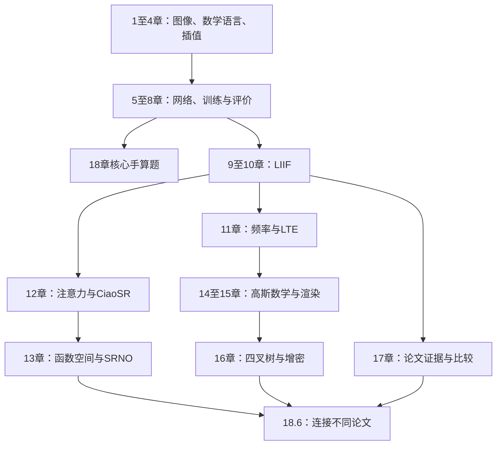

# 零基础教材导航

起点是四则运算；第一遍不要直接从LIIF论文开始。18章分成五段：数字图像与数学语言（1–4）、网络与评价（5–8）、LIIF完整计算（9–10）、后续表示方法（11–16）、读论文与综合实践（17–18）。这是一条有先修关系的学习路线，方法分支不表示论文间必然存在引用或继承关系。

完整连续阅读见[从LIIF开始的零基础学习手册](../%E4%BB%8ELIIF%E5%BC%80%E5%A7%8B%E7%9A%84%E9%9B%B6%E5%9F%BA%E7%A1%80%E5%AD%A6%E4%B9%A0%E6%89%8B%E5%86%8C.md)。查定义用[术语与符号速查](%E6%9C%AF%E8%AF%AD%E4%B8%8E%E7%AC%A6%E5%8F%B7%E9%80%9F%E6%9F%A5.md)，查全部算例用[各章重点与例题索引](%E5%90%84%E7%AB%A0%E9%87%8D%E7%82%B9%E4%B8%8E%E4%BE%8B%E9%A2%98%E7%B4%A2%E5%BC%95.md)。每章有4道完整例题、3道含答案练习。答案紧随该章练习，建议先独立计算，再逐步对照。

## 章节、先修与达标条件

| 章                                                    | 读之前应掌握                  | 读完应能做什么                   |
| ---------------------------------------------------- | ----------------------- | ------------------------- |
| [1 图像与像素](%E7%AC%AC01%E7%AB%A0_%E5%9B%BE%E5%83%8F%E4%B8%8E%E5%83%8F%E7%B4%A0.md)                  | 只需整数、分数和四则运算            | 能分清像素、通道与数值个数，计算大小和数值范围。  |
| [2 函数与坐标](%E7%AC%AC02%E7%AB%A0_%E5%87%BD%E6%95%B0%E4%B8%8E%E5%9D%90%E6%A0%87.md)                  | 第1章                     | 从边界推导像素中心，列出二维网格和cell。    |
| [3 向量矩阵与张量](%E7%AC%AC03%E7%AB%A0_%E5%90%91%E9%87%8F%E7%9F%A9%E9%98%B5%E4%B8%8E%E5%BC%A0%E9%87%8F.md)              | 第1–2章                   | 手算点积、矩阵乘法，跟踪张量轴与拼接。       |
| [4 插值采样与逆问题](%E7%AC%AC04%E7%AB%A0_%E6%8F%92%E5%80%BC%E9%87%87%E6%A0%B7%E4%B8%8E%E9%80%86%E9%97%AE%E9%A2%98.md)            | 第1–3章                   | 算出整张插值结果，构造同一低清输入的不同高清解。  |
| [5 从线性函数到神经网络](%E7%AC%AC05%E7%AB%A0_%E4%BB%8E%E7%BA%BF%E6%80%A7%E5%87%BD%E6%95%B0%E5%88%B0%E7%A5%9E%E7%BB%8F%E7%BD%91%E7%BB%9C.md)        | 第2–3章                   | 手算线性层、ReLU与两层MLP，并统计参数。   |
| [6 损失梯度与训练](%E7%AC%AC06%E7%AB%A0_%E6%8D%9F%E5%A4%B1%E6%A2%AF%E5%BA%A6%E4%B8%8E%E8%AE%AD%E7%BB%83.md)              | 第3、5章                   | 推导平方函数变化率，执行一次梯度下降。       |
| [7 卷积与特征图](%E7%AC%AC07%E7%AB%A0_%E5%8D%B7%E7%A7%AF%E4%B8%8E%E7%89%B9%E5%BE%81%E5%9B%BE.md)                | 第1、3、5章                 | 算卷积窗口、输出尺寸、参数量和感受野。       |
| [8 评价指标与实验设计](%E7%AC%AC08%E7%AB%A0_%E8%AF%84%E4%BB%B7%E6%8C%87%E6%A0%87%E4%B8%8E%E5%AE%9E%E9%AA%8C%E8%AE%BE%E8%AE%A1.md)          | 第4、6章                   | 算MAE、MSE、PSNR，并核对公平比较条件。  |
| [9 隐式表示与LIIF基础](%E7%AC%AC09%E7%AB%A0_%E9%9A%90%E5%BC%8F%E8%A1%A8%E7%A4%BA%E4%B8%8ELIIF%E5%9F%BA%E7%A1%80.md)      | 第1–8章                   | 找到局部特征，算相对坐标与一个查询输出。      |
| [10 LIIF局部集成与单元解码](%E7%AC%AC10%E7%AB%A0_LIIF%E5%B1%80%E9%83%A8%E9%9B%86%E6%88%90%E4%B8%8E%E5%8D%95%E5%85%83%E8%A7%A3%E7%A0%81.md) | 第9章                     | 完整算特征展开、四角预测、权重与cell输入。   |
| [11 频率采样与LTE](%E7%AC%AC11%E7%AB%A0_%E9%A2%91%E7%8E%87%E9%87%87%E6%A0%B7%E4%B8%8ELTE.md)           | 第3、5、10章；本章补三角函数        | 算频率、相位与混叠，再算LTE形式特征。      |
| [12 注意力与CiaoSR](%E7%AC%AC12%E7%AB%A0_%E6%B3%A8%E6%84%8F%E5%8A%9B%E4%B8%8ECiaoSR.md)       | 第3、5、8、10章              | 完整计算Q/K/V、softmax权重与向量聚合。 |
| [13 函数空间与SRNO](%E7%AC%AC13%E7%AB%A0_%E5%87%BD%E6%95%B0%E7%A9%BA%E9%97%B4%E4%B8%8ESRNO.md)         | 第2、3、6、12章；本章补积分        | 算积分近似、投影和两种矩阵乘法顺序。        |
| [14 二维高斯的数学基础](%E7%AC%AC14%E7%AB%A0_%E4%BA%8C%E7%BB%B4%E9%AB%98%E6%96%AF%E7%9A%84%E6%95%B0%E5%AD%A6%E5%9F%BA%E7%A1%80.md)         | 第3、8、11章；本章补方差与逆矩阵      | 算高斯核、协方差、逆矩阵与旋转后核值。       |
| [15 高斯表示与渲染](%E7%AC%AC15%E7%AB%A0_%E9%AB%98%E6%96%AF%E8%A1%A8%E7%A4%BA%E4%B8%8E%E6%B8%B2%E6%9F%93.md)             | 第2、8、14章                | 算三种合成方式，核对坐标转换与耗时口径。      |
| [16 四叉树与自适应增密](%E7%AC%AC16%E7%AB%A0_%E5%9B%9B%E5%8F%89%E6%A0%91%E4%B8%8E%E8%87%AA%E9%80%82%E5%BA%94%E5%A2%9E%E5%AF%86.md)         | 第6、8、14–15章             | 算区域分裂、容量分配和质量/成本取舍。       |
| [17 怎样读懂并比较论文](%E7%AC%AC17%E7%AB%A0_%E6%80%8E%E6%A0%B7%E8%AF%BB%E6%87%82%E5%B9%B6%E6%AF%94%E8%BE%83%E8%AE%BA%E6%96%87.md)         | 第1–10章；涉及支线时回查相应章       | 从来源表格写出有条件的结论和可复查记录。      |
| [18 从输入到输出的综合练习](%E7%AC%AC18%E7%AB%A0_%E4%BB%8E%E8%BE%93%E5%85%A5%E5%88%B0%E8%BE%93%E5%87%BA%E7%9A%84%E7%BB%BC%E5%90%88%E7%BB%83%E4%B9%A0.md)     | 核心题第1–8章；18.6读完第9–16章再读 | 算2×2到4×4的完整输出、误差和一次更新。    |

## 不靠天数判断进度

学完1–4章，应能画出网格并计算一次完整缩放，解释为什么低清观测不决定唯一高清图。学完5–8章，应能算一次网络前向传播、一次梯度更新及一个明确协议下的指标；这时可先做第18章核心题检验基础。

学完9–10章，应能把一个查询位置变成解码器输入，算出四个局部预测并说明cell的含义。学完11–16章，应能分别讲清周期特征、注意力、算子、高斯渲染和增密各改变了哪一步。没有达到某项，就回看该章已知条件、单位与例题，不必重新背全部论文。

## 使用顺序图

先修图是教学安排。真实论文中的引用与方法关系见[从LIIF到前沿的学习路线](../../00_%E5%AF%BC%E8%88%AA/%E4%BB%8ELIIF%E5%88%B0%E5%89%8D%E6%B2%BF%E7%9A%84%E5%AD%A6%E4%B9%A0%E8%B7%AF%E7%BA%BF.md)及其来源记录。完整正文、SI和未完成材料仍分别标注，学习教材的完成不会自动补齐缺失论文材料。
