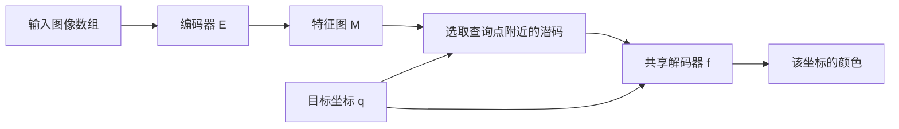

# 第09章 隐式表示与LIIF基础

## 9.1 本章要解决的问题

前八章已经解释了图像数组、坐标、矩阵、神经网络和训练。现在设想一个具体要求：同一个模型，今天输出120×160的图像，明天输出240×320的图像。能否把“从输入图像提取信息”与“决定输出有多少像素”分成两步？LIIF（Local Implicit Image Function，局部隐式图像函数）就是理解这一思想的合适起点。

先修：第2章的像素中心坐标、第3章的向量与拼接、第5章的网络参数、第7章的特征图，以及第8章的训练和评价区别。读完本章，你应能根据一个小特征图，找到某个查询点最近的特征，计算相对坐标，并用给定解码函数算出一个输出值。本章暂时使用最基本的最近邻查询；第10章再加入论文的三项重要设计。

本章来源是项目中[LIIF会议版对照稿](../../PUBLICATION_SCOPE.md)，尤其PDF第3–4页。所有手算网络均为教学构造，原论文没有报告这些小数值实验。

## 9.2 数组表示与坐标函数表示

一张灰度图像可以存成二维数组。例如一行三个像素是`[0.3,0.4,0.5]`。数组已经列出了这三个位置的值，但没有单独给出“两点之间是什么颜色”的规则。第4章的插值实际上就是补充这样一条规则。

另一种表示是给出一个函数。设横坐标为$x$，定义

$$g(x)=0.4+0.2x.$$

这里$g$是函数名称，$x$是查询位置，$g(x)$是该位置的灰度值。若在$x=-0.5,0,0.5$处求值，便得到同样的三个数。这里特意选择的是三个任意探测位置，不是第2章规定的三列像素中心；三列完整网格的中心应为$-2/3,0,2/3$。这段比较只说明“可以通过函数得到数值”，没有把两组采样位置说成同一组。若换一组位置，仍可使用同一个函数计算。

我们把给出全部网格值的方式称为**显式数组表示**；把信号存放在一个可求值函数中的方式称为**函数表示**。在本领域，**隐式神经表示**（implicit neural representation，INR）通常指用神经网络把坐标映射为颜色、距离等信号。这里“隐式”不表示数学上无法写出函数，只是图像没有直接以最终输出网格上的所有RGB值保存。这个术语有领域习惯，不能照搬代数课中“隐函数”的定义。

函数输入可以连续变化，实际输出图片仍然是有限数组。例如，选择120×160个像素中心，在每个中心求一次函数值，再把19200个结果按行列排好，就得到输出图像。**连续的是可查询的坐标域；保存的图像仍有确定的整数高宽。**

还要区分“函数有定义”与“预测准确”。函数在一个没有训练过的位置输出了数字，只能说明计算可以执行。该数字是否接近真实图像，要靠目标、数据和实验判断。

### 例 09-1：同一个函数规则，不同图像内容

**已知。** 用一个数$z$表示某幅图像的局部内容，定义教学解码器，即把内容数值和查询位置变成预测值的函数：

$$g(z,x)=z+0.2x.$$

图像A的$z=0.4$，图像B的$z=0.6$。查询位置均为$-0.5,0,0.5$。

**求。** 两幅图像的三个输出；哪些数发生变化，哪些规则没有变化？

**逐步解答。** A在三个位置分别得到$0.4-0.1=0.3$、$0.4$、$0.4+0.1=0.5$。B分别得到$0.6-0.1=0.5$、$0.6$、$0.6+0.1=0.7$。解码规则中的系数0.2保持不变；代表图像内容的输入$z$改变了。

**结果核对。** 每个对应位置的输出均相差0.2，正好等于两个$z$的差。输出随$x$增加而增加，符合系数0.2为正。

**易错点。** 这里$z$是随图像改变的输入，不是本题中重新训练的模型参数。实际LIIF中的$z$通常是多维特征向量，而不是一个灰度数。

## 9.3 为什么还要输入图像特征

单独使用$f_\theta(x,y)$时，一套固定参数$\theta$对应一个固定的坐标到颜色映射。若想表示另一幅图，必须改变某些信息。可以为每张图分别拟合参数，也可以增加随图像变化的条件输入。LIIF采用后一类思路：不同图像产生不同局部特征，多个图像共享解码规则。

先定义本章各对象：

| 符号 | 含义 | 形状或类型 |
|---|---|---|
| $I_{LR}$ | 输入低分辨率图像 | $H\times W\times C$数组 |
| $E_\varphi$ | 编码器，由参数$\varphi$决定 | 图像到特征图的函数 |
| $M=E_\varphi(I_{LR})$ | 编码后的特征图 | $H_f\times W_f\times D$数组 |
| $M[i,j]$ | 第$i$行、第$j$列的局部特征 | $D$维向量 |
| $q=(x_q,y_q)$ | 想要预测颜色的位置 | 二维坐标 |
| $f_\theta$ | 所有图像共享的解码器 | 特征和坐标到颜色的函数 |
| $s(q)$ | 预测信号 | 灰度教学题为1个数；RGB任务为3个数 |

**编码器**把像素数组变成便于预测的特征图；**解码器**利用特征和坐标计算输出。名称说明分工，不意味着编码器一定压缩空间尺寸。本论文实验使用移除原有上采样模块的EDSR或RDN作为编码器。EDSR（Enhanced Deep Super-Resolution，增强的深度超分辨率网络）和RDN（Residual Dense Network，残差密集网络）是两种已有的卷积网络架构名称；这里先把它们理解为不同的特征提取器，不要求提前掌握其全部内部结构。输出特征网格可以与输入图像高宽相同；其他设计也可能改变尺寸，因此本书把$H_f,W_f$与$H,W$分开记。

**潜码**（latent code）在本章指特征图某个位置的$D$维向量。它是学习得到的数值描述，不必有“第一维是边缘、第二维是纹理”这样的固定含义。一个位置可以通过卷积感受野包含周围像素的信息，所以“局部潜码”也不等于“只看了这一个像素”。

整条计算链为：

推理时，通常先对整张输入图像计算一次$M$，随后反复查询不同坐标。这样不必为了每个输出像素重新完整编码输入图像。如何分批执行查询是实现问题，不改变这里的数学分工。

## 9.4 特征也有位置：绝对坐标与相对坐标

用一个$H_f\times W_f$网格表示特征图。按照第2章的像素中心约定，特征$M[i,j]$的坐标为

$$x_j=\frac{2j+1}{W_f}-1,\qquad y_i=\frac{2i+1}{H_f}-1.$$

索引$i,j$是整数；坐标$x_j,y_i$是所选连续坐标系中的位置。二者不是同一种数。例如$W_f=3$时，列索引为0、1、2，对应坐标为$-2/3,0,2/3$。

最基本查询先找离$q$最近的特征中心，记为$v^*=(x^*,y^*)$，取它的潜码$z^*$。这里星号表示“选中的那个”，不是乘号。距离采用二维欧氏距离：横向差的平方与纵向差的平方相加，再开平方。规则网格上，可以分别找横向最近中心和纵向最近中心；恰好并列时必须指定一致的选取规则。本章手算题避开并列位置。

绝对坐标说明查询点位于整张图的哪里；**相对坐标**说明它相对于选中特征中心位于哪里。先计算本坐标系下的差：

$$\Delta x=x_q-x^*,\qquad \Delta y=y_q-y^*.$$

为了把距离换成与特征网格相关的尺度，本章送入教学解码器的量统一定义为

$$\delta_x=W_f\Delta x,\qquad \delta_y=H_f\Delta y.$$

为什么这样定义？归一化域中的相邻特征横向相距$2/W_f$。乘以$W_f$后，这个间距变成2。LIIF论文PDF第3页使用与特征高宽相关的坐标范围；归一化横坐标$x$变为$W_f(x+1)$后，范围是$[0,2W_f]$，两点的差就是$W_f\Delta x$。纵向同理。

因此，本章的$\Delta$是归一化域中的原始位移，$\delta$是换尺度后的位移。二者不能在同一个已给定解码公式中随意替换。实际程序还可能按$(y,x)$组织坐标；本教材一律按$(x,y)$解释，并分别乘宽、高，避免把横向位移误乘高度。

### 例 09-2：找到最近潜码并计算位移

**已知。** 特征网格$H_f=2,W_f=3,D=2$，各位置向量如下：

| 行/列 | 0 | 1 | 2 |
|---|---|---|---|
| 0 | $(1,10)$ | $(2,20)$ | $(3,30)$ |
| 1 | $(4,40)$ | $(5,50)$ | $(6,60)$ |

查询$q=(0.2,-0.1)$。向量在表格中写成横排只是为了易读，其两项仍是特征分量。

**求。** 最近位置、潜码、$\Delta$和$\delta$。

**逐步解答。** 三列中心是$-2/3,0,2/3$，距$x_q=0.2$分别约0.8667、0.2、0.4667，因此最近列为1。两行中心是$-0.5,0.5$，距$y_q=-0.1$分别为0.4、0.6，因此最近行为0。于是$v^*=(0,-0.5)$，$z^*=(2,20)^T$。

原始相对坐标为$\Delta=(0.2,0.4)$。按本章约定缩放后，$\delta_x=3\times0.2=0.6$，$\delta_y=2\times0.4=0.8$。

**结果核对。** 查询点位于该特征中心的右下方，所以两项位移均为正。横向乘3，纵向乘2，与网格宽、高一致。

**易错点。** 坐标$(0,-0.5)$与数组位置`[0,1]`不能互换。前者是几何位置，后者是行列索引。

## 9.5 从潜码和相对坐标得到颜色

在尚未加入特征展开和cell时，解码器输入是潜码与二维相对坐标的拼接：

$$t=[z^*;\delta_x;\delta_y]\in\mathbb R^{D+2},\qquad s(q)=f_\theta(t).$$

方括号与分号在这里表示按顺序接成一个列向量，不是求平均。$\mathbb R^{D+2}$表示有$D+2$个实数分量。实际LIIF用多层感知机产生RGB；为了可以手算，下面只预测一个灰度值，并把解码器换成明确给出的线性函数。

### 例 09-3：一次完整的基础查询与一个坐标错误

**已知。** 使用例09-2的网格、潜码和查询，教学解码器为

$$f(z_1,z_2,\delta_x,\delta_y)=0.01z_1+0.001z_2+0.1\delta_x+0.2\delta_y.$$

**求。** 正确输出，以及误把$\Delta$直接放进该公式的输出。

**逐步解答。** 正确输入向量为$(2,20,0.6,0.8)^T$。四项贡献分别为0.02、0.02、0.06、0.16，相加得到$0.26$。若错误使用$(2,20,0.2,0.4)^T$，四项贡献变成0.02、0.02、0.02、0.08，结果是$0.14$。

**结果核对。** 两次计算的图像特征完全相同，差异只来自坐标单位。正确结果比错误结果大0.12，等于$0.1(0.6-0.2)+0.2(0.8-0.4)$。

**易错点。** 不能说某一种坐标单位天然更准确。这里的错误是没有遵守题目给定模型的输入约定。若从头在另一种坐标尺度下训练，参数也可以相应改变。

## 9.6 输出尺寸改变时，究竟改变了什么

指定输出$H_o\times W_o$后，建立该尺寸的像素中心网格。每个中心都执行刚才的查询步骤，最后按行列排列。输出尺寸改变会改变查询位置与查询数量；同一图像的编码特征和模型参数通常可以复用。

这里“通常”有明确范围：我们讨论的是给定一张输入图像、固定已训练LIIF模型、只改变所需输出尺寸。若输入图像、模型配置、预处理或特征计算策略改变，就需要重新判断哪些计算可复用。

### 例 09-4：查询数量与参数数量是两回事

**已知。** 输入高48、宽64，输出每个方向放大2.5倍。假设编码器输出$48\times64\times64$特征图。另有一个用于计数的教学RGB解码器：直接把$D+2=66$维输入经过一个带偏置线性层，输出3维RGB。

**求。** 输出尺寸、查询次数、RGB数值总数、编码特征数、该线性解码器参数数。

**逐步解答。** 输出高$48\times2.5=120$、宽$64\times2.5=160$，均为整数。查询次数$N=120\times160=19200$；RGB数值数为$19200\times3=57600$。编码特征数为$48\times64\times64=196608$。线性层权重形状为$3\times66$，有198个权重，另有3个偏置，共201个参数。

**结果核对。** 换成240×320输出时，查询次数变为76800，增加4倍；同一个线性解码器仍是201个参数。执行次数增加不等于每次都新增一套权重。

**易错点。** 201只是本题单层解码器的参数数，不是论文LIIF的真实参数量。真实模型还包含编码器和多层解码器。

## 9.7 最近邻版本还缺少什么

当查询点移动时，最近特征可能从左边突然切到右边。即使位移只变化很小，选中的潜码也可能完全不同；两个局部预测不一致时，输出可能出现接缝。另一问题是：一个潜码可能没有充分利用邻域信息。还有一个问题：只输入像素中心，不一定能表达不同输出像素覆盖范围的差异。

第10章分别处理这三件事：特征展开补充邻域信息，局部集成融合多个局部预测，cell告诉解码器输出像素的大小。请先记住三个问题，再记住三个名称。

## 9.8 本章重点与术语

- 隐式神经表示：用神经函数由坐标求信号；LIIF还用局部特征作为条件。
- 编码器参数$\varphi$、解码器参数$\theta$、图像特征$M$、查询坐标$q$具有不同角色。
- 潜码是特征向量，不是预先规定的语义标签。
- 数组索引`[i,j]`、绝对坐标$(x,y)$、位移$\Delta$和换尺度位移$\delta$必须分清。
- 输出尺寸决定查询网格，不能据此推断新增细节一定真实。

对应概念：[隐式神经表示](../../02_%E6%A6%82%E5%BF%B5/%E9%9A%90%E5%BC%8F%E7%A5%9E%E7%BB%8F%E8%A1%A8%E7%A4%BA.md)、[张量与特征图](../../02_%E6%A6%82%E5%BF%B5/%E5%BC%A0%E9%87%8F%E4%B8%8E%E7%89%B9%E5%BE%81%E5%9B%BE.md)、[连续坐标与单元](../../02_%E6%A6%82%E5%BF%B5/%E8%BF%9E%E7%BB%AD%E5%9D%90%E6%A0%87%E4%B8%8E%E5%8D%95%E5%85%83.md)。

## 9.9 章末练习

**练习 09-1。** $H_f=W_f=2$，查询$q=(-0.2,0.3)$。求最近特征中心、行列索引、$\Delta$和$\delta$。

**练习 09-2。** 沿用例09-3的函数，输入潜码$(4,10)^T$，换尺度后的相对坐标为$(-0.5,0.2)$。求输出。为什么题目必须说清这是$\delta$而不是$\Delta$？

**练习 09-3。** 一个模型对80×120输入生成160×240 RGB输出。忽略分批策略，每个输出像素查询一次。查询几次，产生多少个通道数值？能否仅凭这些数计算真实模型参数量？

### 练习答案

**09-1。** 两方向中心均为$-0.5,0.5$。横向距左中心0.3、右中心0.7；纵向距上中心0.8、下中心0.2，因此选数组位置`[1,0]`，中心$(-0.5,0.5)$。$\Delta=(0.3,-0.2)$，再分别乘宽2、高2，得$\delta=(0.6,-0.4)$。查询位于该中心右上方，与符号一致。

**09-2。** 四项贡献为0.04、0.01、$-0.05$、0.04，总和0.04。如果给的是$\Delta$，还必须知道$H_f,W_f$再换尺度；当前题目已经给$\delta$，不能再乘一次网格尺寸。

**09-3。** 查询$160\times240=38400$次，产生$38400\times3=115200$个数。参数量还取决于编码器、层数、特征维度、每层权重形状等，题目没有这些信息，因此不能计算。应把“运行时产生多少值”与“模型储存多少参数”分开。

下一章：[第10章_LIIF局部集成与单元解码](%E7%AC%AC10%E7%AB%A0_LIIF%E5%B1%80%E9%83%A8%E9%9B%86%E6%88%90%E4%B8%8E%E5%8D%95%E5%85%83%E8%A7%A3%E7%A0%81.md)。返回[00_教材导航](00_%E6%95%99%E6%9D%90%E5%AF%BC%E8%88%AA.md)。
