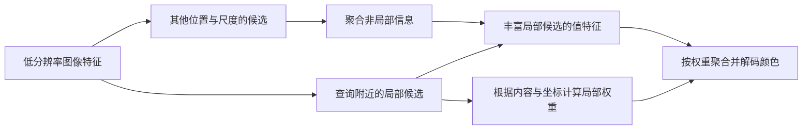

# 第12章 注意力与CiaoSR

## 12.1 学习目标与先修

本章使用第3章的点积和矩阵形状、第5章的线性变换、第8章的指数与对数、第10章的局部加权融合。目标是从给定特征开始，完整计算一次“生成查询、键和值→算分数→归一化→聚合”；解释为什么注意力可以改变融合权重；区分自注意力、交叉注意力和完整Transformer。

第10章中，LIIF的局部集成权重由查询点在邻域中的位置决定。无论邻域里是天空还是窗框，同一个相对位置会产生同样的几何权重。若希望相似纹理贡献更多，就需要一种能读取内容的权重生成方式。注意力（attention）是一类这样的计算机制。它不是人类视觉注意力的精确模型；这里的“注意”是通过可学习分数调整信息的贡献比例。

## 12.2 查询、键和值分别做什么

假设有若干候选位置，每个位置提供一个特征向量。我们要为一个目标位置聚合信息。可以把这个过程分成“如何挑选”和“挑选后取出什么”两部分：

- **查询（query）$q$：** 目标位置用来与候选比较的向量。
- **键（key）$k_m$：** 第$m$个候选用于参与比较的向量。
- **值（value）$v_m$：** 第$m$个候选实际提供、随后参与加权聚合的向量。

下标$m$只是在给候选编号，不表示像素行列。查询和键必须长度相同，才能作点积；值可以采用另一种长度。比如$q,k_m\in\mathbb R^{d}$，$v_m\in\mathbb R^{d_v}$。符号$\mathbb R^d$表示含$d$个实数的向量集合。这里向量都按列写。

它们通常来自已有特征的线性变换，例如$q=W_qf_q+b_q$、$k_m=W_kf_m+b_k$、$v_m=W_vf_m+b_v$。$f_q$和$f_m$是输入特征；$W$和$b$是训练得到的参数。键和值可以由同一候选特征分别变换，因为“用于匹配的信息”和“需要传递的信息”不必完全相同。

先算分数$a_m=q^Tk_m$。点积大只表示在这套学到的向量表达下匹配分数高，不自动等于语义相同，更不是“概率”。分数可为负数，也不一定相加为1。

## 12.3 softmax怎样把分数变成权重

设有$M$个分数，softmax定义为

$$
w_m=\frac{\exp(a_m)}{\sum_{r=1}^{M}\exp(a_r)}.
$$

$\exp(t)=e^t$，$e\approx2.71828$。分子与分母都为正，因此$w_m>0$；把全部权重加起来，分子总和恰好等于分母，所以$\sum_mw_m=1$。自然对数$\ln$与指数互为反函数，例如$\exp(\ln2)=2$。

聚合结果为$z=\sum_mw_mv_m$。若值是标量，这就是加权平均；若值是向量，同一个权重作用于它的每个分量。归一化必须针对“同一个查询所比较的候选集合”，而不是随意把整张表中所有分数一起除。某些注意力还把点积除以$\sqrt d$，称为缩放点积，用于控制分数随向量长度增大时的量级；是否采用这一项应看具体方法。

### 例 12-1：从原始特征一路算到输出

**已知：** 教学模型的两个候选标量特征为$f_1=0,f_2=1$，查询特征$f_q=1$。指定$q=(\ln2)f_q$、$k_m=f_m$、$v_m=6f_m+3$。维度$d=1$，不需额外缩放。求注意力输出。

**步骤1，生成三个角色：** $q=\ln2$；键为$[0,1]$；值为$[3,9]$。键和值不是同一组数。

**步骤2，算分数：** $a_1=(\ln2)\times0=0$，$a_2=(\ln2)\times1=\ln2$。

**步骤3，变成权重：** 指数为$[1,2]$，总和3，故权重为$[1/3,2/3]$。

**步骤4，聚合值：** $z=(1/3)3+(2/3)9=1+6=7$。

**核对：** 两个权重之和为1；输出7位于值3和9之间，并更靠近权重较大的9。**易错点：** 若误把键$[0,1]$当成待聚合的值，会得到$2/3$，这回答了另一个计算问题。此例的参数是手工指定的，不代表CiaoSR实际训练权重。

### 例 12-2：值是向量时，不是把所有数混成一个数

**已知：** $q=(\sqrt2,0)^T$，$k_1=(0,1)^T$、$k_2=(1,0)^T$；值为$v_1=(2,0)^T$、$v_2=(0,4)^T$。本题使用$a_m=q^Tk_m/\sqrt2$。

**解：** 点积依次为0和$\sqrt2$，缩放后分数为0和1。权重分别为$1/(1+e)\approx0.268941$及$e/(1+e)\approx0.731059$。于是

$$
z=0.268941\begin{bmatrix}2\\0\end{bmatrix}
+0.731059\begin{bmatrix}0\\4\end{bmatrix}
\approx\begin{bmatrix}0.537883\\2.924234\end{bmatrix}.
$$

**核对：** 输出仍为2维，不会因为候选有两个就变成4维。第一分量来自两个候选的第一分量，第二分量同理。输出各分量处在对应输入分量的最小值与最大值之间。不要把这条性质推广到后续任意线性层或MLP；经过这些层后，数值可以离开这个范围。

## 12.4 为什么实现中要减去最大分数

指数增长很快。直接计算$e^{1000}$会超过常见浮点数可表示范围。softmax有一个有用性质：给同一行所有分数减去相同常数$c$，权重不变，因为分子和分母都多了一个可约去的$e^{-c}$。通常取$c=\max_m a_m$，使最大的指数变为$e^0=1$。

这不是把匹配结果改成另一种结果，而是用等价形式改善数值计算。程序仍会有有限精度误差；非常小的指数可能舍入成0，但可避免正向溢出。

### 例 12-3：稳定地算大分数

**已知：** 分数为$[1000,1000+\ln3]$，值为$[10,30]$，求输出。

**解：** 取最大分数$1000+\ln3$作为$c$。相减得到$[-\ln3,0]$，指数为$[1/3,1]$，总和为$4/3$。权重为$[1/4,3/4]$，输出为$10/4+90/4=25$。

**核对：** 如果先去掉共同的1000，分数变为$[0,\ln3]$，直接归一化$[1,3]$也得到相同权重。**错误示范：** 用“原始分数除以分数总和”会得到接近$[1/2,1/2]$，输出接近20；那不是softmax。归一化的是指数值。

## 12.5 从一个查询到许多查询

对每个输出位置重复上述步骤，就得到许多聚合向量。为提高计算效率，程序常把查询向量转成行，堆成$Q\in\mathbb R^{N\times d}$；把$M$个键堆成$K\in\mathbb R^{M\times d}$，把值堆成$V\in\mathbb R^{M\times d_v}$。单个向量仍按列定义，这里只是说明矩阵中采用“每行一个向量”的存储排列。

此时$QK^T$的形状为$N\times M$，第$n$行对应第$n$个查询对全部候选的分数。逐行softmax后仍为$N\times M$，再乘$V$，结果为$N\times d_v$。这一形状检查能帮助发现归一化轴错误或转置错误。

查询和候选来自同一组特征，通常叫自注意力；来自不同特征集合，通常叫交叉注意力。多头注意力使用几组不同的投影分别聚合，再组合结果。Transformer则是包含注意力、前馈网络、归一化、残差等部件的一类整体网络，不能把这三个名称互换。

这里的**前馈网络**指信息从输入向输出依次计算、没有反馈循环的一组层，Transformer中常在每个位置应用同一组MLP。**归一化层**按规定维度调整特征的中心和尺度，例如先减均值再除以带稳定项的标准差；它与“softmax把候选权重变成和为1”是不同操作。**残差连接**把模块的输入直接加到其输出上，形如$z_{new}=z+g(z)$，要求相加两项形状相同，作用是让模块学习对已有表示的修正。

### 例 12-4：全局与局部注意力的分数表有多大

**已知：** 一幅$64\times64$特征图，每个位置都作为查询和候选。只统计一头注意力分数表，使用32位浮点数，每个数4字节。比较全局候选与每个查询只看16个候选的情况。

**解：** 位置数$N=64\times64=4096$。全局分数表有$4096^2=16\,777\,216$个数，占$67\,108\,864$字节。按$1\text{ MiB}=2^{20}$字节换算，是64 MiB。局部分数表有$4096\times16=65\,536$个数，占$262\,144$字节，即0.25 MiB，二者相差256倍。

**核对：** 这里只统计分数表，尚未包括Q/K/V、梯度、多头、批量和其他网络层。不能据此说整个模型显存或运行时间一定缩小256倍。局部候选少也可能失去远处有用信息，这是结构设计需要处理的取舍。

## 12.6 CiaoSR的两层信息聚合如何读

CiaoSR会议PDF第3–4页方法部分把问题分为两层。第一层仍然围绕查询点附近的局部特征，但融合权重不再只由几何面积决定；查询、键和值的构造还利用图像特征、相对坐标与目标尺度。第二层在值特征中嵌入非局部、尺度感知的注意力：查询附近没有的纹理线索，可以来自图像其他位置或其他尺度。这里“非局部”指超出当前小邻域，“尺度感知”指计算显式考虑分辨率或缩放信息。

可以按下列信息流阅读，而不是一次背下式(3)–(8)：

图中的名称是本教材的解释，不是复制作者代码模块名。原文式(4)是在局部候选上聚合，再由查询网络输出颜色；其记号没有要求我们把本章标准缩放因子强行补进原式。式(7)描述非局部信息聚合。读本对原文式(5)括号问题已单独说明，不能拿本章简化式静默“修复”原论文。

注意力允许权重依内容变化，不保证每次都会选对真实细节。相似纹理也可能来自不同对象。预测锐利、感知自然、与给定真值误差小是不同评价维度，仍须回到第8章的实验协议。

## 12.7 小结与术语

本章的计算链是：特征经过投影得到Q/K/V，查询与键生成分数，softmax按候选集合归一化，权重再聚合值。内容相关权重与几何权重解决的是不同设计问题。全局信息更丰富，计算和存储成本也可能更高。

核心术语：查询、键、值、投影、点积、softmax、缩放点积、自注意力、交叉注意力、多头、非局部、数值溢出。它们已在正文逐一解释。联系 [注意力](../../02_%E6%A6%82%E5%BF%B5/%E6%B3%A8%E6%84%8F%E5%8A%9B.md)、[计算量与延迟](../../02_%E6%A6%82%E5%BF%B5/%E8%AE%A1%E7%AE%97%E9%87%8F%E4%B8%8E%E5%BB%B6%E8%BF%9F.md)；原作定位见 [CiaoSR逐段读本](../../PUBLICATION_SCOPE.md) PDF第3–4页方法、第7页表7的耗时与模型大小。表7的数值是作者报告，本章没有复现实测。

## 12.8 章末练习

### 练习 12-1

分数为$[0,\ln2,\ln3]$，值为$[2,5,8]$。计算权重与聚合结果，并检查输出范围。

### 练习 12-2

三个查询、五个候选，查询/键长度为4，值长度为2。分别写出Q、K、V、$QK^T$及最终输出的形状；说明softmax应在哪个候选方向上计算。

### 练习 12-3

一维的两个邻居分别在0和1处，查询在0.1处。几何线性插值权重为$[0.9,0.1]$。某教学注意力模型的内容分数却是$[0,\ln9]$，两个值为$[10,30]$。分别求输出，并解释差异是否证明某一种方法必然更好。

## 12.9 练习答案

**12-1：** 指数为$[1,2,3]$，总和6，权重为$[1/6,2/6,3/6]$。加权和为$2/6+10/6+24/6=36/6=6$。权重和为1，输出6位于2与8之间。值不是按分数的大小直接排序后取最大值，而是全部参与加权。

**12-2：** Q为$3\times4$，K为$5\times4$，V为$5\times2$；$QK^T$为$3\times5$，输出为$3\times2$。每个查询一行，应在该行的5个候选间归一化。若改为沿三行归一化，就变成让不同查询竞争权重，计算意义已经改变。

**12-3：** 几何结果为$0.9\times10+0.1\times30=12$。内容分数指数为$[1,9]$，权重$[0.1,0.9]$，结果为$1+27=28$。前者偏向近邻，后者偏向匹配分数更高的候选。题目没有给真值，不能判断哪种更准确；即使给出一例真值，也不足以得出所有图像上的总体结论。

上一章：[第11章_频率采样与LTE](%E7%AC%AC11%E7%AB%A0_%E9%A2%91%E7%8E%87%E9%87%87%E6%A0%B7%E4%B8%8ELTE.md)。下一章：[第13章_函数空间与SRNO](%E7%AC%AC13%E7%AB%A0_%E5%87%BD%E6%95%B0%E7%A9%BA%E9%97%B4%E4%B8%8ESRNO.md)。
